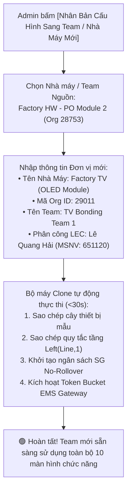

# 09. MÀN HÌNH CÀI ĐẶT HỆ THỐNG, TOPOLOGY & CỔNG EMS (SYSTEM SETTINGS & INTEGRATION GATEWAY)

> **Mã màn hình**: `UI-ADM-01`  
> **Tên màn hình**: Multi-Plant Topology, Token Bucket Limiter & EMS Gateway Configuration Portal  
> **Vai trò người dùng chính**: Quản trị viên Hệ thống (System Administrator) & Chuyên viên LEC Cấp cao.  
> **Khả năng mở rộng**: Cấu hình mở rộng tức thời cho các Team khác và Nhà máy khác (`Factory HW`, `Factory TV`, `Factory Auto Display`) mà không cần sửa code.  
> **Mục tiêu cốt lõi**: Quản trị tập trung các tham số toàn hệ thống: Sơ đồ phân xưởng và nhân bản cấu hình team/nhà máy mới; quy tắc biên dịch tầng tự động `Left(Line, 1) = Floor`; công thức 5 loại nhu cầu mua sắm; cơ chế khóa ngân sách No-Rollover; và giám sát giới hạn tần suất Token Bucket (5 req/s) của Cổng kết nối EMS Nexacro.

---

## 1. NGUYÊN TẮC QUẢN TRỊ & KHẢ NĂNG NHÂN BẢN TOÀN TẬP ĐOÀN

1. **Nhân Bản Cấu Hình Tức Thời Cho Team Khác / Nhà Máy Khác (1-Click Topology Cloning)**:
   - Hệ thống được thiết kế dạng tham số hóa cao (Metadata-Driven).
   - Khi một Team mới (ví dụ: `PO Module 3`) hoặc Nhà máy mới (ví dụ: `Factory TV - Org 29011`) muốn áp dụng hệ thống mua sắm này:
     * Quản trị viên chỉ cần chọn mẫu cấu hình của `Factory HW` và nhấn nút **[Nhân Bản Cấu Hình Cho Nhà Máy Mới]**.
     * Toàn bộ sơ đồ máy, danh mục QCode, quy tắc tầng và ma trận vai trò được sao chép và tự động khởi tạo trong vòng dưới 30 giây.
2. **Quy Tắc Biên Dịch Tầng Tự Động (`Left(Line, 1) = Floor`)**:
   - Thay vì phải cấu hình thủ công dây chuyền nào nằm ở tầng mấy:
     * Chuyền số `201`, `202`, `205` $\rightarrow$ Tự động biên dịch thuộc Tầng 2F.
     * Chuyền số `301`, `302`, `308` $\rightarrow$ Tự động biên dịch thuộc Tầng 3F.
3. **Bảo Vệ Máy Chủ Lõi Bằng Thuật Toán Token Bucket Rate Limiter**:
   - Máy chủ Nexacro EMS Core của tập đoàn là hệ thống legacy rất nhạy cảm với tải kết nối lớn.
   - Gateway nội bộ tích hợp thuật toán **Token Bucket** giới hạn nghiêm ngặt ở mức **5 requests/giây** (Burst tối đa 50 requests) nhằm đảm bảo hệ thống không bao giờ bị EMS từ chối kết nối hoặc làm treo máy chủ nghiệp vụ.

---

## 2. BỐ CỤC KHÔNG GIAN GIAO DIỆN CÀI ĐẶT (LAYOUT ANATOMY)

```
┌──────────────────────────────────────────────────────────────────────────────────────────────────────────────────┐
│ HEADER: CÀI ĐẶT THAM SỐ HỆ THỐNG & CỔNG EMS | Quản Trị Viên: SysAdmin Core | Cổng EMS: 🟢 Online (Độ trễ: 34ms) │
│ Token Bucket Limiter: 🟢 5.0 Req/s (Tải hiện tại: 1.2 req/s) | [ 🔄 Ping Kiểm Tra ] [ 📋 Nhân Bản Nhà Máy Mới ] │
├──────────────────────────────────────────────────────────────────────────────────────────────────────────────────┤
│ ĐIỀU HƯỚNG 6 PHÂN HỆ CẤU HÌNH (6 CONFIGURATION TABS):                                                            │
│ [ 1. Topology Đa Nhà Máy & Team ] [ 2. Quy Tắc Tầng Left(Line,1) ] [ 3. Định Mức 5 Nhu Cầu ]                     │
│ [ 4. Giám Sát Cổng EMS Nexacro ]  [ 5. Ngân Sách & No-Rollover ]   [ 6. Ma Trận Vai Trò 5 Nhóm ]                 │
├──────────────────────────────────────────────────────────────────────────────────────────────────────────────────┤
│ [NỘI DUNG TAB 1: SƠ ĐỒ TOPOLOGY ĐA NHÀ MÁY & CÔNG CỤ NHÂN BẢN TEAM / FACTORY]                                    │
│ Danh Sách Nhà Máy Trong Tổ Hợp (Multi-Plant Registry):                                                           │
│ ┌───────────────────────────┬──────────────┬────────────┬────────────────────┬─────────────────────────────┐ │
│ │ Tên Nhà Máy & Phân Xưởng  │ Mã Org ID    │ Số Dây Chn │ LEC Phụ Trách      │ Thao Tác Quản Trị           │ │
│ ├───────────────────────────┼──────────────┼────────────┼────────────────────┼─────────────────────────────┤ │
│ │ 🏭 Factory HW (Smart Watch)│ Org: 28753   │ 8 Chuyền   │ Phạm Đức Long (MSNV│ [⚙️ Cấu Hình] [📋 Nhân Bản] │ │
│ │   ├── Team: PO Module 1   │              │ (201..204) │  658359)           │                             │ │
│ │   └── Team: PO Module 2   │              │ (301..304) │                    │                             │ │
│ │ 🏭 Factory TV (OLED Large)│ Org: 29011   │ 12 Chuyền  │ Lê Quang Hải       │ [⚙️ Cấu Hình] [📋 Nhân Bản] │ │
│ │ 🏭 Factory Auto Display   │ Org: 31054   │ 6 Chuyền   │ Hoàng Minh Tuấn    │ [⚙️ Cấu Hình] [📋 Nhân Bản] │ │
│ └───────────────────────────┴──────────────┴────────────┴────────────────────┴─────────────────────────────┘ │
│ [ ➕ THÊM NHÀ MÁY / TEAM MỚI ]    [ 📋 NHÂN BẢN TOÀN BỘ CẤU HÌNH SANG TEAM MỚI ]                                 │
├──────────────────────────────────────────────────────────────────────────────────────────────────────────────────┤
│ [NỘI DUNG TAB 2: QUY TẮC BIÊN DỊCH TẦNG TỰ ĐỘNG & BỘ THỬ NGHIỆM TƯƠNG TÁC]                                       │
│ • Công thức biên dịch: `Left(Line, 1) = Floor` (Ký tự đầu tiên của số chuyền quy định tầng nhà xưởng).           │
│ • Bộ Thử Nghiệm Tương Tác:                                                                                       │
│   Nhập số chuyền thử nghiệm: [ 201 ] ➔ Kết quả: 🟢 Tầng 2F (Nhà máy HW - Phân ban Cleanroom Tầng 2)             │
│   Nhập số chuyền thử nghiệm: [ 305 ] ➔ Kết quả: 🟢 Tầng 3F (Nhà máy HW - Phân ban Cleanroom Tầng 3)             │
├──────────────────────────────────────────────────────────────────────────────────────────────────────────────────┤
│ [NỘI DUNG TAB 3: CÔNG THỨC TÍNH TOÁN ĐỊNH MỨC 5 LOẠI NHU CẦU MUA SẮM]                                            │
│ 1. BREAKDOWN (Sự Cố Khẩn): Số lượng mua = 1 EA (Thay thế trực tiếp) | Bắt buộc mã Work Order dừng chuyền.        │
│ 2. PM (Bảo Dưỡng Định Kỳ): Nhu cầu = Standard Quantity x Số máy đến hạn thay thế (EBOM Lifespan).                │
│ 3. IMPROVE (Cải Tiến / CIP): Theo định mức được Hội Đồng Cải Tiến phê duyệt.                                     │
│ 4. SETUP (Model Mới): Bộ Jig/Nozzle/Fixture theo quy chuẩn kỹ thuật của dòng sản phẩm mới.                       │
│ 5. SAFETY STOCK (Dự Phòng): Safety = Max( DailyUsage x LeadTime x 1.25 - OnHandStock, 0 ).                      │
├──────────────────────────────────────────────────────────────────────────────────────────────────────────────────┤
│ [NỘI DUNG TAB 4: GIÁM SÁT CỔNG EMS NEXACRO GATEWAY & BỘ ĐIỀU TIẾT TOKEN BUCKET]                                  │
│ • Cấu hình Token Bucket: Giới hạn tần suất = [ 5.0 ] req/s | Dung lượng xả tức thời (Burst Size) = [ 50 ] req   │
│ • Biểu đồ tải kết nối thời gian thực: [▂▃▅▃▂ 1.2 req/s (24% công suất cho phép) ]                                │
│ • Lịch sử đồng bộ gần nhất: Bảng ds_Inv (Cách đây 2 phút) | Bảng ds_PO (Cách đây 5 phút)                         │
└──────────────────────────────────────────────────────────────────────────────────────────────────────────────────┘
```

---

## 3. QUY TRÌNH 1-CLICK NHÂN BẢN CHO TEAM / NHÀ MÁY KHÁC



---

## 4. CHI TIẾT CẤU HÌNH CỔNG EMS NEXACRO GATEWAY

| Thông Số Cổng Kết Nối | Giá Trị Cấu Hình | Ý Nghĩa Kỹ Thuật |
| :--- | :---: | :--- |
| `gatewayEndpoint` | `https://ems-core.factory.corp/xplatform` | Địa chỉ API kết nối vào hệ thống Nexacro mainframe. |
| `tokenBucketRate` | `5.0 requests/second` | Giới hạn tần suất gọi API tối đa, tránh nghẽn mạng nội bộ. |
| `tokenBucketBurst` | `50 requests` | Số lượng request tối đa có thể phát sinh đồng thời trong 1 giây. |
| `syncIntervalDsInv` | `300 seconds (5 phút)` | Chu kỳ tự động kéo dữ liệu xuất kho thực tế từ bảng `ds_Inv`. |
| `syncIntervalDsPo` | `600 seconds (10 phút)` | Chu kỳ tự động kiểm tra số PO được ký duyệt chính thức. |
| `fallbackMode` | `CIRCUIT_BREAKER_ENABLED` | Nếu EMS mất kết nối quá 3 lần, tự động chuyển sang chế độ hàng đợi offline. |

