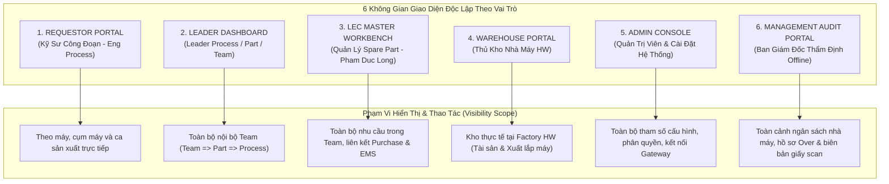

# 00. Ma Trận Phân Định Màn Hình Theo Vai Trò Người Dùng (Role-Based Screen Matrix)
> *Kiến trúc điều hướng và phân quyền truy cập cho 5 nhóm vai trò tại Factory HW (Smart Watch)*

---

## 1. Khung Phân Quyền 6 Nhóm Vai Trò Cốt Lõi (User Role Architecture)

Hệ thống được thiết kế theo nguyên tắc tối thiểu hóa quyền hạn và phân vùng phạm vi chặt chẽ (Principle of Least Privilege & Scoped Visibility). **Mỗi vai trò sở hữu 1 không gian làm việc chuyên biệt độc lập**:



### Danh Mục Không Gian Giao Diện Tách Nhỏ Theo Vai Trò & Màn Hình Chung:
0. [**Màn Hình Chung: Dashboard Báo Cáo & Phân Tích Tổng Hợp (UI-COMMON-00)**](file:///home/longp/projects/company/ops-workflow/procurement-system/05-ui-ux-screen-specifications/00-common-dashboard/screen-universal-analytics-dashboard.md): Tháp chỉ huy dữ liệu thời gian thực: Phễu chu kỳ 7 bước, KPIs tồn kho & Task giải trình, ngân sách 3-chiều, phân tích 6 mã Over và danh sách chi tiết các hạng mục gây Over (cả do Mua hàng và do Xuất kho).
1. [**Giao Diện Kỹ Sư Công Đoạn (Requestor Portal - UI-ROLE-01)**](file:///home/longp/projects/company/ops-workflow/procurement-system/05-ui-ux-screen-specifications/01-role-requestor/screen-requestor-portal.md): Tạo đơn lẻ/khẩn cấp, giải mã EM No 14 ký tự, snapshot tồn kho, lưới Excel, cây EBOM, kênh đối thoại 2 chiều với LEC và **Task Giải Trình Tồn Kho Chưa Sử Dụng**.
2. [**Giao Diện Quản Lý Các Cấp (Leader Dashboard - UI-ROLE-02)**](file:///home/longp/projects/company/ops-workflow/procurement-system/05-ui-ux-screen-specifications/02-role-leader/screen-leader-team-dashboard.md): Giám sát theo Team => Part => Process, thẩm tra chi tiết Work Order máy hỏng kèm ảnh hiện trường, duyệt nội bộ đơn Over/Target, và rà soát Task giải trình tồn kho của kỹ sư.
3. [**Giao Diện LEC Trong Team (LEC Master Workbench - UI-ROLE-03)**](file:///home/longp/projects/company/ops-workflow/procurement-system/05-ui-ux-screen-specifications/03-role-lec/screen-lec-master-workbench.md): Multi-LEC gom đơn toàn team, Interlock 4 bước Y/N, CheckDisuse popup (`holdReasonContent`), theo dõi báo giá Purchase, chốt kỳ 25 và Modal nhập mã PRV No đồng bộ EMS Phase 1.
4. [**Giao Diện Thủ Kho (Warehouse Portal - UI-ROLE-04)**](file:///home/longp/projects/company/ops-workflow/procurement-system/05-ui-ux-screen-specifications/04-role-warehouse/screen-warehouse-portal.md): Quét barcode EM No 14 ký tự & serial linh kiện, xuất kho lắp máy, hạch toán chi phí sử dụng vào máy, đối soát tồn kho vật lý HW vs EMS.
5. [**Giao Diện Quản Trị Hệ Thống (Admin Settings Console - UI-ROLE-05)**](file:///home/longp/projects/company/ops-workflow/procurement-system/05-ui-ux-screen-specifications/05-role-admin/screen-admin-settings-portal.md): Cấu hình 6 Tab: Công thức logic mua, nhà xưởng, phân cấp Line, RBAC, ngân sách 33-33-34, Nexacro Gateway Rate Limiting, danh mục mã Over.
6. [**Giao Diện Ban Giám Đốc (Management Offline Audit Portal - UI-ROLE-06)**](file:///home/longp/projects/company/ops-workflow/procurement-system/05-ui-ux-screen-specifications/06-role-management/screen-management-audit-portal.md): Cổng thẩm định kiểm thảo ngày 25, phê duyệt kế hoạch trước khi kích hoạt Chuyển giao/PO, rà soát danh sách Over và kho lưu trữ biên bản giấy scan.

*(Tài liệu phân tích phản biện chuyên sâu: xem tại [phan-tich-phan-bien-man-hinh-chuc-nang.md](file:///home/longp/projects/company/ops-workflow/procurement-system/05-ui-ux-screen-specifications/phan-tich-phan-bien-man-hinh-chuc-nang.md))*.

---

## 2. Bảng Ma Trận Phân Bổ Màn Hình Theo Vai Trò (Screen Permission Matrix)

Hệ thống bao gồm **10 màn hình chức năng** (từ Màn hình 01 đến 09 cùng Ma trận điều hướng 00). Bảng dưới đây phân định chi tiết quyền hạn của từng vai trò:

| Mã MH | Tên Màn Hình Chức Năng | Requestor (Kỹ sư) | Leader (Các cấp) | LEC Trong Team | Warehouse (Thủ kho) | System Admin |
| :---: | :--- | :---: | :---: | :---: | :---: | :---: |
| **01** | **Cổng Kỹ Sư (Requestor Portal)**<br>• Tạo đơn mua đơn lẻ / sự cố khẩn cấp<br>• Giải mã EM No 14 ký tự, snapshot tồn kho<br>• Phân loại Trong Target vs Over | **Toàn quyền**<br>(Tạo, Sửa nháp, Gửi) | **Xem & Thẩm tra**<br>(View, Thẩm định) | **Xem & Điều phối**<br>(View, Sửa thông số) | 🚫 Không truy cập | **Toàn quyền**<br>(Debug, Support) |
| **02** | **Bàn Điều Khiển Leader (Team Dashboard)**<br>• Giám sát mua sắm theo Team => Part => Process<br>• Thẩm tra Work Order máy hỏng & ảnh sự cố<br>• Xác nhận sơ bộ nội bộ Team | 🚫 Không truy cập | **Toàn quyền**<br>(Duyệt, Trả lại, Ghi chú) | **Xem liên thông**<br>(Theo dõi tiến độ) | 🚫 Không truy cập | **Toàn quyền**<br>(Giám sát tổng thể) |
| **03** | **Bàn Làm Việc LEC (LEC Workbench)**<br>• Tiếp nhận đơn toàn Team, định tuyến Interlock<br>• Xử lý cờ Y/N 4 bước, trích xuất CheckDisuse<br>• Phản hồi 2 chiều với Requestor | 🚫 Không truy cập | 👁️ Chỉ xem<br>(Xem trạng thái) | **Toàn quyền**<br>(Xử lý, Mở chặn, Hủy) | 🚫 Không truy cập | **Toàn quyền**<br>(Hỗ trợ kỹ thuật) |
| **04** | **Đăng Ký QCode & Media Hàng Loạt**<br>• Paste lưới Excel hàng trăm dòng, cấp TMP-HW<br>• Dropzone upload ảnh tự động khớp nối regex | **Tạo theo ca**<br>(Tạo mã tạm, nạp ảnh) | 👁️ Chỉ xem | **Toàn quyền**<br>(Chuẩn hóa, gửi EMS) | 🚫 Không truy cập | **Toàn quyền**<br>(Quản trị dữ liệu) |
| **05** | **Theo Dõi Tiến Độ Báo Giá Purchase**<br>• Nhật ký liên hệ chuyên viên Purchase ngoài<br>• Cập nhật đơn giá đàm phán sơ bộ & tệp báo giá | 👁️ Xem giá chốt<br>(Sau khi có giá chính thức) | 👁️ Chỉ xem<br>(Xem tiến độ giá) | **Toàn quyền**<br>(Cập nhật, ghi nhật ký) | 🚫 Không truy cập | **Toàn quyền**<br>(Kiểm toán giá) |
| **06** | **Chốt Kỳ Tháng & Ngân Sách SG 33-33-34**<br>• Khóa kỳ ngày 25, cân đối ngân sách SG quý<br>• Xuất hồ sơ thẩm định Offline & Tải scan biên bản | 🚫 Không truy cập | 👁️ Xem báo cáo<br>(Leader Team xem) | **Toàn quyền**<br>(Khóa kỳ, xuất file, tải scan)| 🚫 Không truy cập | **Toàn quyền**<br>(Kiểm toán chu kỳ) |
| **07** | **Trình Duyệt Cây Thiết Bị EBOM Trực Quan**<br>• Cây Process > Machine > Unit > Line<br>• Tra cứu bản vẽ CAD FDM, vị trí lắp đặt | 👁️ Tra cứu & Chọn<br>(1-Click tạo đơn) | 👁️ Tra cứu | 👁️ Tra cứu & Gán mã | 👁️ Tra cứu vị trí | **Toàn quyền**<br>(Cập nhật cấu trúc cây)|
| **08** | **Xuất Kho Lắp Máy & Ghi Nhận Chi Phí**<br>• Quét barcode EM No và mã phụ tùng<br>• Hạch toán chi phí sử dụng vào giá thành máy | 👁️ Xem phiếu xuất<br>(Khi nhận phụ tùng) | 👁️ Xem chi phí xuất<br>(Theo công đoạn) | 👁️ Đối soát xuất kho<br>(Khấu trừ tồn kho) | **Toàn quyền**<br>(Quét xuất, ghi nhận sổ)| **Toàn quyền**<br>(Quản trị giao dịch) |
| **09** | **Cài Đặt & Cấu Hình Hệ Thống (Settings)**<br>• Cài đặt logic tính số lượng mua (5 loại nhu cầu)<br>• Cài đặt cây tổ chức, phân cấp Line, tỷ lệ 33-33-34<br>• Cài đặt kết nối Nexacro Gateway & 6 mã Over | 🚫 Không truy cập | 🚫 Không truy cập | ⚙️ Cài đặt hạn mức<br>(Chỉ chỉnh tham số Team) | 🚫 Không truy cập | **Toàn quyền**<br>(Toàn quyền cấu hình) |

*Ghi chú quy ước ký hiệu:*
- **Toàn quyền**: Được tạo mới, chỉnh sửa, xóa bản nháp, ký duyệt và xuất dữ liệu.
- **Xem & Thẩm tra**: Được xem dữ liệu trong phạm vi phụ trách và thực hiện hành động xác nhận nội bộ.
- **👁️ Chỉ xem**: Chỉ được tra cứu dữ liệu, không có quyền chỉnh sửa trạng thái.
- **🚫 Không truy cập**: Không hiển thị menu và bị chặn bởi Middleware RBAC (HTTP 403 Forbidden).

---

## 3. Kiến Trúc Menu Điều Hướng Theo Vai Trò (Role-Based Navigation Sitemap)

Tùy thuộc vào vai trò của tài khoản đăng nhập, thanh điều hướng chính (Top Navbar & Sidebar) tự động thay đổi tương ứng:

### 3.1. Giao Diện Dành Cho Kỹ Sư Công Đoạn (Requestor Navigation)
```
[LOGO OPS] HỆ THỐNG MUA BÁN FACTORY HW                Vai trò: Requestor (Nguyen Van A - ID: 87021)
├── 📝 Tạo Đơn Mua (F2)          [MH-01: Requestor Portal]
├── 📋 Đơn Của Tôi (14)          [Danh sách đơn cá nhân & Phản hồi 2 chiều với LEC]
├── ⚡ Nhập Hàng Loạt (Excel)     [MH-04: Batch Grid Entry & Media Dropzone]
├── 🌳 Duyệt Cây EBOM            [MH-07: EBOM Visual Tree Explorer]
└── 📦 Lịch Sử Nhận Phụ Tùng     [MH-08: Tra cứu phiếu xuất kho lắp máy]
```

### 3.2. Giao Diện Dành Cho Cấp Quản Lý (Leader Navigation)
```
[LOGO OPS] HỆ THỐNG MUA BÁN FACTORY HW                Vai trò: Process Leader (Tran Van B - DB)
├── 📊 Bàn Điều Khiển Team       [MH-02: Leader Team Monitoring Dashboard]
│     ├── 🟢 Trong Target (Bù định mức)
│     └── 🔴 Over Ngoài Kế Hoạch (Sự cố WO & Báo cáo hiện trường)
├── 📋 Danh Sách Đơn Cần Thẩm Tra (5 đơn chờ duyệt)
├── 🌳 Tra Cứu Cây EBOM          [MH-07: EBOM Visual Tree Explorer]
└── 📈 Báo Cáo Chi Phí Công Đoạn [MH-08: Thống kê chi phí xuất kho thực tế]
```

### 3.3. Giao Diện Dành Cho LEC Trong Team (Pham Duc Long - 658359)
```
[LOGO OPS] HỆ THỐNG MUA BÁN FACTORY HW                Vai trò: LEC Trong Team (Pham Duc Long - 658359)
├── 📥 Hạng Mục Chờ Xử Lý (64)   [MH-03: LEC Workbench]
├── ⚡ Giải Tỏa Interlock Hàng Loạt [MH-03: Batch Interlock Resolver Y/N]
├── 📞 Theo Dõi Báo Giá Purchase [MH-05: Quotation Tracking Workbench]
├── 📅 Chốt Kỳ Tháng (Ngày 25)   [MH-06: Monthly Audit & Budget Rollover 33-33-34]
├── 🏷️ Quản Lý QCode & Mã Tạm    [MH-04: Batch QCode Master Data & Media Matching]
├── 🌳 Tra Cứu EBOM Kỹ Thuật     [MH-07: EBOM Visual Explorer]
└── ⚙️ Cài Đặt Tham Số Team       [MH-09: Quản lý hạn mức & công thức logic mua]
```

### 3.4. Giao Diện Dành Cho Thủ Kho (Warehouse Navigation)
```
[LOGO OPS] HỆ THỐNG MUA BÁN FACTORY HW                Vai trò: Warehouse Lead (Le Thi Thu Kho)
├── 📤 Xuất Kho Lắp Máy (F3)     [MH-08: Quét Barcode EM No & Serial Phụ Tùng]
├── 📋 Lịch Sử Phiếu Xuất        [Danh sách phiếu xuất và hạch toán chi phí công đoạn]
├── 📊 Đối Soát Tồn Kho On-hand  [Đối chiếu tồn kho vật lý HW vs EMS Read-Model]
└── 🌳 Tra Cứu Vị Trí Máy EBOM   [MH-07: Xác định vị trí máy nhận phụ tùng]
```

### 3.5. Giao Diện Dành Cho Quản Trị Hệ Thống (System Admin Navigation)
```
[LOGO OPS] HỆ THỐNG MUA BÁN FACTORY HW                Vai trò: System Administrator
├── ⚙️ CÀI ĐẶT HỆ THỐNG (MH-09)
│     ├── 1. Cấu hình Công thức & Logic Mua hàng (5 loại nhu cầu)
│     ├── 2. Cấu hình Master Data Nhà Xưởng & Dây Chuyền (Left(Line,1)=Floor)
│     ├── 3. Cấu hình Cây Tổ Chức, Vai Trò & Phân Quyền RBAC
│     ├── 4. Cấu hình Ngân Sách SG (33-33-34), Ngày Khóa Sổ & SLA
│     ├── 5. Cấu hình Kết Nối EMS Gateway & Tham Số Nexacro (Rate Limiting)
│     └── 6. Cấu hình Danh Mục Chuẩn Hóa & 6 Mã Over (OVR-01..06)
├── 👥 Quản Lý Người Dùng & Phân Vai Trò
├── 📜 Nhật Ký Hệ Thống (System Audit Trail & EMS Gateway Logs)
└── 🌐 Toàn Quyền Truy Cập Tất Cả Các Màn Hình Nghiệp Vụ (MH-01 đến MH-08)
```

---

## 4. Cơ Chế Chuyển Quyền & Phân Cấp Ngữ Cảnh (Context Scoping Rules)

Hệ thống áp dụng 4 nguyên tắc bảo mật ngữ cảnh (Context Security):

1. **Khóa cứng ngữ cảnh nhà máy**: Toàn bộ phiên làm việc của người dùng đăng nhập mặc định gắn liền với `Factory HW (Smart Watch) = Org ID: 28753`. Người dùng không thể chuyển sang nhà máy TV hay Auto Display nếu không có phân quyền tập đoàn.
2. **Quy tắc phân vùng phạm vi cấp bậc (Hierarchy Scoping)**:
   - `Requestor`: Chỉ xem và sửa các đơn hàng do chính mình tạo (lọc tự động theo `requestor_id`).
   - `Process Leader`: Tự động lọc các đơn có `process_code` bằng với công đoạn phụ trách (ví dụ `DB`).
   - `Part Leader`: Tự động xem toàn bộ các Process trực thuộc Part (ví dụ: `CP/SG Part 1` chứa cả `DB`, `BD`, `LT`).
   - `Team Leader` & `LEC`: Tự động xem toàn bộ phạm vi phòng ban `PO Module Technology Team 2`.
3. **Phản hồi hai chiều (Bilateral Reconfirmation State Guard)**:
   - Khi đơn ở trạng thái `PENDING_REQUESTOR_RECONFIRMATION` (do LEC thay đổi số lượng, quy cách hoặc mã QCode thay thế), **chỉ có Kỹ sư tạo đơn mới có quyền bấm Đồng ý hoặc Giải trình lại**. Các kỹ sư khác hoặc Leader không được thao tác thay.
4. **Bảo vệ toàn vẹn kỳ khóa sổ (Monthly Lockout Enforcement)**:
   - Sau 17:00 ngày 25 hàng tháng, khi LEC bấm `Khóa kỳ mua sắm tháng`, toàn bộ quyền tạo đơn mới hoặc sửa đổi đơn của Kỹ sư và Leader đều bị vô hiệu hóa (Chế độ Read-Only). Chỉ có Quản trị viên hệ thống (System Admin) mới có quyền mở khóa đặc biệt (Special Cycle Reopen) với biên bản giải trình.

