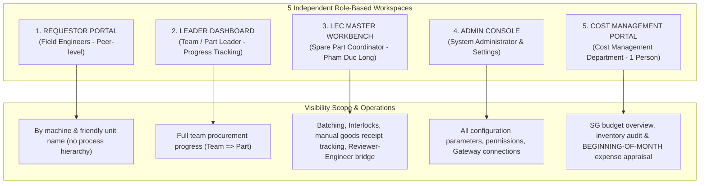

# 00. Role-Based Screen Matrix
> *Navigation architecture and access control matrix: Warehouse Portal eliminated (warehouse staff do not use this system; inventory issuance is automatically synced from EMS), Approval system eliminated (approvals take place on EMS; this system strictly controls progress), Peer engineers with no process hierarchy, Cost Management (Reviewer & Assistant is a single person).*

---

## 1. 5 Core User Role Architecture

The system is designed following the Principle of Least Privilege & Scoped Visibility. **Each role possesses an independent, dedicated workspace**:

### Directory of Role-Based Workspaces & Universal Screens:
0. [**Universal Screen: Universal Progress & Analytics Dashboard (UI-COMMON-00)**](file:///wsl.localhost/Ubuntu/home/longp/projects/ops-workflow/procurement-system/05-ui-ux-screen-specifications/00-common-dashboard/screen-universal-analytics-dashboard.md): Real-time operations intelligence control tower: Procurement progress funnel, inventory KPIs & aging audit tasks, 3-way budget reconciliation, analysis of 6 Over codes (segregated into PO Spend Over vs. Issue Expense Over from EMS).
1. [**Field Engineer Workspace (Requestor Portal - UI-ROLE-01)**](file:///wsl.localhost/Ubuntu/home/longp/projects/ops-workflow/procurement-system/05-ui-ux-screen-specifications/01-role-requestor/screen-requestor-portal.md): Create requests by friendly machine names, inventory snapshots, Excel grids, visual EBOM tree, **CAD folder data preparation for LEC QCode registration**, 3-party clarification responses with LEC, and **Beginning-of-Month Inventory Justification Tasks**.
2. [**Team / Part Management Workspace (Leader Dashboard - UI-ROLE-02)**](file:///wsl.localhost/Ubuntu/home/longp/projects/ops-workflow/procurement-system/05-ui-ux-screen-specifications/02-role-leader/screen-leader-team-dashboard.md): Monitor procurement progress hierarchical breakdown by `Team => Part`, preliminary review of Over reasons, and follow up on engineer inventory justification tasks *(Strictly no approvals; approvals take place on EMS)*.
3. [**Team LEC Workspace (LEC Master Workbench - UI-ROLE-03)**](file:///wsl.localhost/Ubuntu/home/longp/projects/ops-workflow/procurement-system/05-ui-ux-screen-specifications/03-role-lec/screen-lec-master-workbench.md): Multi-LEC batching across the entire team, 4-step Interlocks (processing `agingInterlockFlag` to borrow/use peer team stock, `unitPriceFlag`), EOL reclassification, RFQ tracking, **manual goods receipt progress tracking**, and serving as the **3-party clarification bridge** with the Cost Management Reviewer.
4. [**System Admin Workspace (Admin Settings Console - UI-ROLE-05)**](file:///wsl.localhost/Ubuntu/home/longp/projects/ops-workflow/procurement-system/05-ui-ux-screen-specifications/05-role-admin/screen-admin-settings-portal.md): 6 configuration tabs: 5-demand logic formulas, factory plants, Line hierarchy `Left(Line,1)=Floor`, Multi-Team Tree (eliminated process hierarchy; peer engineers), SG Budget No-Rollover, and Nexacro Gateway Rate Limiting.
5. [**Cost Management Workspace (Cost Management Portal - UI-ROLE-06)**](file:///wsl.localhost/Ubuntu/home/longp/projects/ops-workflow/procurement-system/05-ui-ux-screen-specifications/06-role-management/screen-management-audit-portal.md): Dedicated to the **Reviewer & Assistant (a single individual)**: Cost appraisal and inventory aging justification review at the BEGINNING OF THE MONTH, Over item audit, **input clarification requests sent to LEC** *(Official approval takes place on EMS)*.

---

## 2. Screen Authorization Matrix

| Functional Workspace | Field Engineer (Requestor) | Team / Part Leader | Team LEC | Cost Management (1 Person) | System Admin |
| :--- | :---: | :---: | :---: | :---: | :---: |
| **00. Universal Progress Dashboard** | 👁️ Machine scope | 👁️ Team/Part scope | 👁️ Full Team scope | 👁️ Plant-wide scope | **Full Access** |
| **01. Requestor Portal** • Create requests with friendly names • Prepare QCode data folder • Clarification feedback loop • Beginning-of-month aging tasks | **Full Access** (Create, Edit draft, Submit data) | 👁️ Read-only (Tracking) | 👁️ View & Assist | 🚫 No Access | **Full Access** (Tech Support) |
| **02. Leader Monitoring Dashboard** • Monitor progress Team => Part • Follow up on aging tasks • *(No approvals)* | 🚫 No Access | **Full Access (Tracking)** (Internal notes) | 👁️ Cross-view | 👁️ Cross-audit view | **Full Access** |
| **03. LEC Master Workbench** • Batch orders by status • Mark Target vs Over manually • Release Interlocks & EOL • Reviewer-Engineer info bridge • Manual goods receipt entry | 🚫 No Access | 👁️ View progress only | **Full Coordination Access** (Process, Unlock, Receipt) | 👁️ View prepared dossiers | **Full Access** |
| **04. Cost Management Portal** • BEGINNING-OF-MONTH cost appraisal • Inventory aging audit review • Send clarification requests to LEC • EMS reconciliation lookup | 🚫 No Access | 🚫 No Access | 👁️ View clarification requests | **Full Control Access** (Clarification request, Clearance) | **Full Access** |
| **05. System Settings Console** • Configure 5-demand formulas • Multi-Team Tree (peer engineers) • Gateway EMS Rate Limiting | 🚫 No Access | 🚫 No Access | ⚙️ Team budget settings | 🚫 No Access | **Full Config Access** |
| **06. Machine EBOM Drag & Drop** | 👁️ Lookup & Select | 👁️ Lookup | **Full Mapping Access** | 👁️ Structure Lookup | **Full Access** |
