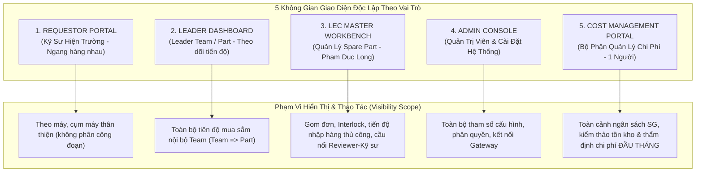

# 00. Ma Trận Phân Định Màn Hình Theo Vai Trò Người Dùng (Role-Based Screen Matrix)
> *Kiến trúc điều hướng và phân quyền truy cập: Loại bỏ Cổng Thủ Kho (thủ kho không dùng hệ thống, xuất kho lấy tự động từ EMS), Bỏ hệ thống duyệt (duyệt trên EMS, hệ thống chỉ kiểm soát tiến độ), Kỹ sư ngang hàng không chia công đoạn, Cost Management (Reviewer & Assistant là 1 người)*

---

## 1. Khung Phân Quyền 5 Nhóm Vai Trò Cốt Lõi (User Role Architecture)

Hệ thống được thiết kế theo nguyên tắc tối thiểu hóa quyền hạn và phân vùng phạm vi chặt chẽ (Principle of Least Privilege & Scoped Visibility). **Mỗi vai trò sở hữu 1 không gian làm việc chuyên biệt độc lập**:

### Danh Mục Không Gian Giao Diện Theo Vai Trò & Màn Hình Chung:
0. [**Màn Hình Chung: Dashboard Kiểm Soát Tiến Độ Tổng Hợp (UI-COMMON-00)**](file:///wsl.localhost/Ubuntu/home/longp/projects/ops-workflow/procurement-system/05-ui-ux-screen-specifications/00-common-dashboard/screen-universal-analytics-dashboard.md): Tháp chỉ huy dữ liệu thời gian thực: Phễu tiến độ mua sắm, KPIs tồn kho & Task giải trình, ngân sách 3-chiều, phân tích 6 mã Over (tách riêng do Mua Hàng vs Xuất Kho từ EMS).
1. [**Giao Diện Kỹ Sư Hiện Trường (Requestor Portal - UI-ROLE-01)**](file:///wsl.localhost/Ubuntu/home/longp/projects/ops-workflow/procurement-system/05-ui-ux-screen-specifications/01-role-requestor/screen-requestor-portal.md): Tạo đơn theo tên máy thân thiện, snapshot tồn kho, lưới Excel, cây EBOM, **chuẩn bị dữ liệu folder CAD để LEC đăng ký QCode**, phản hồi làm rõ thông tin với LEC và **Task Giải Trình Tồn Kho Đầu Tháng**.
2. [**Giao Diện Quản Lý Team / Part (Leader Dashboard - UI-ROLE-02)**](file:///wsl.localhost/Ubuntu/home/longp/projects/ops-workflow/procurement-system/05-ui-ux-screen-specifications/02-role-leader/screen-leader-team-dashboard.md): Giám sát tiến độ mua sắm phân tầng theo `Team => Part`, rà soát sơ bộ lý do Over và đôn đốc Task giải trình tồn kho của kỹ sư *(Tuyệt đối không phê duyệt thay EMS)*.
3. [**Giao Diện LEC Trong Team (LEC Master Workbench - UI-ROLE-03)**](file:///wsl.localhost/Ubuntu/home/longp/projects/ops-workflow/procurement-system/05-ui-ux-screen-specifications/03-role-lec/screen-lec-master-workbench.md): Multi-LEC gom đơn toàn team, Interlock 4 bước (xử lý cờ `agingInterlockFlag` xuất dùng tồn kho Team bạn, `unitPriceFlag`), EOL reclassification, theo dõi RFQ, **nhập tiến độ nhập hàng thủ công**, **cầu nối phản hồi 3 bên** với Reviewer Cost Management.
4. [**Giao Diện Quản Trị Hệ Thống (Admin Settings Console - UI-ROLE-05)**](file:///wsl.localhost/Ubuntu/home/longp/projects/ops-workflow/procurement-system/05-ui-ux-screen-specifications/05-role-admin/screen-admin-settings-portal.md): Cấu hình 6 Tab: Công thức logic mua, nhà xưởng, phân cấp Line `Left(Line,1)=Floor`, Cây Đa Team (bỏ trường công đoạn, kỹ sư ngang hàng), Ngân sách SG No-Rollover, Nexacro Gateway Rate Limiting.
5. [**Giao Diện Bộ Phận Quản Lý Chi Phí (Cost Management Portal - UI-ROLE-06)**](file:///wsl.localhost/Ubuntu/home/longp/projects/ops-workflow/procurement-system/05-ui-ux-screen-specifications/06-role-management/screen-management-audit-portal.md): Dành cho **Reviewer & Assistant (1 người duy nhất)**: Thẩm định chi phí và kiểm thảo giải trình tồn kho ĐẦU THÁNG, rà soát danh sách Over, **nhập yêu cầu cần thêm thông tin gửi cho LEC** *(Phê duyệt chính thức diễn ra trên EMS)*.

---

## 2. Bảng Ma Trận Quyền Hạn Màn Hình

| Không Gian Chức Năng | Kỹ Sư Hiện Trường | Leader Team / Part | LEC Trong Team | Cost Management (1 Người) | System Admin |
| :--- | :---: | :---: | :---: | :---: | :---: |
| **00. Dashboard Tiến Độ Chung** | 👁️ Xem phạm vi máy | 👁️ Xem Team/Part | 👁️ Xem toàn Team | 👁️ Xem toàn xưởng | **Toàn quyền** |
| **01. Cổng Kỹ Sư (Requestor)** • Tạo đơn theo tên thân thiện • Chuẩn bị data folder QCode • Phản hồi làm rõ thông tin • Task giải trình tồn kho đầu tháng | **Toàn quyền** (Tạo, Sửa nháp, Nộp data) | 👁️ Xem theo dõi | 👁️ Xem & Hỗ trợ | 🚫 Không truy cập | **Toàn quyền** (Hỗ trợ kỹ thuật) |
| **02. Bàn Theo Dõi Leader** • Giám sát tiến độ Team => Part • Đôn đốc Task giải trình tồn kho • *(Không phê duyệt)* | 🚫 Không truy cập | **Toàn quyền theo dõi** (Ghi chú nội bộ) | 👁️ Xem liên thông | 👁️ Xem đối soát | **Toàn quyền** |
| **03. Bàn Làm Việc LEC** • Gom đơn cùng trạng thái • Đánh dấu Trong Target vs Over • Mở Interlock & EOL • Cầu nối thông tin Reviewer-Kỹ sư • Nhập tiến độ nhập hàng thủ công | 🚫 Không truy cập | 👁️ Chỉ xem tiến độ | **Toàn quyền điều phối** (Xử lý, Mở chặn, Nhập hàng) | 👁️ Xem hồ sơ chuẩn bị | **Toàn quyền** |
| **04. Bàn Cost Management** • Thẩm định chi phí ĐẦU THÁNG • Kiểm thảo giải trình tồn kho • Gửi yêu cầu thêm thông tin cho LEC • Tra cứu đối soát EMS | 🚫 Không truy cập | 🚫 Không truy cập | 👁️ Xem yêu cầu bổ sung | **Toàn quyền kiểm soát** (Yêu cầu làm rõ, Clearance) | **Toàn quyền** |
| **05. Cài Đặt Hệ Thống (Settings)** • Cấu hình công thức 5 nhu cầu • Cây Đa Team (kỹ sư ngang hàng) • Gateway EMS Rate Limiting | 🚫 Không truy cập | 🚫 Không truy cập | ⚙️ Cài đặt ngân sách Team | 🚫 Không truy cập | **Toàn quyền cấu hình** |
| **06. Kéo - Thả EBOM Máy** | 👁️ Tra cứu & Chọn | 👁️ Tra cứu | **Toàn quyền gán mã** | 👁️ Tra cứu cơ cấu | **Toàn quyền** |
