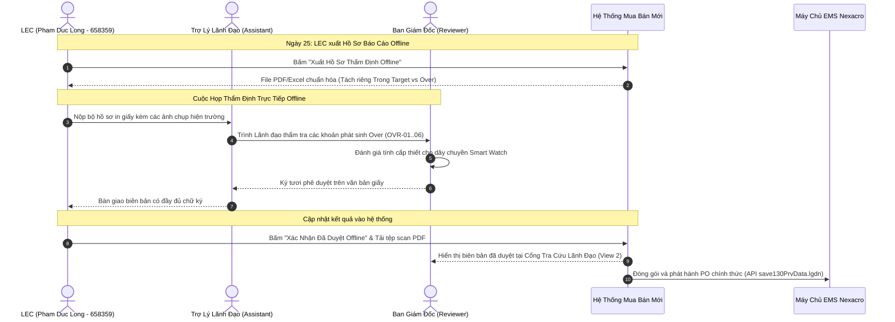

# Giao Diện Dành Riêng Cho Vai Trò: Team Management (Lãnh Đạo Thẩm Định Offline)
> **Mã Giao Diện: UI-ROLE-06 — Executive Management Offline Audit Portal**  
> *Dành riêng cho: Ban Lãnh Đạo & Quản Lý Nhà Máy: Reviewer (Quản lý cấp cao phê duyệt) và Assistant (Trợ lý điều phối)*

---

## 1. Tổng Quan Không Gian Làm Việc Của Ban Quản Lý (Workspace Anatomy)

Theo nguyên tắc vận hành cốt lõi của nhà máy:
> *"Mua bán (phát hành PO) và Chuyển giao (Transfer liên pháp nhân) BẮT BUỘC PHẢI DIỄN RA SAU THẨM ĐỊNH PHÊ DUYỆT. Hàng tháng (ngày 25), LEC tổng hợp hồ sơ, trình Ban Quản Lý (Team Management) thẩm định kiểm thảo chi tiết về tồn kho chưa dùng và các khoản chi Over. Sau khi Lãnh đạo thẩm định phê duyệt xong, hệ thống mới chính thức kích hoạt các lệnh điều chuyển và phát hành PO."*

Để phục vụ tốt nhất quy trình này, giao diện **Executive Management Portal** đóng vai trò là **Cổng Tra Cứu & Đối Soát Số Hóa (Digital Audit Mirror)** liên kết trực tiếp với [Dashboard Báo Cáo Phân Tích Tổng Hợp (UI-COMMON-00)](file:///home/longp/projects/company/ops-workflow/procurement-system/05-ui-ux-screen-specifications/00-common-dashboard/screen-universal-analytics-dashboard.md) giúp Ban Giám Đốc và Trợ Lý:
- Xem trước toàn cảnh báo cáo trước buổi họp thẩm định trực tiếp ngày 25.
- Rà soát danh sách chi tiết các hạng mục gây **Over Ngoài Kế Hoạch** (tách riêng Over do Mua Hàng vs Over do Xuất Kho) kèm hình ảnh hiện trường, mã Work Order và biên bản sự cố.
- Rà soát các **Task Giải Trình Tồn Kho Không Sử Dụng** của các Kỹ sư công đoạn để kiểm soát hiện tượng găm tồn kho chết (Dead stock).
- Lưu trữ và tra cứu lịch sử các biên bản phê duyệt giấy đã được ký và scan tải lên hệ thống.

Cấu trúc giao diện gồm **2 Chế Độ Xem Chuyên Biệt**:
1.  **View 1: 📑 Bảng Tổng Hợp Kỳ Mua Sắm Tháng (Monthly Executive Package)**: Tách bạch rõ ràng giữa hạn mức ngân sách SG tháng ($33\% - 33\% - 34\%$), tổng cam kết **🟢 TRONG TARGET**, và danh sách chi tiết các dòng **🔴 OVER NGOÀI KẾ HOẠCH** (phân loại theo 6 mã `OVR-01` đến `OVR-06`).
2.  **View 2: 📂 Kho Lưu Trữ Biên Bản Phê Duyệt Scan (Signed Paperwork Archive)**: Tra cứu toàn bộ các bản scan PDF biên bản họp thẩm định hàng tháng có đầy đủ chữ ký tươi của Ban Lãnh Đạo, gắn liền với mã lô PRV đã đẩy sang EMS.

---

## 2. Bản Vẽ Giao Diện Chi Tiết (ASCII UI Wireframe)

```
┌──────────────────────────────────────────────────────────────────────────────────────────────────────────────────────────────────┐
│ [LOGO OPS]  CỔNG TRA CỨU THẨM ĐỊNH LÃNH ĐẠO — FACTORY HW (SMART WATCH)           [🔔 1 Kỳ Chờ Thẩm Định] [👤 Reviewer (Ban GĐ)]  │
│ Phạm vi: Toàn bộ Nhà máy HW (Display Module Plant 1)                             Kỳ thẩm định: Tháng 11/2026 (Chốt ngày 25)       │
├──────────────────────────────────────────────────────────────────────────────────────────────────────────────────────────────────┤
│ CÁC CHẾ ĐỘ XEM CỦA BAN LÃNH ĐẠO:                                                                                                │
│ [📑 VIEW 1: BẢNG TỔNG HỢP KỲ MUA SẮM THÁNG 11]            [📂 VIEW 2: KHO BIÊN BẢN PHÊ DUYỆT GIẤY SCAN (12 KỲ ĐÃ DUYỆT)]         │
├──────────────────────────────────────────────────────────────────────────────────────────────────────────────────────────────────┤
│ 📌 ĐANG XEM: VIEW 1 — HỒ SƠ TỔNG HỢP MUA SẮM PHỤ TÙNG KỲ THÁNG 11/2026 (PHỤC VỤ HỌP OFFLINE)                                    │
│                                                                                                                                  │
│ 1.1. BẢNG CÂN ĐỐI NGÂN SÁCH MUA SẮM SG (QUÝ 4/2026 - TỶ LỆ 33% - 33% - 34%):                                                     │
│ ┌──────────────────────┬──────────────────────┬──────────────────────┬─────────────────────────────────────────────────────────┐ │
│ │ Tổng Hạn Mức SG Quý  │ Hạn Mức Tháng 11 (M2)│ Dồn Số Dư Tháng 10   │ TỔNG TRẦN MUA CHO PHÉP THÁNG 11 (PO COMMIT LIMIT)        │ │
│ │    $450,000 USD      │ 33% = $148,500 USD   │ + $4,200 USD         │ $152,700 USD                                            │ │
│ └──────────────────────┴──────────────────────┴──────────────────────┴─────────────────────────────────────────────────────────┘ │
│ • Tổng cam kết đề xuất Trong Target (Bù tồn an toàn EBOM):  $124,500 USD (81.5% trần) [🟢 Nằm trong hạn mức]                    │
│ • Tổng phát sinh Mua Ngoài Kế Hoạch (Over Unplanned):        $28,200 USD (18.5% trần) [🔴 Bắt buộc giải trình tại cuộc họp]     │
│ ➔ TỔNG ĐỀ XUẤT KÝ DUYỆT THÁNG 11:                           $152,700 USD (Vừa khít 100.0% hạn mức trần)                        │
│                                                                                                                                  │
│ 1.2. DANH MỤC 8 HẠNG MỤC PHÁT SINH OVER BẮT BUỘC THẨM ĐỊNH (OVR-01 ĐẾN OVR-06):                                                  │
│ ┌──┬────────────┬─────────────────────────────┬───────────┬─────────────┬─────────────┬──────────┬──────────────┬───────────────┐ │
│ │ST│ Mã QCode   │ Tên Phụ Tùng & Maker        │ Công Đoạn │ Số Lượng Mua│ Thành Tiền  │ Mã Lý Do │ Mã Lệnh Máy  │ Hồ Sơ Minh    │ │
│ │T │ / Mã Tạm   │                             │ & Line    │             │ Dự Kiến     │ Over     │ (Work Order) │ Chứng Sự Cố   │ │
│ ├──┼────────────┼─────────────────────────────┼───────────┼─────────────┼─────────────┼──────────┼──────────────┼───────────────┤ │
│ │1 │ QDAD12236  │ Board nguồn CPX V4 Trumpf   │ DB / #201 │ 1 EA        │ $3,150.00   │ OVR-01   │ WO-248926091 │ [🖼️ 2 Ảnh máy]│ │
│ │  │            │ ↳ Lý do: Cháy board nguồn do xung sét ca đêm, máy EC line #201 dừng hẳn                │ [📋 Alarm log]│ │
│ ├──┼────────────┼─────────────────────────────┼───────────┼─────────────┼─────────────┼──────────┼──────────────┼───────────────┤ │
│ │2 │ TMP-HW-0104│ Xylanh trượt kép SMC MXQ16  │ TAB/ #202 │ 2 EA        │ $440.00     │ OVR-03   │ WO-248926098 │ [📄 Công văn] │ │
│ │  │            │ ↳ Lý do: LGD Korea vướng thủ tục hải quan chưa transfer kịp, mua tạm 2 chiếc tránh dừng│ [📧 Email HQ] │ │
│ └──┴────────────┴─────────────────────────────┴───────────┴─────────────┴─────────────┴──────────┴──────────────┴───────────────┘ │
│                                                                                                                                  │
│  [📥 TẢI BÁO CÁO GIẢI TRÌNH TỒN KHO & KIỂM THẢO (EXCEL FORM CỐ ĐỊNH)]      [👁️ XEM THÔNG TIN ĐỐI SOÁT EMS ĐÃ ĐỒNG BỘ]     │
└──────────────────────────────────────────────────────────────────────────────────────────────────────────────────────────────────┘
```

---

## 3. Quy Trình Phê Duyệt Giấy & Lưu Trữ Số Hóa



---

## 4. Quyền Hạn Của Ban Lãnh Đạo (Team Management)

1. **Thẩm quyền phê duyệt ngân sách tối cao**: Ban Lãnh Đạo là cấp duy nhất có quyền ký phê duyệt các khoản chi ngoài kế hoạch (Over-budget) để phụ tùng được phép phát hành PO.
2. **Quyền đình chỉ hoặc cắt giảm hạng mục**: Nếu tại cuộc họp phát hiện hạng mục mua không cấp thiết, Ban Lãnh Đạo gạch bỏ trực tiếp trên biên bản giấy, LEC sẽ cập nhật xóa dòng đó trên phần mềm trước khi phát hành PO sang EMS.

