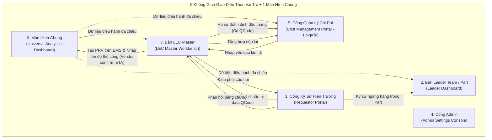

# Phân Tích & Phản Biện Chuyên Sâu Các Màn Hình Chức Năng (UI/UX Critical Evaluation)
> **Tài liệu thẩm định kiến trúc giao diện người dùng — Hệ thống Quản lý Mua bán Phụ tùng Factory HW (Smart Watch)**  
> *Đánh giá toàn diện 6 không gian giao diện: Màn hình chung (Dashboard) + 5 Giao diện theo vai trò*  
> *Nguyên tắc cốt lõi: Loại bỏ Cổng thủ kho HW (thủ kho không dùng hệ thống, xuất kho đồng bộ từ EMS); Bỏ qua hệ thống duyệt (duyệt chính thức trên EMS, hệ thống CHỈ KIỂM SOÁT TIẾN ĐỘ); Kỹ sư ngang hàng trong Part/Team không chia công đoạn; Cost Management (Reviewer & Assistant là 1 người); Thẩm định đầu tháng & Luồng phản hồi 3 bên.*

---

## 1. Bối Cảnh Tái Cấu Trúc Giao Diện & Các Nguyên Tắc Chỉ Đạo

Sau khi tiếp thu đầy đủ các chỉ đạo nghiệp vụ thực tế từ hiện trường nhà xưởng:
1.  **5 Không Gian Giao Diện Chuyên Biệt Theo Vai Trò**: Kỹ sư hiện trường (Requestor), Quản lý Team / Part (Leader), Quản trị phụ tùng trong Team (LEC Master), Quản trị hệ thống (Admin), và Bộ phận Quản lý Chi phí (Cost Management). Hoàn toàn **không có Cổng thủ kho** vì xuất kho lấy tự động từ EMS.
2.  **Màn Hình Chung / Dashboard Kiểm Soát Tiến Độ Tổng Hợp ([`UI-COMMON-00`](file:///wsl.localhost/Ubuntu/home/longp/projects/ops-workflow/procurement-system/05-ui-ux-screen-specifications/00-common-dashboard/screen-universal-analytics-dashboard.md))**: Tháp chỉ huy dữ liệu cung cấp phễu tiến độ mua sắm 7 bước (không có bước duyệt trên app mới), KPIs tồn kho & Task giải trình, ngân sách SG không bảo lưu (No-Rollover), và phân tích 6 mã Over (tách bạch Over Mua Hàng vs Over Xuất Kho từ EMS).
3.  **Quy Trình Cốt Lõi Được Chuẩn Hóa**:
    *   **Hệ thống chỉ kiểm soát tiến độ**: Tuyệt đối không phê duyệt PRV/PO trên ứng dụng này; mọi phê duyệt chính thức diễn ra trên **LG Display Nexacro EMS**.
    *   **Thẩm định ĐẦU THÁNG**: Đợt thẩm định chi phí và kiểm thảo giải trình tồn kho diễn ra vào đầu tháng với Cost Management.
    *   **Điều kiện thẩm định**: Bắt buộc phải có **Mã QCode chính thức**. Kéo thả folder CAD/Doc/ảnh là bước **chuẩn bị dữ liệu kỹ thuật** để LEC đăng ký QCode trên ERP/EMS, không phải thẩm định.
    *   **Phân loại Target vs Over**: **Không tự động**, LEC tự tay đánh giá và phân loại thủ công.
    *   **Thời hạn (Deadlines)**: Hạn giải trình tồn kho và hạn chốt hồ sơ thẩm định do **LEC quy định và cấu hình**.
    *   **Cảnh báo tồn kho của Team khác (`agingInterlockFlag`)**: Hiển thị cảnh báo tức thì ngay khi tạo đơn; hệ thống duy trì Task bắt buộc mượn/xuất kho cho đến khi dữ liệu EMS đồng bộ cờ chuyển sang `'N'`.
    *   **Cầu nối phản hồi 3 bên**: Reviewer Cost Management (offline) $\rightarrow$ LEC nhập yêu cầu lên hệ thống $\rightarrow$ Kỹ sư phản hồi cho LEC $\rightarrow$ LEC tổng hợp gửi lại Reviewer.
    *   **Tiến độ nhập hàng**: Hàng về kiểm tra trên EMS; các mốc trước đó (Vendor confirm ngày giao, ETA, phân bổ chi phí hàng tháng) được nhập và theo dõi trên hệ thống này.

---

## 2. Phân Tích & Phản Biện Chi Tiết Từng Không Gian Giao Diện

---

### 2.1. Màn Hình Chung: Dashboard Kiểm Soát Tiến Độ Tổng Hợp (`UI-COMMON-00`)

* **Phân tích chức năng**:
  - Hợp nhất 5 khối dữ liệu: Phễu tiến độ mua sắm 7 bước (từ chuẩn bị data QCode đến hàng về), Bộ chỉ số tồn kho & Task giải trình, Cân đối ngân sách SG No-Rollover, Phân tích 6 mã Over (`OVR-01..06`), và Danh sách chi tiết hạng mục Over (tách bạch Over Mua Hàng vs Over Xuất Kho đọc từ EMS).
* **Điểm phản biện & Giải pháp tối ưu**:
  1. *Nguy cơ ngợp thông tin (Information Overload)*: Kỹ sư hoặc Part Leader có thể bị phân tâm bởi số liệu toàn nhà máy.
     - *Giải pháp*: Tự động lọc dữ liệu theo ngữ cảnh đăng nhập (Context Auto-Scoping). Khi kỹ sư mở Dashboard, hệ thống mặc định lọc sẵn phạm vi dây chuyền/máy của họ.
  2. *Độ trễ tính toán danh sách Over*: Quét hàng ngàn dòng xuất kho từ EMS và đơn mua có thể làm chậm Dashboard.
     - *Giải pháp*: Bảng Read-Model của `ops-workflow` được cập nhật qua worker nền định kỳ, truy vấn trực tiếp dưới 50ms.

---

### 2.2. Cổng Kỹ Sư Hiện Trường (`UI-ROLE-01: Requestor Portal`)

* **Phân tích chức năng**:
  - Tên máy thân thiện 100%, đối soát tồn kho tức thời 50ms, upload folder CAD/Doc/ảnh chuẩn bị data đăng ký QCode trên ERP/EMS.
  - Cảnh báo tức thời tồn kho của Team khác (`agingInterlockFlag = Y`), duy trì Task bắt buộc mượn tồn kho cho đến khi EMS đồng bộ `'N'`.
  - Bàn Task giải trình tồn kho đầu tháng trước Deadline của LEC.
  - Kênh tiếp nhận và phản hồi làm rõ 3 bên với LEC.
* **Điểm phản biện & Giải pháp tối ưu**:
  1. *Kỹ sư tạo đơn mua mới dù có tồn kho của Team khác*:
     - *Giải pháp*: Hệ thống bắn Banner màu cam cảnh báo tức thì ngay khi chọn mã, đồng thời tạo Task bắt buộc không thể xóa thủ công. Task chỉ tự đóng khi API EMS xác nhận cờ `agingInterlock` chuyển về `'N'`.
  2. *Nhầm lẫn giữa nộp folder CAD và thẩm định*:
     - *Giải pháp*: Giao diện ghi rõ chú thích: Upload folder chỉ tạo mã tạm `TMP-HW-xxxx` để LEC đăng ký QCode; hạng mục chỉ đủ điều kiện thẩm định khi đã có mã QCode chính thức.

---

### 2.3. Bàn Điều Khiển Leader Team / Part (`UI-ROLE-02: Leader Dashboard`)

* **Phân tích chức năng**:
  - Giám sát mua sắm phân tầng `Team => Part => Kỹ Sư Ngang Hàng` (loại bỏ hoàn toàn cấp bậc công đoạn).
  - Giám sát tiến độ giải trình tồn kho đầu tháng và tiến độ xử lý Task mượn kho của kỹ sư.
  - Theo dõi tỷ trọng Target vs Over do LEC phân loại.
* **Điểm phản biện & Giải pháp tối ưu**:
  1. *Xung đột vai trò phê duyệt*: Tránh việc Leader nhầm lẫn giao diện mới có nút duyệt đơn mua.
     - *Giải pháp*: Bàn Leader **hoàn toàn không có nút Endorse / Approve / Reject**. Mọi phê duyệt diễn ra trên EMS. Bàn điều khiển chỉ hiển thị dữ liệu giám sát và nút nhắn tin trao đổi nội bộ.

---

### 2.4. Bàn Làm Việc LEC Master Trong Team (`UI-ROLE-03: LEC Master Workbench`)

* **Phân tích chức năng**:
  - Hỗ trợ mô hình Multi-LEC trong Team gom đơn toàn diện.
  - Quét Interlock 4 bước, cờ `agingInterlockFlag` (mượn tồn team khác), cờ `unitPriceFlag` (đã có giá hay chờ RFQ).
  - Đăng ký QCode ngoài ERP từ dữ liệu folder của kỹ sư.
  - Thiết lập thời hạn (Deadline) giải trình và thẩm định.
  - **Tự tay phân loại thủ công** `[TRONG TARGET]` hoặc `[OVER PHÁT SINH]` (không tự động).
  - **Cầu nối 3 bên**: Nhập yêu cầu làm rõ từ Reviewer Cost Management $\rightarrow$ chuyển kỹ sư $\rightarrow$ nhận phản hồi $\rightarrow$ nộp lại Reviewer.
  - **Theo dõi tiến độ nhập hàng thủ công**: Nhập ngày Vendor confirm giao hàng, ngày ETA về cảng/xưởng, phân bổ chi phí sử dụng hàng tháng; đối soát hoàn tất qua EMS.

---

### 2.5. Trung Tâm Cài Đặt & Cấu Hình Hệ Thống (`UI-ROLE-05: Admin Settings Console`)

* **Phân tích chức năng**:
  - Cấu hình toàn bộ hệ thống qua 6 Tab: Logic công thức, Nhà xưởng Line `Left(Line,1)=Floor` (không chia công đoạn), Cây tổ chức 3 cấp chuẩn, Ngân sách SG No-Rollover & Deadline của LEC, Kết nối Gateway Nexacro Rate Limiting, Danh mục mã Over.
* **Điểm phản biện & Giải pháp tối ưu**:
  - Đảm bảo toàn bộ quyền hạn được phân đúng 5 nhóm vai trò, hoàn toàn loại bỏ quyền Thủ kho; tích hợp Audit Trail lịch sử cấu hình.

---

### 2.6. Cổng Bộ Phận Quản Lý Chi Phí (`UI-ROLE-06: Cost Management Portal`)

* **Phân tích chức năng**:
  - Dành riêng cho **Bộ phận Quản lý Chi phí (Reviewer & Assistant là 1 người duy nhất)**.
  - Phục vụ thẩm định chi phí và kiểm thảo giải trình tồn kho diễn ra vào **ĐẦU THÁNG**.
  - Kiểm tra các hạng mục **đã có Mã QCode chính thức** và được LEC phân loại Target vs Over (`OVR-01..06`).
  - **Tab Điều phối yêu cầu làm rõ**: Nhập các câu hỏi cần kỹ sư bổ sung thông tin gửi cho LEC.
  - Lưu trữ biên bản thẩm định offline số hóa. *(Phê duyệt ngân sách chính thức diễn ra trên EMS)*.

---

## 3. Bảng Tổng Hợp Đánh Giá Khả Thi & Mức Độ Hoàn Thiện

| Không Gian Giao Diện | Vai Trò Chính | Đánh Giá | Điểm Mạnh Cốt Lõi | Cơ Chế Đã Tối Ưu Hóa |
| :--- | :--- | :---: | :--- | :--- |
| **`UI-COMMON-00`** | Dùng chung toàn nhà máy | **9.9 / 10** | Phễu tiến độ 7 bước (không nút duyệt); bóc tách Over Mua Hàng vs Over Xuất Kho đọc từ EMS; No-Rollover. | Auto-scoping theo ngữ cảnh; Read-Model ops-workflow <50ms. |
| **`UI-ROLE-01`** | Requestor (Kỹ sư ngang hàng) | **9.8 / 10** | Tên máy thân thiện; Cảnh báo tức thì tồn kho Team khác; Upload folder chuẩn bị data QCode; Task treo đến khi EMS='N'. | Banner cảnh báo cam ngay khi chọn mã; Kênh làm rõ 3 bên qua LEC. |
| **`UI-ROLE-02`** | Leader Team / Part | **9.7 / 10** | Giám sát `Team => Part => Kỹ Sư`; đôn đốc Task tồn kho; theo dõi Target vs Over; hoàn toàn không nút duyệt. | Loại bỏ Process; Modal chỉ phục vụ xem chi tiết kỹ thuật. |
| **`UI-ROLE-03`** | LEC Master trong Team | **9.9 / 10** | Gom đơn toàn team; quét Interlock & cờ tồn/giá; thiết lập Deadline; LEC tự phân loại Target/Over; Cầu nối 3 bên; Nhập tiến độ Vendor/ETA. | Kiểm tra mã PRV tức thì trên EMS; khóa dòng thao tác chống xung đột. |
| **`UI-ROLE-05`** | Quản trị hệ thống | **9.9 / 10** | Cấu hình 6 Tab Zero-code; quản lý Rate Limiting Nexacro; No-Rollover; Cây tổ chức 3 cấp. | Bỏ phân quyền thủ kho; Audit trail lịch sử cấu hình. |
| **`UI-ROLE-06`** | Cost Management (1 người) | **9.8 / 10** | Thẩm định ĐẦU THÁNG; rà soát Over có QCode; gửi yêu cầu làm rõ cho LEC; lưu biên bản số hóa. | Hợp nhất Reviewer & Assistant; Luồng phản hồi 3 bên trực tuyến. |

---

## 4. Kết Luận

Kiến trúc giao diện mới với **1 Màn Hình Chung + 5 Không Gian Chuyên Biệt Theo Vai Trò** đã loại bỏ hoàn toàn các điểm không phù hợp thực tế, tuân thủ chặt chẽ ranh giới vận hành:
- **Hệ thống mới**: Tập trung toàn lực vào kiểm soát tiến độ, chuẩn bị dữ liệu kỹ thuật, cảnh báo tồn kho liên team, đôn đốc giải trình và điều phối thông tin thẩm định 3 bên.
- **Hệ thống EMS core**: Duy trì vai trò duy nhất về phê duyệt chi phí chính thức, phát hành PO và ghi nhận xuất kho thực tế.
