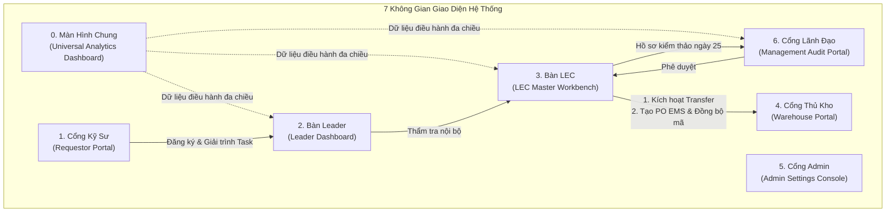

# Phân Tích & Phản Biện Chuyên Sâu Các Màn Hình Chức Năng (UI/UX Critical Evaluation)
> **Tài liệu thẩm định kiến trúc giao diện người dùng — Hệ thống Quản lý Mua bán Phụ tùng Factory HW (Smart Watch)**  
> *Đánh giá toàn diện 7 không gian giao diện: Màn hình chung (Dashboard) + 6 Giao diện theo vai trò*

---

## 1. Bối Cảnh Tái Cấu Trúc Giao Diện & Các Nguyên Tắc Chỉ Đạo

Sau khi tiếp thu đầy đủ các chỉ đạo nghiệp vụ thực tế từ hiện trường nhà xưởng, hệ thống giao diện đã được tái cấu trúc triệt để:
1.  **Mỗi vai trò sở hữu 1 không gian giao diện chuyên biệt**: Kỹ sư (Requestor), Leader các cấp, LEC trong Team (Multi-LEC), Thủ kho (Warehouse), Quản trị viên (Admin), và Ban Giám Đốc (Management).
2.  **Bổ sung Màn Hình Chung / Dashboard Báo Cáo Phân Tích Tổng Hợp ([`UI-COMMON-00`](file:///home/longp/projects/company/ops-workflow/procurement-system/05-ui-ux-screen-specifications/00-common-dashboard/screen-universal-analytics-dashboard.md))**: Đóng vai trò là tháp chỉ huy dữ liệu (Operations Intelligence), cung cấp phễu tiến độ mua sắm, KPIs tồn kho, cân đối ngân sách SG 33-33-34, phân tích sâu nguyên nhân Over và trả về danh sách chi tiết các hạng mục gây Over (cả do Mua hàng và do Xuất kho).
3.  **Quy trình cốt lõi**:
    *   **Mua bán (PO) và Chuyển giao (Transfer) BẮT BUỘC chỉ diễn ra SAU KHI thẩm định phê duyệt**.
    *   **Kỹ sư giải trình tồn kho chưa sử dụng trực tiếp trên hệ thống qua cơ chế Task** (tương tự như luồng trao đổi phản hồi với LEC).
    *   **Lộ trình tích hợp EMS mở rộng dần**: Giai đoạn 1 LEC tạo trên EMS rồi quay lại nhập mã PRV No để hệ thống lấy dữ liệu và cập nhật trạng thái; Giai đoạn 2 mới mở rộng gọi API tự động tạo PRV.

---

## 2. Phân Tích & Phản Biện Chi Tiết Từng Màn Hình Chức Năng

---

### 2.1. Màn Hình Chung: Dashboard Báo Cáo & Phân Tích Tổng Hợp (`UI-COMMON-00`)

* **Phân tích chức năng**:
  - Hợp nhất toàn bộ 5 khối dữ liệu: Phễu tiến độ mua sắm 7 bước, Bộ chỉ số tồn kho & tỷ lệ hoàn thành Task giải trình, Cân đối ngân sách SG (Hạn mức vs PO Commit vs Chi phí xuất), Cơ cấu 6 mã Over (`OVR-01..06`), và Ma trận chi tiết các hạng mục gây Over.
  - Phân tách rõ ràng 2 luồng Over: **Over do Mua Hàng** (làm đội ngân sách cam kết tháng) vs **Over do Xuất Kho** (vượt định mức tiêu hao linh kiện của máy).
* **Điểm phản biện & Rủi ro vận hành**:
  1. *Nguy cơ ngợp thông tin (Information Overload)*: Dashboard chứa quá nhiều số liệu vĩ mô có thể khiến một Process Leader cơ sở (ví dụ Leader công đoạn DB) khó tập trung vào công việc của mình.
     - *Giải pháp*: Áp dụng cơ chế **Tự động lọc dữ liệu theo ngữ cảnh đăng nhập (Context Auto-Scoping)**. Khi Leader DB mở Dashboard, hệ thống mặc định lọc sẵn toàn bộ biểu đồ và danh sách Over theo phạm vi công đoạn DB, chỉ có Ban Giám Đốc và LEC mới mặc định xem toàn nhà máy HW.
  2. *Độ trễ tính toán danh sách Over (Compute Latency)*: Việc quét hàng ngàn dòng xuất kho và đơn mua để phân tích nguyên nhân Over có thể làm chậm thời gian tải trang.
     - *Giải pháp*: Bảng Read-Model của `ops-workflow` cần được tổng hợp sẵn (Pre-aggregated Materialized View / Cache Redis 5 phút) để Dashboard tải ngay lập tức dưới 200ms.

---

### 2.2. Cổng Kỹ Sư Công Đoạn (`UI-ROLE-01: Requestor Portal`)

* **Phân tích chức năng**:
  - Tích hợp bộ giải mã 14 ký tự EM No (`HWBMTL21EC0101`), thanh đối soát tồn kho 50ms, dropdown 5 nhu cầu cơ sở (`SETUP`, `IMPROVE`, `BREAKDOWN`, `PM`, `SAFETY_STOCK`), trường nhập logic công thức tính toán.
  - Nhập lưới spreadsheet paste từ Excel và kéo thả hàng loạt ảnh tự động regex.
  - **Đặc biệt**: Tab 4 tích hợp cả **Kênh phản hồi 2 chiều với LEC** và **Bàn Task Giải Trình Tồn Kho Chưa Sử Dụng**.
* **Điểm phản biện & Rủi ro vận hành**:
  1. *Kỹ sư đối phó khi giải trình Task tồn kho chưa sử dụng*: Kỹ sư có xu hướng chọn lý do chung chung như "máy chạy tốt chưa cần thay" để hoãn việc giải trình.
     - *Giải pháp*: Bắt buộc Kỹ sư phải cam kết **Ngày dự kiến xuất kho (`expected_issue_date`)** và gắn với mã máy EM No cụ thể. Nếu đến ngày đó mà kho chưa có phiếu xuất, hệ thống sẽ cảnh báo đỏ trực tiếp lên bảng kiểm thảo của Leader.
  2. *Quy chuẩn viết Logic tính toán số lượng mua*: Kỹ sư có thể gõ tự do gây khó hiểu cho LEC.
     - *Giải pháp*: Cung cấp các **Template công thức gợi ý sẵn (Formula Chips)** ngay dưới ô nhập liệu (ví dụ: `[Bù mòn PM]`, `[Đúng số lượng vỡ hỏng WO]`) để kỹ sư chỉ cần bấm chọn và điền số.

---

### 2.3. Bàn Điều Khiển Leader Các Cấp (`UI-ROLE-02: Leader Dashboard`)

* **Phân tích chức năng**:
  - Giám sát mua sắm phân tầng theo đúng `Team => Part => Process`.
  - Cửa sổ Modal thẩm tra chi tiết Work Order máy hỏng kèm ảnh hiện trường, mã alarm log máy và bản vẽ CAD đối chiếu.
  - Phê duyệt sơ bộ nội bộ và rà soát các Task giải trình tồn kho của kỹ sư công đoạn.
* **Điểm phản biện & Rủi ro vận hành**:
  1. *Nguy cơ Leader trở thành "máy bấm duyệt" (Rubber-Stamping)*: Khi số lượng đơn nhiều, Leader có thể bấm xác nhận hàng loạt mà không xem kỹ chi tiết.
     - *Giải pháp*: Hệ thống phân luồng thông minh: Các đơn **🟢 TRONG TARGET** có giá trị nhỏ (< $100 USD) được gom duyệt hàng loạt; riêng các đơn **🔴 OVER NGOÀI KẾ HOẠCH** bắt buộc Leader phải mở Modal xem chi tiết ít nhất 3 giây mới sáng nút `[Xác Nhận]`.
  2. *Thẩm quyền thực chất của Leader*: Khẳng định rõ trên giao diện: Leader chỉ xác nhận tính xác thực nội bộ, **quyết định mua bán và chuyển giao chỉ được kích hoạt sau khi đã qua Hội Đồng Thẩm Định / Kiểm Thảo Phê Duyệt**.

---

### 2.4. Bàn Làm Việc LEC Trong Team (`UI-ROLE-03: LEC Master Workbench`)

* **Phân tích chức năng**:
  - Hỗ trợ mô hình **Nhiều nhân sự LEC (Multi-LEC)** cùng làm việc trong Team.
  - Định tuyến Interlock 4 bước Y/N tuần tự: `Transfer => Reject & CheckDisuse popup => Internal Repair => Mua thường`.
  - Quản lý mã tạm `TMP-HW-xxxx`, theo dõi tiến độ báo giá Purchase.
  - Chốt kỳ mua sắm ngày 25 và **Modal nhập thông tin đối soát EMS (PRV No, PO No) trong Giai đoạn 1** để đồng bộ trạng thái tự động.
* **Điểm phản biện & Rủi ro vận hành**:
  1. *Lỗi gõ sai mã PRV No khi đồng bộ thủ công*: Do LEC thao tác trên EMS rồi quay lại paste mã vào hệ thống, có nguy cơ gõ nhầm 1 ký tự khiến hệ thống không tìm thấy đơn.
     - *Giải pháp*: Trong Modal nhập mã đối soát EMS, hệ thống tích hợp nút `[Kiểm Tra Tức Thì]`: Ngay khi LEC nhập mã PRV No, hệ thống lập tức gọi API `retrieveBuyMainList.lgdn` sang EMS để hiển thị preview danh sách linh kiện trong đơn. Chỉ khi khớp số lượng và tên linh kiện thì mới cho phép bấm Lưu.
  2. *Phối hợp giữa các LEC*: Khi có nhiều LEC trong Team, tránh việc 2 LEC cùng mở khóa Interlock cho 1 mã linh kiện.
     - *Giải pháp*: Áp dụng cơ chế **Khóa dòng thao tác (Row-level Optimistic Locking)**: Khi LEC A đang mở xem dòng nào, dòng đó hiển thị avatar của LEC A, LEC B chỉ có quyền đọc.

---

### 2.5. Cổng Quản Lý Kho Phụ Tùng (`UI-ROLE-04: Warehouse Portal`)

* **Phân tích chức năng**:
  - Tối ưu hóa cho thiết bị công nghiệp / màn hình cảm ứng: Quét barcode EM No 14 ký tự của máy $\rightarrow$ Quét mã phụ tùng / Serial $\rightarrow$ Ghi nhận mã Work Order và kỹ sư nhận.
  - Hạch toán ghi nhận chi phí thực tế (Issue Expense) vào tài khoản SG của phòng ban thụ hưởng và công đoạn sử dụng máy.
  - Đối soát số lượng tồn kho vật lý on-hand tại kho HW vs Read-Model EMS.
* **Điểm phản biện & Rủi ro vận hành**:
  1. *Tốc độ thao tác giờ cao điểm*: Kỹ sư ca đêm chạy vào kho xin linh kiện gấp, việc bắt thủ kho quét đủ 3 bước có thể gây ùn ứ tại cửa kho.
     - *Giải pháp*: Hỗ trợ chế độ **"Quét Nhập Nhanh (Fast Barcode Stream)"**: Thủ kho có thể quét liên tục 5-10 linh kiện vào cùng 1 mã máy EM No và 1 mã Work Order chỉ bằng 1 lần quét đầu mã máy.

---

### 2.6. Trung Tâm Cài Đặt & Cấu Hình Hệ Thống (`UI-ROLE-05: Admin Settings Console`)

* **Phân tích chức năng**:
  - Cấu hình toàn bộ hệ thống qua 6 Tab chuyên sâu mà không cần can thiệp code (Zero-code configuration): Logic 5 nhu cầu, Nhà xưởng, Line `Left(Line,1)=Floor`, Cây tổ chức & RBAC, Ngân sách SG 33-33-34 & chu kỳ khóa sổ, Kết nối EMS Gateway Rate Limiting, Danh mục mã Over.
* **Điểm phản biện & Rủi ro vận hành**:
  1. *Rủi ro cấu hình sai làm sập quy trình toàn nhà máy*: Nếu Admin vô tình chỉnh sai công thức logic hoặc hạ giới hạn Rate Limiting của Gateway.
     - *Giải pháp*: Mọi thay đổi trong Cài Đặt Hệ Thống đều bắt buộc lưu vào **Bảng Nhật Ký Kiểm Toán (Configuration Audit Trail)** ghi rõ: Người sửa, giờ sửa, giá trị cũ, giá trị mới, và yêu cầu xác nhận 2 bước (Two-Factor Confirmation) cho các tham số nhạy cảm như Gateway URL hoặc Tỷ lệ ngân sách.

---

### 2.7. Cổng Thẩm Định Ban Lãnh Đạo (`UI-ROLE-06: Management Audit Portal`)

* **Phân tích chức năng**:
  - Phục vụ trực tiếp cuộc họp kiểm thảo định kỳ ngày 25 giữa Ban Giám Đốc (Reviewer) và Nhóm LEC.
  - Tra cứu toàn cảnh ngân sách SG quý, rà soát danh mục 100% các hạng mục Over ngoài kế hoạch (kèm ảnh máy hỏng và Work Order), rà soát các Task giải trình tồn kho chưa dùng của kỹ sư.
  - Kho lưu trữ số hóa các biên bản thẩm định có chữ ký tươi đã scan qua các tháng.
  - **Khẳng định nguyên tắc**: Ban Lãnh Đạo thẩm định phê duyệt xong thì hệ thống mới kích hoạt cho phép LEC thực hiện các lệnh chuyển giao và tạo PO.
* **Điểm phản biện & Rủi ro vận hành**:
  1. *Thời gian chuẩn bị trước cuộc họp*: Nếu ngày 25 mới tổng hợp số liệu thì cuộc họp sẽ bị động.
     - *Giải pháp*: Hệ thống gửi thông báo tự động (Pre-meeting Briefing) cho Trợ lý (Assistant) và Lãnh đạo từ **ngày 23 hàng tháng**, hiển thị bản xem trước nháp (Draft Preview) các hạng mục Over và các Task giải trình tồn kho chưa nộp để lãnh đạo chỉ đạo xử lý sớm.

---

## 3. Bảng Tổng Hợp Đánh Giá Khả Thi & Mức Độ Hoàn Thiện

| Không Gian Giao Diện | Vai Trò Chính | Đánh Giá Khả Thi | Điểm Mạnh Cốt Lõi | Biện Pháp Tối Ưu Đã Tích Hợp |
| :--- | :--- | :---: | :--- | :--- |
| **`UI-COMMON-00`** | Dùng chung toàn nhà máy | **9.8 / 10** | Phễu chu kỳ 7 bước, so sánh PO Commit vs Issue Expense, drill-down danh sách Over cụ thể. | Auto-scoping theo vai trò đăng nhập; Cache dữ liệu Redis 5 phút. |
| **`UI-ROLE-01`** | Requestor (Kỹ sư) | **9.5 / 10** | Giải mã EM No 14 ký tự, EBOM CAD, Task giải trình tồn kho chưa dùng, kênh phản hồi LEC. | Gợi ý sẵn Template công thức; bắt buộc cam kết ngày xuất máy cụ thể. |
| **`UI-ROLE-02`** | Leader các cấp | **9.6 / 10** | Thẩm tra Work Order máy hỏng kèm alarm log & ảnh; giám sát phân tầng Team => Part => Process. | Khóa nút duyệt nhanh đối với đơn Over; chỉ xác nhận sau thẩm định. |
| **`UI-ROLE-03`** | Nhóm LEC trong Team | **9.7 / 10** | Multi-LEC phân công linh hoạt; Interlock Y/N; CheckDisuse; modal đối soát EMS Phase 1. | Kiểm tra tự động mã PRV tức thì khi nhập; khóa dòng thao tác chống xung đột. |
| **`UI-ROLE-04`** | Thủ kho HW | **9.6 / 10** | Quét barcode EM No xuất máy; hạch toán chi phí sử dụng thực tế; đối soát tồn vật lý. | Chế độ quét nhanh dòng liên tục cho môi trường kho xưởng. |
| **`UI-ROLE-05`** | Quản trị hệ thống | **9.9 / 10** | Cấu hình 6 Tab Zero-code; quản lý Rate Limiting Nexacro an toàn tuyệt đối. | Audit trail lịch sử thay đổi; xác nhận 2 bước cho tham số nhạy cảm. |
| **`UI-ROLE-06`** | Ban Giám Đốc | **9.7 / 10** | Kiểm thảo ngày 25; duyệt trước khi chuyển giao/mua; lưu trữ biên bản số hóa. | Báo cáo tóm tắt tự động gửi trước ngày 23 để chủ động cuộc họp. |

---

## 4. Kết Luận

Kiến trúc giao diện mới với **1 Màn Hình Chung (Dashboard Báo Cáo Phân Tích Tổng Hợp)** kết hợp **6 Không Gian Riêng Biệt Cho Từng Vai Trò** đã giải quyết triệt để mọi yêu cầu nghiệp vụ:
- Kỹ sư có kênh giải trình tồn kho chưa sử dụng trực tiếp trên phần mềm bằng Task.
- Quy trình mua sắm và chuyển giao được gắn chặt vào chốt chặn pháp lý: **Chỉ kích hoạt sau khi Hội Đồng Thẩm Định thông qua**.
- Lãnh đạo và các cấp quản lý có công cụ điều hành đa chiều, nhìn thấy chính xác **từng hạng mục nào gây Over, Over do Mua Hàng hay do Xuất Kho, kèm đầy đủ mã máy EM No và Work Order giải trình**.
- Lộ trình triển khai thực tế, an toàn (Phase 1 nhập mã đối soát EMS, Phase 2 tự động hóa hoàn toàn).

