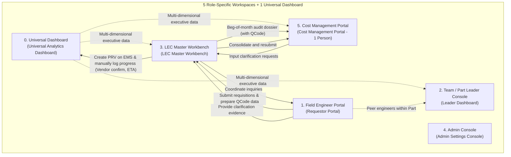

# In-Depth UI/UX Critical Evaluation & Architectural Review of Functional Screens
> **UI Architecture Audit Document — Factory HW (Smart Watch) Spare Parts Procurement & Management System**  
> *Comprehensive Evaluation of 6 Interface Spaces: Universal Dashboard + 5 Role-Specific Consoles*  
> *Core Principles: Elimination of HW Warehouse Portal (warehouse keepers do not use the system; issuance is synced from EMS); Bypassing internal approval workflows (official approvals on EMS; system ONLY TRACKS PROGRESS); Peer engineers in Part/Team without process/stage hierarchy; Cost Management (Reviewer & Assistant is 1 single person); Beginning-of-Month Audit & 3-Party Clarification Loop.*

---

## 1. UI Restructuring Context & Guiding Principles

Following thorough integration of operational feedback from factory floor operations:
1.  **5 Role-Specific Dedicated Workspaces**: Field Engineer (Requestor), Team / Part Management (Leader), Team Equipment Management (LEC Master), System Administrator (Admin), and Cost Management Department (Cost Management). **No Warehouse Portal** exists, as inventory issuance data is automatically synchronized from EMS (`ds_Inv`).
2.  **Universal Cross-Functional Progress Dashboard ([`UI-COMMON-00`](file:///wsl.localhost/Ubuntu/home/longp/projects/ops-workflow/procurement-system/05-ui-ux-screen-specifications/00-common-dashboard/screen-universal-analytics-dashboard.md))**: Serves as the data command tower providing a 7-stage procurement progress funnel (no approval buttons on this system), inventory KPIs & aging justification tasks, strict No-Rollover SG budget tracking, and 6-code Over analysis (strictly separating Over from Procurement vs. Over from Warehouse Issuance read from EMS).
3.  **Standardized Core Operational Workflows**:
    *   **System tracks progress only**: Absolutely no PRV/PO approval actions take place on this application; all official approvals are executed exclusively on **LG Display Nexacro EMS**.
    *   **BEGINNING-OF-MONTH Audit**: Cost audit sessions and unconsumed aging inventory reviews take place at the beginning of each month (Days 01-05) with Cost Management.
    *   **Audit Prerequisite**: Official registered **QCode is strictly mandatory**. Dragging and dropping CAD/Doc/image folders is purely a **technical data preparation step** for the LEC to register the QCode on external ERP/EMS; temporary `TMP-HW-xxxx` codes are strictly blocked from audit.
    *   **Target vs. Over Classification**: **Strictly non-automated**; the LEC personally evaluates and manually classifies each item.
    *   **Deadlines**: Justification submission deadlines and audit dossier finalization deadlines are **configured and governed by the LEC**.
    *   **Cross-Team Stock Warning (`agingInterlockFlag`)**: Triggers an immediate warning banner upon requisition creation; the system maintains a persistent mandatory task to borrow/use peer team stock before purchasing, which auto-closes only when EMS re-sync confirms the flag is `'N'`.
    *   **3-Party Clarification Loop**: Reviewer (Cost Management offline) $\rightarrow$ LEC inputs inquiries into system $\rightarrow$ Requestor Engineer replies to LEC with evidence $\rightarrow$ LEC consolidates and resubmits to Reviewer.
    *   **Inbound Delivery Progress**: Physical receipt validation is verified on EMS; preceding milestones (Vendor Confirm Date, ETA to port/plant, Monthly Expense Allocation Plan) are logged and monitored on this system.

---

## 2. Detailed Architectural Evaluation of Each Workspace

---

### 2.1. Universal Dashboard: Comprehensive Progress Control Dashboard (`UI-COMMON-00`)

* **Functional Analysis**:
  - Consolidates 5 core data blocks: 7-stage procurement progress funnel (from QCode data preparation to goods receipt), Inventory KPIs & Aging Justification Tasks, SG Budget No-Rollover Balance, 6-code Over Analysis (`OVR-01..06`), and Detailed Over Items Table (distinguishing Over from Procurement vs. Over from Warehouse Issuance synced from EMS).
* **Critique & Optimization**:
  1. *Information Overload Risk*: Engineers or Part Leaders could get distracted by facility-wide metrics.
     - *Solution*: Context Auto-Scoping based on login credentials. When an engineer opens the Dashboard, data automatically scopes to their assigned Line and machines.
  2. *Performance Latency in Calculating Over Lists*: Scanning thousands of EMS warehouse issuance records and purchase orders could degrade Dashboard responsiveness.
     - *Solution*: An `ops-workflow` Read-Model table updated via asynchronous background workers, enabling sub-50ms query responses.

---

### 2.2. Field Engineer Portal (`UI-ROLE-01: Requestor Portal`)

* **Functional Analysis**:
  - 100% friendly equipment names, instant 50ms stock checks, CAD/Doc/image folder upload for preparing data to register QCodes on external ERP/EMS.
  - Instant warning for peer team stock (`agingInterlockFlag = Y`), maintaining a mandatory stock borrowing task until EMS syncs `'N'`.
  - Beginning-of-month aging inventory justification tasks before LEC deadlines.
  - 3-party clarification channel with LEC.
* **Critique & Optimization**:
  1. *Engineer creates new purchase despite existing peer team stock*:
     - *Solution*: Instant amber warning banner upon part selection, coupled with a mandatory task that cannot be manually dismissed. The task auto-closes only when the EMS API confirms `agingInterlock` reverts to `'N'`.
  2. *Confusion between CAD folder upload and audit readiness*:
     - *Solution*: UI explicitly emphasizes that uploading folders generates only a temporary `TMP-HW-xxxx` code for LEC QCode registration; line items qualify for audit only once assigned an official QCode.

---

### 2.3. Team / Part Leader Console (`UI-ROLE-02: Leader Dashboard`)

* **Functional Analysis**:
  - Hierarchical procurement monitoring `Team => Part => Peer Engineers` (eliminating process/stage hierarchy).
  - Monitoring beginning-of-month aging stock justifications and progress on peer-team stock borrow tasks.
  - Tracking Target vs. Over proportions as categorized by LEC.
* **Critique & Optimization**:
  1. *Role conflict regarding approvals*: Prevent leaders from expecting approval buttons on the new interface.
     - *Solution*: The Leader Dashboard **strictly features no Endorse / Approve / Reject buttons**. All approvals occur on EMS. The dashboard functions purely for monitoring, oversight, and internal peer communication.

---

### 2.4. LEC Master Workbench within Team (`UI-ROLE-03: LEC Master Workbench`)

* **Functional Analysis**:
  - Multi-LEC support for comprehensive batch grouping across the team.
  - 4-step Interlock scans, `agingInterlockFlag` (borrowing peer team stock), `unitPriceFlag` (active pricing vs. awaiting RFQ).
  - External ERP QCode registration from engineer folders.
  - Setting justification and audit deadlines.
  - **Manual categorization** of `[WITHIN TARGET]` vs. `[OVER UNBUDGET]` (strictly no auto-classification).
  - **3-party bridge**: Inputting inquiries from Reviewer (Cost Management) $\rightarrow$ forwarding to engineer $\rightarrow$ collecting feedback $\rightarrow$ resubmitting to Reviewer.
  - **Manual inbound delivery tracking**: Logging Vendor Confirmation Date, ETA to port/plant, and Monthly Expense Allocation Plan; final physical receiving validation verified on EMS.

---

### 2.5. Operations Settings & Configuration Console (`UI-ROLE-05: Admin Settings Console`)

* **Functional Analysis**:
  - Full system configuration across 6 Tabs: Reorder logic, Line topology with `Left(Line, 1) = Floor` (no process hierarchy), standard 3-tier organizational structure, SG Budget No-Rollover & LEC Deadlines, Nexacro Gateway Rate Limiting, and Over code dictionaries.
* **Critique & Optimization**:
  - Ensures strict RBAC enforcement across 5 roles, completely removing Warehouse Keeper permissions, supported by full administrative audit logging.

---

### 2.6. Cost Management Audit Portal (`UI-ROLE-06: Cost Management Portal`)

* **Functional Analysis**:
  - Dedicated exclusively to the **Cost Management Department (Reviewer & Assistant is 1 single person)**.
  - Serves beginning-of-month cost audits and unconsumed inventory aging reviews (Days 01-05).
  - Scrutinizes requisitions possessing **official QCodes** and categorized by LEC into Target vs. Over (`OVR-01..06`).
  - **Clarification Dispatch Tab**: Inputs inquiries requiring engineer clarification and routes them to LEC.
  - Archives digitized offline audit minutes. *(Official budget approvals occur on EMS)*.

---

## 3. Summary Table of Feasibility & Maturity Evaluation

| Interface Workspace | Primary Role | Maturity Rating | Core Strengths | Optimized Architectural Mechanism |
| :--- | :--- | :---: | :--- | :--- |
| **`UI-COMMON-00`** | Facility-wide shared | **9.9 / 10** | 7-stage progress funnel (no approval buttons); isolates Over Procurement vs. Over Issuance from EMS; No-Rollover. | Context auto-scoping; Read-Model ops-workflow <50ms. |
| **`UI-ROLE-01`** | Requestor (Peer Engineer) | **9.8 / 10** | Friendly equipment names; Instant peer stock warning; Folder upload for QCode prep; Task persists until EMS='N'. | Amber warning banner upon part select; 3-party clarification via LEC. |
| **`UI-ROLE-02`** | Team / Part Leader | **9.7 / 10** | Monitors `Team => Part => Peers`; tracks aging tasks & Target vs Over; strictly zero approval buttons. | Process hierarchy eliminated; Modals purely for technical inspection. |
| **`UI-ROLE-03`** | LEC Master in Team | **9.9 / 10** | Team batch grouping; Interlock & stock/price flags; Configures deadlines; Manual Target/Over; 3-party bridge; Logs Vendor/ETA. | Instant PRV verification on EMS; row-locking against concurrent edits. |
| **`UI-ROLE-05`** | System Administrator | **9.9 / 10** | Zero-code 6-Tab configuration; Nexacro Rate Limiting management; No-Rollover; 3-tier organizational tree. | Warehouse keeper role eliminated; Complete configuration audit trail. |
| **`UI-ROLE-06`** | Cost Management (1 person)| **9.8 / 10** | BEGINNING-OF-MONTH audit; Scrutinizes Over with QCode; Clarification requests to LEC; Digitized minutes archive. | Merged Reviewer & Assistant; Online 3-party clarification loop. |

---

## 4. Conclusion

The redesigned UI architecture featuring **1 Universal Dashboard + 5 Role-Specific Workspaces** completely resolves previous operational misalignments and rigorously respects systemic boundaries:
- **New System**: Focuses entirely on progress control, technical data preparation, cross-team inventory interlocks, aging stock justification, and 3-party audit clarification workflows.
- **Core EMS System**: Maintains exclusive authority over formal cost approvals, PO issuance, and actual physical inventory issuance/receiving records.
