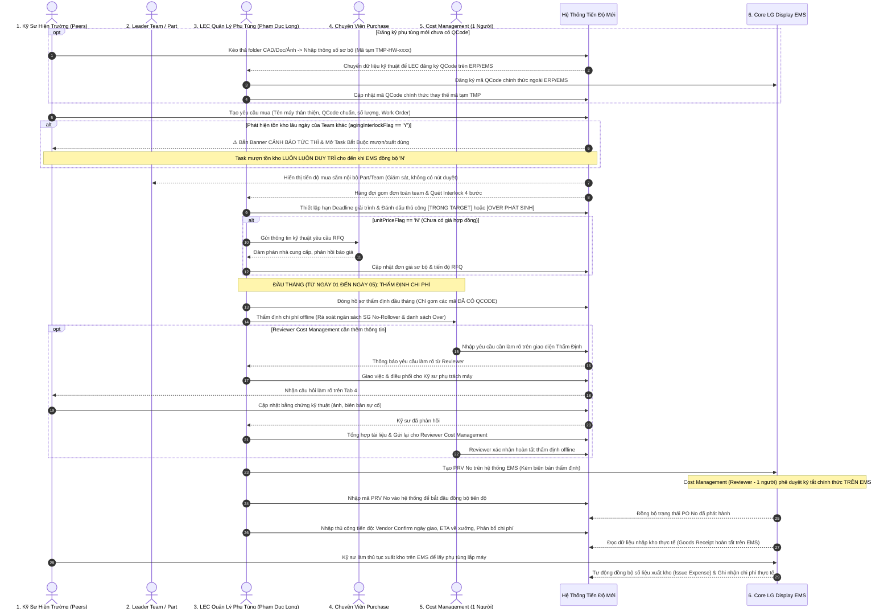
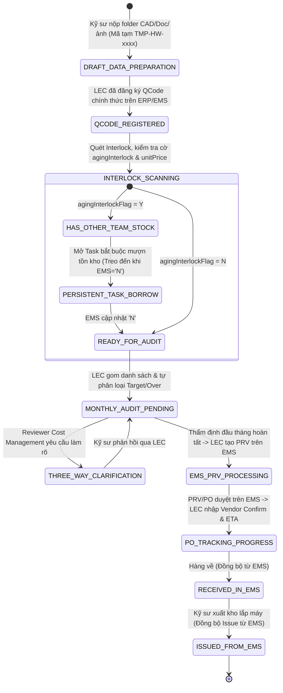

# 01. Sơ Đồ Quy Trình Tổng Thể Đầu - Cuối (End-to-End Procurement Progress Workflow)
> *Kiến trúc kiểm soát tiến độ mua sắm phụ tùng Factory HW (Smart Watch)*  
> *Nguyên tắc cốt lõi: Hệ thống mới kiểm soát tiến độ (KHÔNG PHÊ DUYỆT); Mọi phê duyệt ký tá ngân sách diễn ra trên EMS; Bỏ qua Cổng thủ kho (xuất kho lấy từ EMS); Kỹ sư ngang hàng trong Part/Team; Thẩm định ĐẦU THÁNG với Cost Management (1 người); Luồng phản hồi 3 bên; Bắt buộc có QCode để thẩm định; Nhập tiến độ Vendor Confirm / ETA thủ công.*

---

## 1. Sơ Đồ Quy Trình Hoạt Động (Swimlane Sequence Diagram)

---

## 2. Các Mốc Trạng Thái Vòng Đời Của Yêu Cầu (Requisition State Machine)

Hệ thống quản lý tiến độ qua 8 trạng thái minh bạch:

---

## 3. Các Nguyên Tắc Vận Hành Bất Biến

1. **Tuyệt Đối Không Phê Duyệt Trên Hệ Thống Mới**:
   - Hệ thống mới đóng vai trò là "Bảng điều khiển kiểm soát tiến độ & dữ liệu kỹ thuật". Mọi phê duyệt có giá trị pháp lý và tài chính bắt buộc phải thực hiện trên **LG Display Nexacro EMS**.
2. **Loại Bỏ Hoàn Toàn Cổng Thủ Kho**:
   - Nhân viên kho không sử dụng ứng dụng này. Số liệu xuất kho, nhập kho và tồn kho vật lý được đọc tự động qua các API tích hợp của EMS.
3. **Điều Kiện Đủ Để Thẩm Định Chi Phí**:
   - Bắt buộc phải có **Mã QCode chính thức**. Mọi phụ tùng mới còn mang mã tạm `TMP-HW-xxxx` chỉ dừng ở giai đoạn chuẩn bị dữ liệu, không được đưa vào đợt thẩm định đầu tháng.
4. **Cảnh Báo Tồn Kho Khác Team Là Task Bắt Buộc**:
   - Kỹ sư không phải giải trình lý do chưa xuất, nhưng bắt buộc phải ưu tiên liên hệ mượn/xuất kho của Team bạn. Task này không thể bấm đóng thủ công; chỉ khi hệ thống đọc lại EMS thấy cờ chuyển `'N'`, Task mới tự động hoàn tất.
