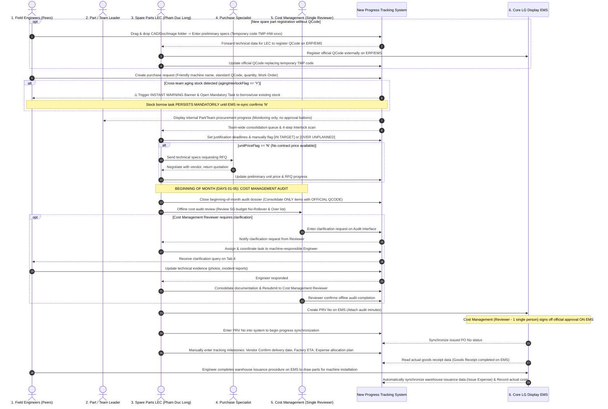
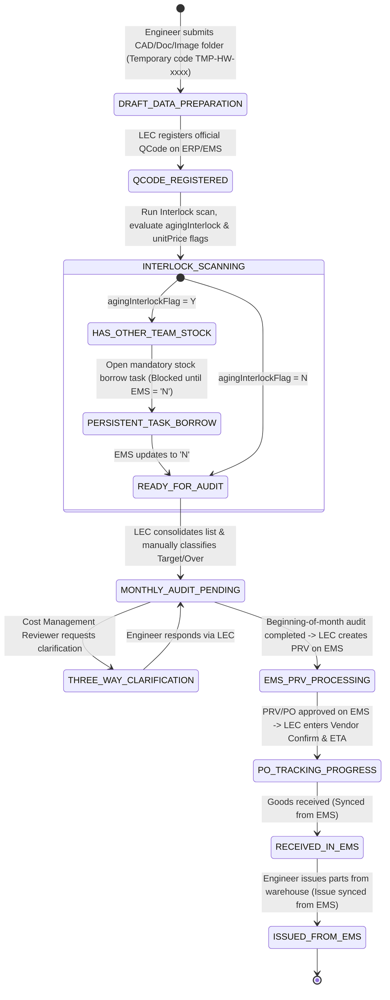

# 01. End-to-End Procurement Progress Workflow
> *Procurement progress tracking architecture for Factory HW (Smart Watch) spare parts*  
> *Core Principles: The new system tracks progress ONLY (NO APPROVALS); All financial budget sign-offs occur exclusively on EMS; No Warehouse Portal (issuance synced from EMS); Peer engineers in Part/Team; BEGINNING-OF-MONTH audit with Cost Management (1 single person); 3-party clarification loop; Mandatory official QCode for audit; Manual entry for Vendor Confirm Date / ETA tracking.*

---

## 1. Swimlane Sequence Diagram

---

## 2. Requisition Lifecycle State Machine

The system tracks progress across 8 transparent states:

---

## 3. Immutable Operational Principles

1. **Strictly No Approvals on the New System**:
   - The new system serves solely as a "Progress Tracking & Technical Data Control Dashboard". All legal, administrative, and financial approvals must take place on **LG Display Nexacro EMS**.
2. **Complete Elimination of Warehouse Portal**:
   - Warehouse personnel do not use this application. Inventory movements, physical receipts, and material issuance are read automatically through EMS integration APIs.
3. **Mandatory Prerequisite for Cost Audit**:
   - Requisitions strictly require an **Official QCode**. Any new spare parts retaining temporary codes (`TMP-HW-xxxx`) remain in the data preparation stage and are strictly excluded from the beginning-of-month audit.
4. **Cross-Team Aging Stock Warning is a Mandatory Task**:
   - While engineers do not need to submit delayed issuance justifications, they are mandated to prioritize borrowing and utilizing stock available in peer teams. This task cannot be closed manually; it automatically resolves only when the system re-syncs with EMS and confirms the flag is `'N'`.
