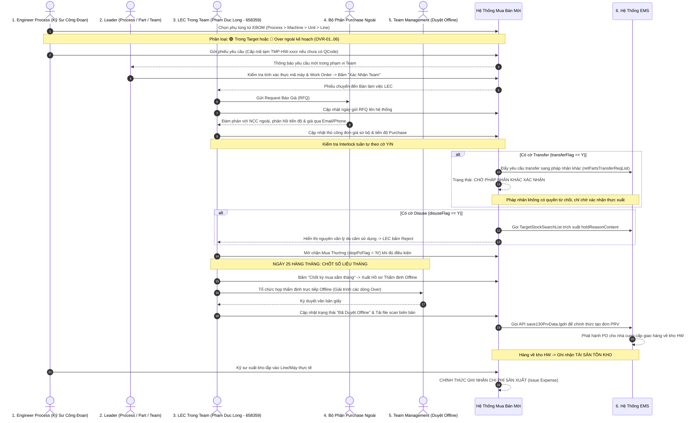
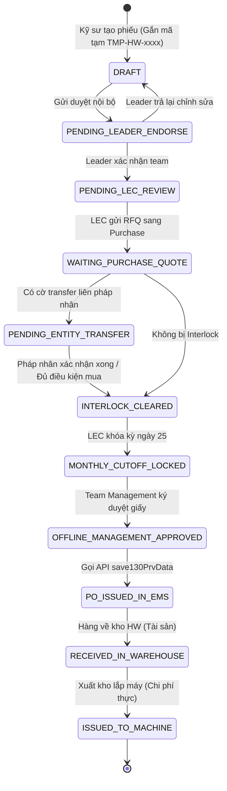

# 01. Sơ Đồ Quy Trình Tổng Thể Đầu - Cuối (End-to-End Procurement Workflow)

## 1. Sơ Đồ Quy Trình Hoạt Động (Swimlane Process Diagram)

Quy trình chuẩn hóa sự tham gia của 6 tác nhân chính:

---

## 2. Các Mốc Trạng Thái Vòng Đời Của Yêu Cầu (Requisition State Machine)

