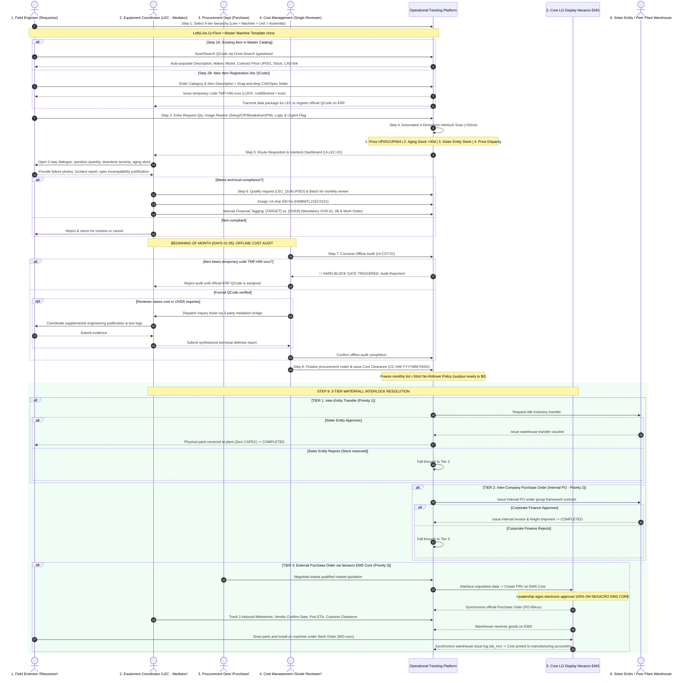
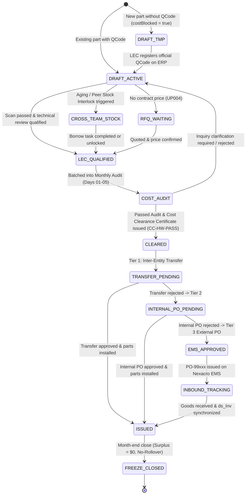

# 01. End-to-End Procurement Progress Workflow
> *Procurement progress tracking architecture for Factory HW (Smart Watch) spare parts*  
> *Core Principles: The new system tracks progress ONLY (NO APPROVALS); All financial budget sign-offs occur exclusively on Nexacro EMS Core; No Warehouse Portal (issuance synced from EMS); Peer engineers in Part/Team; BEGINNING-OF-MONTH audit with Cost Management (1 single person); 3-party clarification loop; Mandatory official QCode for audit; 3-Tier waterfall execution (Transfer -> Internal PO -> External PO).*

---

## 1. Swimlane Sequence Diagram (9-Step Lifecycle)

---

## 2. Requisition Lifecycle State Machine

The system tracks progress across transparent operational states:

---

## 3. Sequential Architectural Rules

1. **No PO Release for Temporary Codes (`TMP-HW-xxxx`)**:
   - Requisitions bearing temporary codes remain strictly in `DRAFT_TMP` with `costBlocked = true`.
   - Cannot enter Step 7 Cost Audit nor generate EMS PRVs.
2. **Dedicated LEC Mediation Bridge**:
   - Reviewer never interacts directly with field engineers during the audit. All inquiry dispatches route through LEC.
3. **Execution strictly follows the 3-Tier Waterfall**:
   - $\text{Tier 1: Transfer} \xrightarrow{\text{Reject}} \text{Tier 2: Internal PO} \xrightarrow{\text{Reject}} \text{Tier 3: External PO on Nexacro Core}$.
4. **All Financial Approvals 100% on Nexacro EMS Core**:
   - The web platform provides intelligence, progress tracking, and audit collaboration, but PRV/PO approvals take place exclusively within the Nexacro EMS Core binary.
