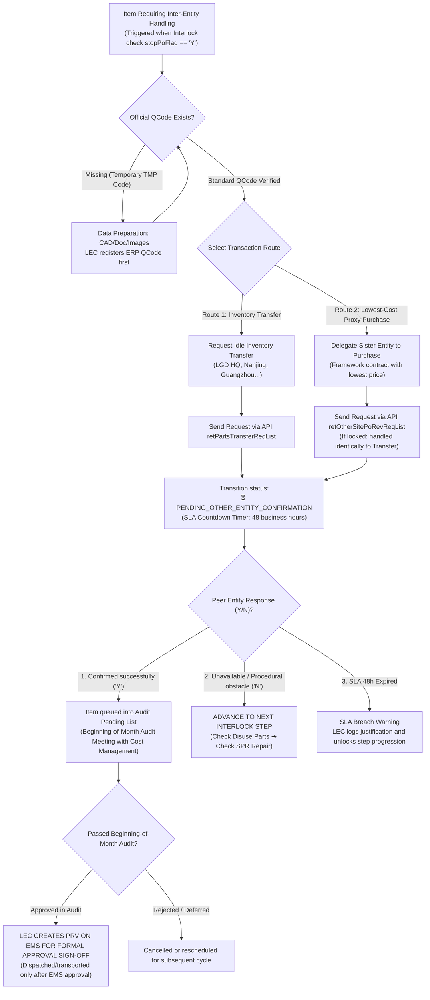

# 02. Process Workflow: Inter-Entity Transactions (Inventory Transfer & Lowest-Cost Proxy Purchase)
> *Standardizing 2 Inter-Entity Transaction Branches, Y/N Confirmation Mechanism, Mandatory Official QCode Prerequisite & Execution Post Beginning-of-Month Audit*

---

## 1. Detailed Flowchart: 2 Inter-Entity Transaction Branches

---

## 2. Business Specifications & Sequential Constraints

### 2.1. Clear Distinction Between the Two Branches
1.  **Inventory Transfer**:
    - Applied when spare parts are already available in a peer entity's warehouse as excess safety stock or idle inventory.
    - Saves 100% of the cost of purchasing new parts from external suppliers.
2.  **Lowest-Cost Proxy Purchase from Peer Entity**:
    - Applied when an external supplier provides the identical component to LGD Korea or China at a lower unit contract price than quoted for LGD Vietnam.
    - If the purchase channel via the peer entity is also system-locked: Process identically to a Transfer order (dispatch request for partner confirmation, await response within 48 hours).

### 2.2. Mandatory Trigger Condition: After Beginning-of-Month Audit
> ⚠️ **APPROVAL & LEGAL CONSTRAINT**:  
> Even if the peer entity confirms agreement to transfer or purchase on our behalf (`status == 'CONFIRMED'`), **strictly no warehouse issuance orders or purchase orders may be issued prior to the Beginning-of-Month Audit review with the Cost Management department (Reviewer & Assistant is 1 single person)**.  
> Only after passing the offline audit will the LEC proceed to create a PRV on EMS for official management approval sign-off. Any transaction takes legal and financial effect only when EMS approval is fully completed.
