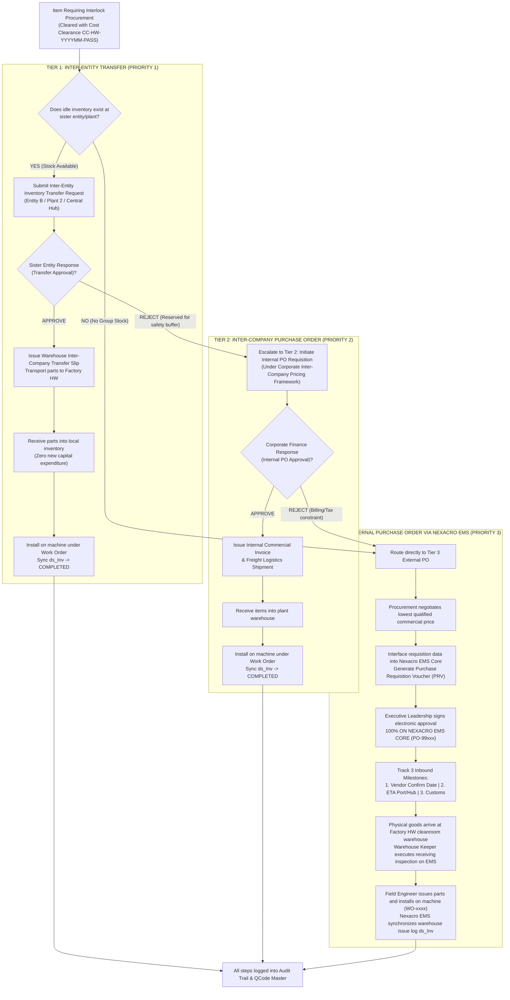

# 02. Process Workflow: 3-Tier Waterfall Interlock Resolution & Inter-Entity Execution
> *Standardizing the 3-Tier Waterfall Resolution: Tier 1 Transfer -> Tier 2 Internal PO -> Tier 3 External Market Purchase via Nexacro EMS Core*

---

## 1. Detailed Flowchart: 3-Tier Waterfall Procurement Execution

---

## 2. Business Specifications & Priority Ranking

### 2.1. The 3 Tiers Defined

1. **Tier 1: Inter-Entity Inventory Transfer (Chuyển Giao Kho Liên Pháp Nhân)**:
   - **Trigger**: Interlock scan detects surplus or idle components at sister factories (Entity B, Plant 2, Central Hub).
   - **Cost Impact**: **Zero new capital outflow**. Utilizes previously capitalized inventory.
   - **Action if Approved**: Generates warehouse transfer slip, moves stock between entity sub-inventories.
   - **Action if Rejected**: Sister plant reserves parts for their own emergency buffer $\rightarrow$ Automatically escalates to Tier 2.

2. **Tier 2: Inter-Company Purchase Order (Mua Hàng Nội Bộ - Internal PO)**:
   - **Trigger**: Transfer is rejected, but sister entity is willing to sell component via inter-company commercial agreement.
   - **Cost Impact**: Group-internal transfer pricing (typically lower than open market spot quotes).
   - **Action if Approved**: Internal purchase order released, cross-entity billing executed.
   - **Action if Rejected**: Inter-company budget exhaustion, cross-border customs restrictions, or tax tariff constraints $\rightarrow$ Automatically escalates to Tier 3.

3. **Tier 3: External Market Purchase via Nexacro EMS Core (Mua Thường Cục Bộ Giá Thấp Nhất)**:
   - **Trigger**: Neither transfer nor internal purchase is viable. External market procurement is mandatory.
   - **Governance**: Procurement department solicits competitive quotations to identify the lowest qualified market price.
   - **Approval Rule**: Requisition is interfaced into **LG Display Nexacro EMS Core**. Executive leadership signs PRV and PO **100% on Nexacro EMS Core**. The web platform is read-only for PO approval.
   - **Execution**: Official PO (`PO-99xxx`) released to external vendor. LEC tracks 3 Inbound milestones (`Vendor Confirm Date`, `ETA Port`, `Customs Clearance`). Parts received, installed under Work Order, and synchronized via `ds_Inv` into manufacturing product cost accounting.

---

## 3. Sequential Architectural Rules

1. **Mandatory Prerequisite: Cost Clearance Certificate (`CC-HW-YYYYMM-PASS`)**:
   - Strictly no Tier 1, Tier 2, or Tier 3 actions may proceed before the Cost Management Team formally approves the Beginning-of-Month Audit (Days 01–05) and issues the Cost Clearance Certificate.
2. **Deterministic Fall-Through**:
   - The system strictly enforces the sequential priority waterfall: $\text{Tier 1} \xrightarrow{\text{Reject}} \text{Tier 2} \xrightarrow{\text{Reject}} \text{Tier 3}$. No arbitrary bypassing of Tier 1 or Tier 2 is permitted.
