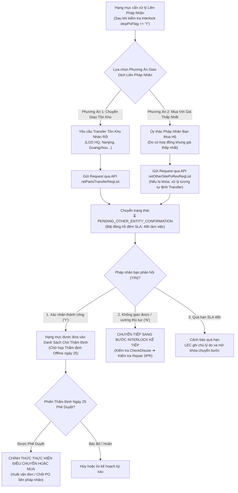

# 02. Sơ Đồ Quy Trình: Giao Dịch Liên Pháp Nhân (Chuyển Giao Tồn Kho & Mua Giá Thấp Nhất)
> *Chuẩn Hóa 2 Nhánh Giao Dịch Liên Pháp Nhân, Cơ Chế Chờ Xác Nhận Y/N & Điều Kiện Bắt Buộc Sau Thẩm Định Ngày 25*

---

## 1. Lưu Đồ Chi Tiết 2 Nhánh Giao Dịch Liên Pháp Nhân

---

## 2. Đặc Tả Nghiệp Vụ & Ràng Buộc Tuần Tự

### 2.1. Phân Biệt Rõ Ràng Hai Nhánh
1.  **Chuyển Giao Tồn Kho (Inventory Transfer)**:
    - Áp dụng khi phụ tùng đang nằm sẵn trong kho của pháp nhân bạn dưới dạng tồn kho an toàn vượt mức hoặc phụ tùng nhàn rỗi.
    - Tiết kiệm 100% chi phí mua mới từ nhà cung cấp bên ngoài.
2.  **Mua Với Giá Thấp Nhất Từ Pháp Nhân Khác (Lowest-Cost Proxy Purchase)**:
    - Áp dụng khi nhà cung cấp ngoài bán cùng một linh kiện cho LGD Hàn Quốc hoặc Trung Quốc với đơn giá rẻ hơn nhiều so với báo giá cho LGD Việt Nam.
    - Nếu kênh mua qua pháp nhân bạn cũng bị khóa hệ thống: Quy trình xử lý **hoàn toàn tương tự như lệnh Transfer** (gửi yêu cầu đối tác xác nhận, chờ phản hồi trong vòng 48h).

### 2.2. Điều Kiện Kích Hoạt Bắt Buộc: Sau Khi Thẩm Định Ngày 25
> ⚠️ **RÀNG BUỘC PHÊ DUYỆT**:  
> Dù pháp nhân bạn đã phản hồi đồng ý chuyển giao hoặc mua hộ (`status == 'CONFIRMED'`), **tuyệt đối không được phát hành lệnh xuất kho hay ký hợp đồng trước phiên Thẩm định Offline ngày 25**.  
> Chỉ sau khi Ban Quản Lý thẩm định tính hợp lý và ký biên bản, hệ thống mới chính thức giải phóng khóa để thực hiện giao dịch.
