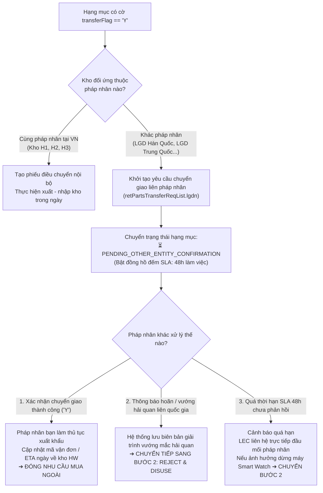

# 02. Sơ Đồ Quy Trình: Điều Chuyển Liên Pháp Nhân & Chờ Xác Nhận

## 1. Lưu Đồ Chi Tiết Quy Trình Bước 1 Interlock (Transfer)

### Điểm nhấn pháp lý quan trọng:
- Pháp nhân sở hữu kho **không có quyền từ chối lệnh chuyển giao của tập đoàn**.
- Phiếu điều chuyển chỉ chuyển trạng thái hoặc chuyển sang mua mới khi có xác nhận chính thức về rào cản logistics xuất nhập khẩu hoặc kiểm kê thực tế thiếu hụt từ pháp nhân đó.

