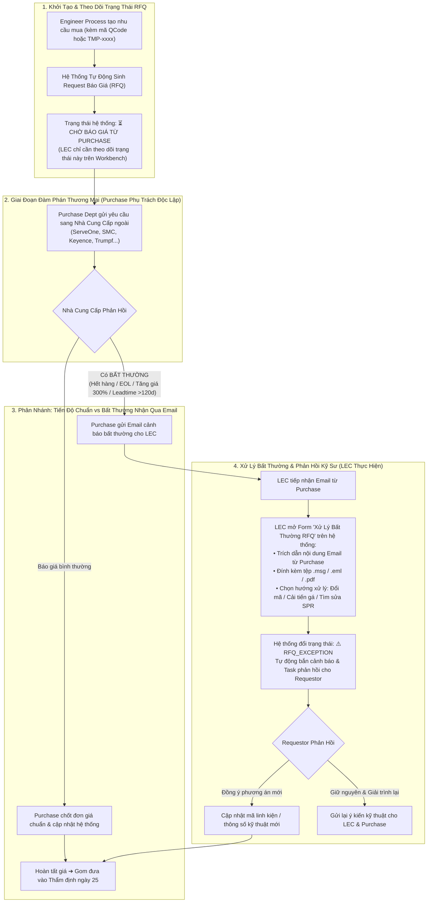

# 03. Sơ Đồ Quy Trình: Theo Dõi Trạng Thái Báo Giá (RFQ) & Xử Lý Bất Thường Từ Email
> *Ranh Giới Nghiệp Vụ Chuẩn Hóa: Purchase Làm Giá Với Nhà Cung Cấp, LEC Chỉ Theo Dõi Trạng Thái & Xử Lý Bất Thường Nhận Qua Mail*

---

## 1. Lưu Đồ Chi Tiết Vòng Đời Báo Giá & Luồng Xử Lý Bất Thường

---

## 2. Đặc Tả Nghiệp Vụ Xử Lý Bất Thường Của LEC

1.  **Không gây quá tải cho LEC**: LEC không phải chuyên viên đàm phán thương mại. Mọi công việc liên hệ hãng, xin chiết khấu do Purchase đảm nhận 100%. LEC chỉ cần mở hệ thống giám sát tiến độ (đang chờ, đã có giá sơ bộ, hay có vướng mắc).
2.  **Minh bạch nguyên nhân chậm trễ**: Khi có sự cố (ví dụ NCC báo thời gian giao hàng mất 6 tháng do khủng hoảng chip toàn cầu), email gốc từ Purchase được LEC đưa lên hệ thống làm bằng chứng minh bạch, triệt tiêu việc nghi ngờ lẫn nhau giữa Kỹ sư hiện trường và bộ phận văn phòng.
3.  **Tự động liên thông với CSDL Master Data**: Nếu email bất thường xác nhận mã phụ tùng đã bị nhà máy ngừng sản xuất, LEC bấm xác nhận phân loại lại thành `Ngừng sản xuất (EOL)` $\rightarrow$ toàn bộ hệ thống EBOM được cập nhật tức thì.
