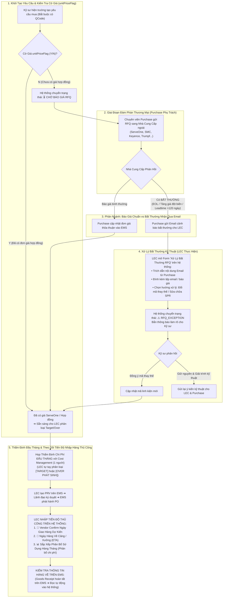

# 03. Sơ Đồ Quy Trình: Theo Dõi Báo Giá (RFQ), Xử Lý Bất Thường & Kiểm Soát Tiến Độ Nhập Hàng
> *Ranh Giới Nghiệp Vụ Chuẩn Hóa: Purchase Làm Giá Với Nhà Cung Cấp, LEC Theo Dõi Tiến Độ RFQ, Xử Lý Bất Thường Từ Email, và Nhập Thủ Công Các Mốc Tiến Độ Nhập Hàng (Vendor Confirm, ETA, Phân Bổ Chi Phí Hàng Tháng; Hàng Về Kiểm Tra Trên EMS)*

---

## 1. Lưu Đồ Chi Tiết Vòng Đời Báo Giá & Kiểm Soát Tiến Độ Nhập Hàng

---

## 2. Đặc Tả Nghiệp Vụ Xử Lý & Kiểm Soát Tiến Độ

1.  **Ranh Giới Rõ Ràng Về Báo Giá**:
    - LEC không làm thay công việc thương mại của Purchase. Mọi thủ tục đàm phán, chiết khấu thuộc trách nhiệm của bộ phận Mua hàng. LEC chỉ theo dõi trạng thái cờ `unitPriceFlag` trên hệ thống.
2.  **Minh Bạch Sự Cố Qua Email**:
    - Khi có chậm trễ ngoài mong muốn (hãng ngừng sản xuất EOL, thời gian giao hàng kéo dài), LEC đưa nguyên văn email từ Purchase lên hệ thống để kỹ sư nắm rõ, loại bỏ hoàn toàn việc nghi ngờ chậm trễ thủ tục.
3.  **Kiểm Soát Tiến Độ Nhập Hàng Thủ Công**:
    - **Thông tin hàng về cuối cùng**: Chỉ cần kiểm tra và đọc tự động từ hệ thống Core EMS khi kho hoàn tất thủ tục nhập kho.
    - **Các mốc trước khi hàng về**: Do EMS không quản lý chi tiết các mốc trung gian của nhà sản xuất, LEC sẽ **nhập thủ công trên hệ thống này**:
      * **Vendor Confirm Ngày Nhận**: Ngày nhà cung cấp chính thức xác nhận xuất xưởng.
      * **ETA (Estimated Time of Arrival)**: Ngày dự kiến hàng cập cảng hoặc về đến nhà máy HW.
      * **Sắp Xếp Phân Bổ Sử Dụng Hàng Tháng**: Kế hoạch chia nhỏ số lượng sử dụng theo từng tháng để cân đối phân bổ chi phí ngân sách SG, tránh dồn cục chi phí làm vượt trần ngân sách tháng.
