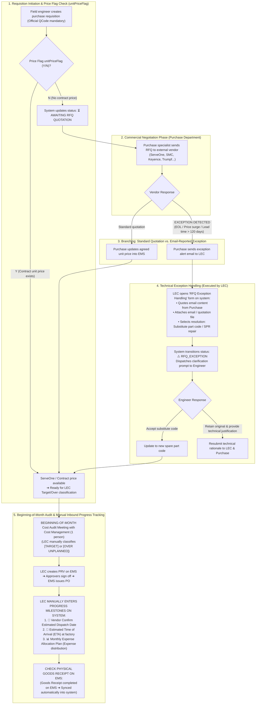

# 03. Process Workflow: RFQ Tracking, Exception Handling & Goods Receipt Progress Monitoring
> *Standardized Operational Boundaries: Purchase Negotiates Pricing with Suppliers, LEC Tracks RFQ Progress, Handles Email Exceptions, and Manually Enters Inbound Progress Milestones (Vendor Confirm Date, ETA, Monthly Expense Allocation Plan; Physical Goods Receipt Checked on EMS)*

---

## 1. Detailed Flowchart: Quotation Lifecycle & Inbound Progress Monitoring

---

## 2. Business Specifications & Progress Monitoring

1.  **Clear Boundary on Quotations**:
    - The LEC does not handle commercial pricing duties in place of Purchase. All supplier negotiations, quotations, and volume discounts are the sole responsibility of the Purchasing department. The LEC only monitors the `unitPriceFlag` status in the system.
2.  **Transparency for Email-Reported Exceptions**:
    - When unexpected delays or roadblocks occur (manufacturer End-of-Life [EOL], abnormal lead times), the LEC quotes the verbatim email received from Purchase into the system so engineers have immediate visibility, eliminating misunderstandings or suspicion of administrative delays.
3.  **Manual Inbound Progress Monitoring**:
    - **Final Goods Receipt Verification**: Inspected and verified directly on Core EMS; once the warehouse completes physical goods receipt, the status is automatically synchronized into the system.
    - **Intermediate Milestones Prior to Arrival**: Because EMS does not record upstream manufacturer milestones, the LEC **manually enters them in this system**:
      * **Vendor Confirm Estimated Dispatch Date**: The date the vendor officially confirms outbound shipment from their manufacturing facility.
      * **Estimated Time of Arrival (ETA)**: Projected arrival date at port or delivery at the HW factory floor.
      * **Monthly Expense Allocation Plan**: Schedule dividing projected material usage across calendar months to balance SG budget expense allocations and prevent single-month budget cap overruns.
