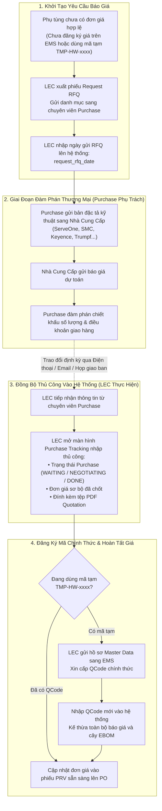

# 03. Sơ Đồ Quy Trình: Khảo Sát Báo Giá & Phối Hợp Thủ Công Với Purchase

## 1. Lưu Đồ Chi Tiết Vòng Đời Báo Giá (RFQ Flow)

Do EMS hoàn toàn không quản lý các bước đàm phán trung gian của Bộ phận Mua Hàng (Purchase), luồng thông tin vận hành như sau:

