# 04. Process Workflow: Within Target vs. Unplanned Over Classification & LEC Authority
> *Engineers Provide Rationale/Current Status, Official QCode Is Mandatory, LEC Manually Flags Classification (Strictly No Auto-Classification), Dual-Axis Cost Reconciliation (Procurement Commit vs. Warehouse Issuance Synced from EMS), Strict No-Rollover SG Budget & Beginning-of-Month 3-Party Clarification Loop*

---

## 1. Detailed Flowchart: LEC Classification Decision Flow

```mermaid
flowchart TD
    Start["Field Engineer Creates Purchase Request"] --> CheckQCode{"Official QCode Exists?"}
    
    CheckQCode -->|"Missing (Temporary code TMP-HW-xxxx)"| HoldData["Data Preparation: CAD/Doc/Images\nLEC registers ERP QCode first\n(Ineligible for audit)"]
    HoldData --> CheckQCode
    
    CheckQCode -->|"Standard QCode Verified"| CheckStock{"Check agingInterlockFlag"}
    
    CheckStock -->|"Y (Cross-team stock exists)"| StockAlert["⚠️ INSTANT CROSS-TEAM STOCK WARNING\n• Open mandatory task to borrow/issue stock\n• Task persists until EMS re-sync returns 'N'"]
    StockAlert --> StockResolved{"Stock borrowed & EMS flag is 'N'?"}
    StockResolved -->|"No"| StockAlert
    StockResolved -->|"Yes ('N')"| EngineerInput
    
    CheckStock -->|"N"| EngineerInput["Engineer Provides Field Data:\n• Select Mode: Periodic Restocking OR Machine Breakdown\n• Enter Breakdown Work Order code (if applicable)\n• Propose preliminary root cause code (OVR-01 through OVR-06)"]
    
    EngineerInput --> LEC_Review["LEC Opens Budget Reconciliation Workbench:\n• Check Monthly Budget Ceiling (Manual, Strict No-Rollover)\n• Review machine technical characteristics & maintenance history"]
    
    LEC_Review --> EvalCheck{"LEC Manual Evaluation (Strictly No Auto-Classification)"}
    
    EvalCheck -->|"Within BOM allowance & safety stock"| ActionTarget["LEC MANUALLY FLAGS: 🟢 WITHIN TARGET\n(Within recurring operational expense ceiling)"]
    
    EvalCheck -->|"Unplanned variance / Exceeds budget ceiling"| ActionOver["LEC MANUALLY FLAGS: 🔴 UNPLANNED OVER\n(Attach 1 of 6 root cause codes OVR-01..06)"]
    
    ActionOver --> SplitFlow{"Classify by Nature of Expense"}
    
    SplitFlow -->|"Incurred from New Purchase Requisition"| OverPO["🔴 PROCUREMENT OVER (PO COMMIT OVER)\n• Tag PRV/PO number, Supplier\n• Enqueue into BEGINNING-OF-MONTH Audit list"]
    
    SplitFlow -->|"Incurred from Warehouse Issuance for Machine (EMS)"| OverIssue["🔴 WAREHOUSE ISSUANCE OVER (ISSUE EXPENSE OVER - EMS SYNC)\n• Tag Machine Name, Work Order\n• System reads automatically from EMS warehouse issuance data"]
    
    ActionTarget --> AuditQueue["CONSOLIDATE INTO BEGINNING-OF-MONTH AUDIT DOSSIER (Official QCode Required)"]
    OverPO --> AuditQueue
    
    AuditQueue --> EarlyMonthAudit["BEGINNING-OF-MONTH COST AUDIT MEETING (Cost Management - 1 Single Person)"]
    EarlyMonthAudit --> ThreeWayLoop{"Reviewer requests clarification?"}
    ThreeWayLoop -->|"Inquiries raised"| Clarify["Reviewer enters query ➔ LEC routes to Engineer ➔ Engineer responds ➔ LEC submits to Reviewer"]
    Clarify --> EarlyMonthAudit
    ThreeWayLoop -->|"Audit completed"| EMS_Approve["LEC creates PRV on EMS ➔ Approvers sign off formally on EMS"]
```

---

## 2. RACI Responsibility Assignment Matrix

| Operational Step | Field Engineers (Requestor) | Equipment Management Engineer (LEC) | Part / Team Leader | Cost Management (1 Single Person) |
| :--- | :---: | :---: | :---: | :---: |
| Drag & drop CAD/Doc folder for QCode data preparation | **R** (Executes) | A (Registers ERP/EMS) | I (Monitors) | I |
| Enter machine status & Work Order | **R** (Executes) | I (Informed) | I (Monitors) | I |
| Propose preliminary Over root cause code | **R** (Proposes) | C (Reviews) | I | I |
| **Manually flag `TARGET` / `OVER` (Strictly no auto-classification)** | I | **R / A (Sole Authority)** | I | I |
| Set justification & audit deadlines | I | **R / A (Full configuration authority)** | I | I |
| Monthly budget reconciliation (Strict No-Rollover) | I | **R (Executes)** | I | C (Reviews) |
| Offline beginning-of-month cost audit & 3-party clarification loop | C (Responds to LEC) | **R** (Defends & consolidates) | I (Monitors) | **A (Sole Reviewer)** |
| Official PRV / PO approval on EMS | I | **R** (Creates EMS requisition) | A (Approves on EMS) | **A (Approves budget on EMS)** |

*(Legend: R: Responsible - Executes the task, A: Accountable - Has final decision/authority, C: Consulted - Provides input/feedback, I: Informed - Kept updated)*
