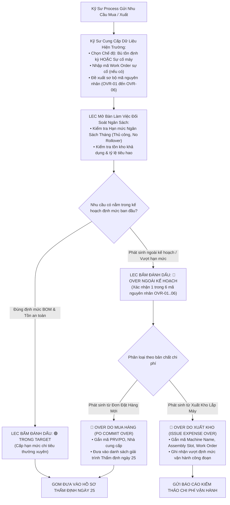

# 04. Sơ Đồ Quy Trình: Phân Loại Trong Target vs Over Ngoài Kế Hoạch & Thẩm Quyền Của LEC
> *Kỹ Sư Cung Cấp Lý Do/Hiện Trạng, LEC Chính Thức Đánh Dấu Cờ Phân Loại, Đối Chiếu Hai Trục Chi Phí (Mua Hàng vs Xuất Kho) & Ngân Sách Không Rollover*

---

## 1. Lưu Đồ Quyết Định Phân Loại Của LEC (Decision Flow)

---

## 2. Bảng Ma Trận Phân Định Trách Nhiệm (RACI Matrix)

| Bước nghiệp vụ | Kỹ sư Quy trình (Requestor) | Kỹ sư Quản trị Thiết bị (LEC) | Leader Công Đoạn | Ban Quản Lý (Management) |
| :--- | :---: | :---: | :---: | :---: |
| Nhập hiện trạng máy & Work Order | **R** (Thực hiện) | I (Nhận tin) | A (Phê duyệt WO) | I |
| Đề xuất mã nguyên nhân Over | **R** (Đề xuất) | C (Tham vấn) | I | I |
| **Đánh dấu chính thức `TARGET` / `OVER`** | I | **R / A (Thẩm quyền duy nhất)** | I | I |
| Đối soát với hạn mức Ngân sách tháng | I | **R (Thực hiện)** | I | C |
| Phê duyệt danh sách Over trong phiên 25 | I | C (Giải trình) | C (Giải trình) | **A (Quyết định tối cao)** |

*(R: Responsible, A: Accountable, C: Consulted, I: Informed)*
