# 04. Sơ Đồ Quy Trình: Phân Loại Trong Target vs Over Ngoài Kế Hoạch & Thẩm Quyền Của LEC
> *Kỹ Sư Cung Cấp Lý Do/Hiện Trạng, Bắt Buộc Phải Có QCode, LEC Tự Tay Đánh Dấu Cờ Phân Loại Thủ Công (Không Tự Động), Đối Chiếu Hai Trục Chi Phí (Mua Hàng vs Xuất Kho Đọc Từ EMS), Ngân Sách Không Rollover & Vòng Phản Hồi 3 Bên Đầu Tháng*

---

## 1. Lưu Đồ Quyết Định Phân Loại Của LEC (Decision Flow)

```mermaid
flowchart TD
    Start["Kỹ Sư Hiện Trường Tạo Yêu Cầu Mua"] --> CheckQCode{"Đã Có Mã QCode Chính Thức?"}
    
    CheckQCode -->|"Chưa có (Mã tạm TMP-HW-xxxx)"| HoldData["Chuẩn bị dữ liệu CAD/Doc/ảnh\nLEC đăng ký QCode ERP trước\n(Chưa đủ điều kiện thẩm định)"]
    HoldData --> CheckQCode
    
    CheckQCode -->|"Đã có QCode chuẩn"| CheckStock{"Kiểm Tra Cờ agingInterlockFlag"}
    
    CheckStock -->|"Y (Có tồn kho Team khác)"| StockAlert["⚠️ CẢNH BÁO TỒN KHO TEAM KHÁC TỨC THÌ\n• Mở Task bắt buộc mượn/xuất kho\n• Duy trì Task đến khi EMS load lại 'N'"]
    StockAlert --> StockResolved{"Đã mượn tồn xong & EMS='N'?"}
    StockResolved -->|"Chưa"| StockAlert
    StockResolved -->|"Đã xong ('N')"| EngineerInput
    
    CheckStock -->|"N"| EngineerInput["Kỹ Sư Cung Cấp Dữ Liệu Hiện Trường:\n• Chọn Chế độ: Bù tồn định kỳ HOẶC Sự cố máy\n• Nhập mã Work Order sự cố (nếu có)\n• Đề xuất sơ bộ mã nguyên nhân (OVR-01 đến OVR-06)"]
    
    EngineerInput --> LEC_Review["LEC Mở Bàn Làm Việc Đối Soát Ngân Sách:\n• Kiểm tra Hạn mức Ngân Sách Tháng (Thủ công, No Rollover)\n• Kiểm tra tính chất kỹ thuật & lịch sử máy"]
    
    LEC_Review --> EvalCheck{"LEC Đánh Giá Thủ Công (Không Tự Động)"}
    
    EvalCheck -->|"Đúng định mức BOM & Tồn an toàn"| ActionTarget["LEC BẤM ĐÁNH DẤU THỦ CÔNG: 🟢 TRONG TARGET\n(Nằm trong hạn mức chi tiêu thường xuyên)"]
    
    EvalCheck -->|"Phát sinh ngoài kế hoạch / Vượt hạn mức"| ActionOver["LEC BẤM ĐÁNH DẤU THỦ CÔNG: 🔴 OVER PHÁT SINH\n(Gắn 1 trong 6 mã nguyên nhân OVR-01..06)"]
    
    ActionOver --> SplitFlow{"Phân loại theo bản chất chi phí"}
    
    SplitFlow -->|"Phát sinh từ Yêu Cầu Mua Mới"| OverPO["🔴 OVER DO MUA HÀNG (PO COMMIT OVER)\n• Gắn mã PRV/PO, Nhà cung cấp\n• Đưa vào danh sách Thẩm Định ĐẦU THÁNG"]
    
    SplitFlow -->|"Phát sinh từ Xuất Kho Lắp Máy (EMS)"| OverIssue["🔴 OVER DO XUẤT KHO (ISSUE EXPENSE OVER - EMS SYNC)\n• Gắn mã Machine Name, Work Order\n• Hệ thống đọc tự động từ dữ liệu xuất kho EMS"]
    
    ActionTarget --> AuditQueue["GOM ĐƯA VÀO HỒ SƠ THẨM ĐỊNH ĐẦU THÁNG (Có QCode)"]
    OverPO --> AuditQueue
    
    AuditQueue --> EarlyMonthAudit["HỌP THẨM ĐỊNH CHI PHÍ ĐẦU THÁNG (Cost Management - 1 người)"]
    EarlyMonthAudit --> ThreeWayLoop{"Reviewer yêu cầu làm rõ?"}
    ThreeWayLoop -->|"Có câu hỏi"| Clarify["Reviewer nhập yêu cầu ➔ LEC chuyển Kỹ sư ➔ Kỹ sư phản hồi ➔ LEC nộp Reviewer"]
    Clarify --> EarlyMonthAudit
    ThreeWayLoop -->|"Hoàn tất thẩm định"| EMS_Approve["LEC tạo PRV trên EMS ➔ Lãnh đạo ký duyệt chính thức trên EMS"]
```

---

## 2. Bảng Ma Trận Phân Định Trách Nhiệm (RACI Matrix)

| Bước nghiệp vụ | Kỹ sư Hiện Trường (Requestor) | Kỹ sư Quản trị Thiết bị (LEC) | Leader Team / Part | Cost Management (1 Người) |
| :--- | :---: | :---: | :---: | :---: |
| Kéo thả folder CAD/Doc chuẩn bị data QCode | **R** (Thực hiện) | A (Đăng ký ERP/EMS) | I (Theo dõi) | I |
| Nhập hiện trạng máy & Work Order | **R** (Thực hiện) | I (Nhận tin) | I (Giám sát) | I |
| Đề xuất sơ bộ mã nguyên nhân Over | **R** (Đề xuất) | C (Xem xét) | I | I |
| **Đánh dấu thủ công `TARGET` / `OVER` (Không tự động)** | I | **R / A (Thẩm quyền duy nhất)** | I | I |
| Thiết lập hạn Deadline giải trình & thẩm định | I | **R / A (Toàn quyền thiết lập)** | I | I |
| Đối soát ngân sách tháng No-Rollover | I | **R (Thực hiện)** | I | C (Rà soát) |
| Thẩm định chi phí đầu tháng offline & Luồng 3 bên | C (Phản hồi LEC) | **R** (Đại diện giải trình & tổng hợp) | I (Theo dõi) | **A (Thẩm định viên duy nhất)** |
| Phê duyệt PRV / PO chính thức trên EMS | I | **R** (Tạo đơn EMS) | A (Ký duyệt EMS) | **A (Duyệt ngân sách EMS)** |

*(Ghi chú: R: Responsible - Người thực hiện, A: Accountable - Người chịu trách nhiệm/quyết định, C: Consulted - Người được tham vấn, I: Informed - Người nhận thông tin theo dõi)*
