# 05. Process Workflow: Beginning-of-Month Audit, Aging Inventory Review & 3-Party Clarification Loop
> *Beginning-of-Month Workflow: Engineers Submit Aging Justifications via Tasks, Mandatory Official QCode Prerequisite, LEC Manually Classifies Target/Over, Offline Beginning-of-Month Audit with Cost Management (1 Single Person), 3-Party Clarification Loop & Official Approval on EMS*

---

## 1. Timeline of the Beginning-of-Month Audit Cycle

```mermaid
flowchart TD
    subgraph Phase1["Phase 1: Late Month N-1 to Beginning of Month N (Data Preparation & Justifications)"]
        P1["Field engineers register demand using friendly machine names\n(Attaching CAD folder if new QCode registration is needed)"]
        P1_QCode["LEC registers official QCode on ERP/EMS (Official QCode mandatory for audit)"]
        P1_Stock["System scans unissued inventory > 30 days\n➔ Automatically generates AGING INVENTORY JUSTIFICATION TASK for Engineer"]
        P1_Task["Engineers submit aging justification task before DEADLINE CONFIGURED BY LEC (e.g., 3rd of month)"]
        P1_LEC["LEC consolidates items with official QCodes, manually flags:\n[🟢 WITHIN TARGET] or [🔴 UNPLANNED OVER]"]
    end

    subgraph Phase2["Phase 2: Beginning-of-Month Audit Dossier Lock (Configured by LEC)"]
        P2["Upon reaching deadline configured by LEC (e.g., 5th of month at 12:00):\nLEC clicks 'Lock Beginning-of-Month Audit Dossier' ➔ Freezes data"]
        P3["System automatically aggregates Reporting Dashboard & Audit Dossier:\n• Procurement progress summary & inventory metrics table\n• Monthly SG budget reconciliation with Strict No-Rollover (Manual entry)\n• Breakdown of Over causes (Segregating Procurement Over vs Warehouse Issuance Over from EMS)\n• Consolidated report of engineer aging inventory justifications"]
    end

    subgraph Phase3["Phase 3: Offline Beginning-of-Month Audit Session with Cost Management"]
        P4["Direct Offline Audit Meeting between LEC and Cost Management Reviewer\n(Reviewer & Assistant is 1 single person)\n• Audit unplanned Over items (OVR-01..06)\n• Review unissued aging inventory justifications from engineers"]
        
        P4_Loop{"Reviewer requests further clarification?"}
        P4_Loop -->|"Inquiries raised"| ThreeWay["3-PARTY CLARIFICATION LOOP:\n1. Reviewer enters queries on Cost Management Portal\n2. LEC receives & assigns clarification task to responsible Engineer\n3. Engineer updates technical evidence and returns to LEC\n4. LEC consolidates & resubmits to Cost Management Reviewer"]
        ThreeWay --> P4_Loop
        
        P4_Loop -->|"Criteria met"| P5["Reviewer confirms offline audit approval\n(Digitized audit minutes recorded in system)"]
    end

    subgraph Phase4["Phase 4: Formal Approval & Execution on EMS"]
        P6["LEC creates PRV No on Core EMS attaching audit minutes"]
        P7["Cost Management (Reviewer - 1 single person) FORMALLY SIGNS OFF ON EMS\n(New system has strictly no approval buttons)"]
        P8["LEC enters PRV No into new system to initiate PO progress synchronization"]
        P9["LEC manually enters: Vendor Confirm dispatch date, ETA, Monthly expense allocation plan\nGoods receipt reconciliation completed on EMS"]
    end

    Phase1 --> Phase2 --> Phase3 --> Phase4
```

---

## 2. Mandatory Principles in Beginning-of-Month Review & Audit

1.  **Timing in the BEGINNING OF THE MONTH**:
    - The cost audit cycle and aging inventory review take place concentrated at the **BEGINNING OF THE MONTH** (typically from Day 01 to Day 05 of each month) between the LEC and the Cost Management Reviewer, ensuring synchronization with the new month's SG budget cycle.
2.  **Cost Management Department**:
    - Dedicated operational cost management department, **not the Board of Directors / Executive Leadership**.
    - The **Reviewer and Assistant roles are performed by 1 single individual**.
3.  **Mandatory Prerequisite: Official QCode Required**:
    - Only spare parts with registered official QCodes on ERP/EMS qualify for inclusion in the beginning-of-month audit list.
    - New spare parts submitted with CAD/Doc/image folders represent technical data preparation only, carrying temporary codes `TMP-HW-xxxx`, and are strictly prohibited from participating in the audit.
4.  **Target vs. Over Classification is Manually Handled by LEC**:
    - The system does not auto-classify. The LEC directly evaluates equipment status, failure characteristics, and the monthly SG budget to click `[WITHIN TARGET]` or `[UNPLANNED OVER]`.
5.  **Deadlines Configured by LEC**:
    - Deadlines for engineers to submit aging justifications and the dossier closing cutoff are configured directly by the LEC in the system.
6.  **Tight 3-Party Clarification Loop**:
    - All clarification inquiries following the offline audit session are managed directly within the software: Reviewer sends queries to LEC $\rightarrow$ LEC forwards to Engineer $\rightarrow$ Engineer responds to LEC $\rightarrow$ LEC consolidates and resubmits to Reviewer, ensuring data integrity and full audit trail history.
7.  **Formal Approval on EMS & No Warehouse Portal**:
    - The new system acts as a progress tracking and technical document preparation tool.
    - All approvals take place on EMS. Material issuance is synchronized automatically from EMS, with no warehouse keeper interface on this application.
