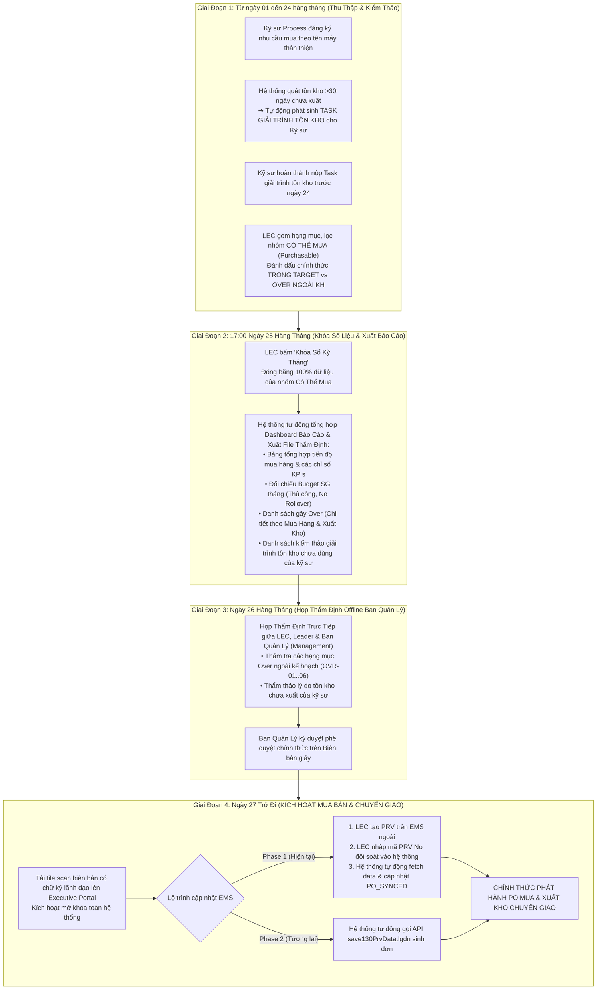

# 05. Sơ Đồ Quy Trình: Kiểm Thảo Tồn Kho, Chốt Kỳ Tháng & Thẩm Định Offline Ban Quản Lý
> *Quy Trình Kiểm Thảo Hàng Tháng: Kỹ Sư Giải Trình Tồn Kho Chưa Dùng Qua Task, Thẩm Định Offline Ngày 25 & Kích Hoạt Mua Bán / Chuyển Giao SAU Khi Phê Duyệt*

---

## 1. Dòng Thời Gian Vận Hành Toàn Diện Kỳ Mua Sắm & Kiểm Thảo Tháng

---

## 2. Các Nguyên Tắc Bắt Buộc Trong Kiểm Thảo & Thẩm Định

1.  **Mua Bán & Chuyển Giao Tuyệt Đối Diễn Ra Sau Thẩm Định**:
    - Ngăn chặn triệt để tình trạng "tiền trảm hậu tấu" (tự ý mua ngoài hoặc tự ý nhận chuyển giao kho từ pháp nhân bạn khi lãnh đạo chưa phê chuẩn).
    - Mọi mã hàng chỉ được cấp ngân sách và mở cổng phát hành PO sau khi Biên bản thẩm định ngày 25 có chữ ký của Quản Lý.
2.  **Trách Nhiệm Giải Trình Tồn Kho Của Kỹ Sư**:
    - Phụ tùng mua về phải được lắp máy tạo ra sản phẩm. Nếu phụ tùng nằm kho quá 30 ngày, Kỹ sư yêu cầu ban đầu bắt buộc phải làm việc qua Task giải trình.
    - Ban Quản Lý sử dụng danh sách giải trình này để quyết định có tiếp tục phê duyệt các đơn mua mới của kỹ sư đó hay không.
