# 05. Sơ Đồ Quy Trình: Thẩm Định Đầu Tháng, Kiểm Thảo Tồn Kho & Luồng Phản Hồi 3 Bên
> *Quy Trình Đầu Tháng: Kỹ Sư Giải Trình Tồn Kho Qua Task, Điều Kiện Bắt Buộc Có QCode, LEC Tự Phân Loại Target/Over, Thẩm Định Offline Đầu Tháng Với Cost Management (1 Người), Vòng Phản Hồi 3 Bên & Phê Duyệt Chính Thức Trên EMS*

---

## 1. Dòng Thời Gian Vận Hành Kỳ Thẩm Định Đầu Tháng

```mermaid
flowchart TD
    subgraph Phase1["Giai Đoạn 1: Cuối Tháng N-1 Đến Đầu Tháng N (Chuẩn Bị Dữ Liệu & Giải Trình)"]
        P1["Kỹ sư hiện trường đăng ký nhu cầu mua theo tên máy thân thiện\n(Kèm folder CAD nếu cần đăng ký QCode mới)"]
        P1_QCode["LEC đăng ký QCode trên ERP/EMS (Bắt buộc phải có QCode để thẩm định)"]
        P1_Stock["Hệ thống quét tồn kho >30 ngày chưa xuất\n➔ Tự động phát sinh TASK GIẢI TRÌNH TỒN KHO cho Kỹ sư"]
        P1_Task["Kỹ sư nộp Task giải trình tồn kho trước DEADLINE DO LEC QUY ĐỊNH (vd: 03 hàng tháng)"]
        P1_LEC["LEC gom hạng mục đã có QCode, tự tay phân loại thủ công:\n[🟢 TRONG TARGET] hoặc [🔴 OVER PHÁT SINH]"]
    end

    subgraph Phase2["Giai Đoạn 2: Chốt Kỳ Hồ Sơ Thẩm Định Đầu Tháng (Do LEC Cấu Hình)"]
        P2["Đúng hạn Deadline do LEC thiết lập (vd: 05 hàng tháng lúc 12:00):\nLEC bấm 'Chốt Hồ Sơ Thẩm Định Đầu Tháng' ➔ Đóng băng dữ liệu"]
        P3["Hệ thống tự động tổng hợp Dashboard Báo Cáo & Hồ Sơ Thẩm Định:\n• Bảng tổng hợp tiến độ mua sắm & chỉ số tồn kho\n• Đối chiếu ngân sách SG tháng No-Rollover (Nhập thủ công)\n• Danh sách gây Over (Bóc tách Over Mua Hàng vs Over Xuất Kho từ EMS)\n• Báo cáo tổng hợp giải trình tồn kho của các kỹ sư"]
    end

    subgraph Phase3["Giai Đoạn 3: Phiên Thẩm Định Offline Đầu Tháng Với Cost Management"]
        P4["Họp Thẩm Định Offline Trực Tiếp giữa LEC và Reviewer Bộ Phận Quản Lý Chi Phí\n(Reviewer & Assistant là 1 người duy nhất)\n• Thẩm tra các hạng mục Over ngoài kế hoạch (OVR-01..06)\n• Kiểm thảo các giải trình tồn kho chưa xuất của kỹ sư"]
        
        P4_Loop{"Reviewer yêu cầu làm rõ thêm thông tin?"}
        P4_Loop -->|"Có yêu cầu"| ThreeWay["LUỒNG PHẢN HỒI 3 BÊN:\n1. Reviewer nhập câu hỏi trên Cost Management Portal\n2. LEC tiếp nhận & giao nhiệm vụ làm rõ cho Kỹ sư\n3. Kỹ sư cập nhật bằng chứng kỹ thuật gửi lại cho LEC\n4. LEC tổng hợp & gửi lại cho Reviewer Cost Management"]
        ThreeWay --> P4_Loop
        
        P4_Loop -->|"Đạt yêu cầu"| P5["Reviewer xác nhận thông qua thẩm định offline\n(Lưu biên bản số hóa lên hệ thống)"]
    end

    subgraph Phase4["Giai Đoạn 4: Phê Duyệt Chính Thức & Vận Hành Trên EMS"]
        P6["LEC tạo mã PRV No trên hệ thống Core EMS kèm biên bản thẩm định"]
        P7["Cost Management (Reviewer - 1 người) KÝ DUYỆT CHÍNH THỨC TRÊN EMS\n(Hệ thống mới hoàn toàn không có nút duyệt)"]
        P8["LEC nhập mã PRV No vào hệ thống mới để bắt đầu đồng bộ tiến độ PO"]
        P9["LEC nhập thủ công: Vendor Confirm ngày nhận, ETA, Phân bổ chi phí hàng tháng\nHàng về đối soát hoàn tất trên EMS"]
    end

    Phase1 --> Phase2 --> Phase3 --> Phase4
```

---

## 2. Các Nguyên Tắc Bắt Buộc Trong Kiểm Thảo & Thẩm Định Đầu Tháng

1.  **Thời Điểm Diễn Ra Vào ĐẦU THÁNG**:
    - Kỳ thẩm định chi phí và kiểm thảo giải trình tồn kho diễn ra tập trung vào **ĐẦU THÁNG** (thường từ ngày 01 đến ngày 05 hàng tháng) giữa LEC và Reviewer Cost Management, đảm bảo khớp với chu kỳ ngân sách SG tháng mới.
2.  **Bộ Phận Quản Lý Chi Phí (Cost Management)**:
    - Là bộ phận quản lý chi phí chuyên trách, **không phải Ban Giám Đốc/Hội đồng quản trị**.
    - Vai trò **Reviewer và Assistant là 1 người duy nhất**.
3.  **Điều Kiện Bắt Buộc: Phải Có Mã QCode Chính Thức**:
    - Chỉ các phụ tùng đã có mã QCode chính thức trên ERP/EMS mới đủ điều kiện đưa vào danh sách thẩm định đầu tháng.
    - Phụ tùng mới nộp folder CAD/Doc/ảnh chỉ là giai đoạn chuẩn bị dữ liệu kỹ thuật, mang mã tạm `TMP-HW-xxxx`, chưa được tham gia thẩm định.
4.  **Phân Loại Target vs Over Là Thủ Công Bởi LEC**:
    - Hệ thống không tự động phân loại. LEC là người trực tiếp đánh giá dựa trên tình trạng thiết bị, tính chất hư hỏng và ngân sách SG tháng để bấm chọn `[TRONG TARGET]` hoặc `[OVER PHÁT SINH]`.
5.  **Thời Hạn (Deadlines) Do LEC Thiết Lập**:
    - Hạn chót kỹ sư nộp giải trình tồn kho và hạn chốt hồ sơ thẩm định do chính LEC cấu hình trên hệ thống.
6.  **Vòng Phản Hồi 3 Bên Chặt Chẽ**:
    - Mọi yêu cầu làm rõ sau buổi thẩm định offline được quản lý trực tiếp trên phần mềm: Reviewer gửi câu hỏi cho LEC $\rightarrow$ LEC chuyển cho Kỹ sư $\rightarrow$ Kỹ sư phản hồi cho LEC $\rightarrow$ LEC tổng hợp nộp lại cho Reviewer, đảm bảo tính toàn vẹn và lưu vết lịch sử.
7.  **Phê Duyệt Chính Thức Trên EMS & Không Có Cổng Thủ Kho**:
    - Hệ thống mới đóng vai trò kiểm soát tiến độ và chuẩn bị tài liệu kỹ thuật.
    - Mọi phê duyệt diễn ra trên EMS. Xuất kho phụ tùng được đồng bộ tự động từ EMS, không qua thủ kho trên ứng dụng này.
