# 06. ĐẶC TẢ CHI TIẾT FLOW TIẾN ĐỘ TỪNG CÔNG ĐOẠN (END-TO-END STAGE PROGRESSION FLOW)

> **Dự án**: Spare Parts Procurement Tracking & Engineering Operations Platform  
> **Phân xưởng**: Smart Watch (SW) — Factory HW (Org ID: `28753`)  
> **Tài liệu tham chiếu chuẩn**: [`procurement-item-registration-flow.puml`](file:///home/longp/projects/company/ops-workflow/procurement-item-registration-flow.puml)  
> **Sơ đồ trực quan Vector**: [`procurement-item-registration-flow.svg`](file:///home/longp/projects/company/ops-workflow/procurement-item-registration-flow.svg) | [`procurement-item-registration-flow.png`](file:///home/longp/projects/company/ops-workflow/procurement-item-registration-flow.png)  
> **Trình xem tương tác**: [`procurement-flow-viewer.html`](file:///home/longp/projects/company/ops-workflow/procurement-flow-viewer.html)  
> **Phiên bản tài liệu**: 3.0 Enterprise Standardized (9-Step Lifecycle & 3-Tier Execution)  

---

## 1. SƠ ĐỒ DÒNG CHẢY TIẾN ĐỘ 9 BƯỚC LIÊN HOÀN (MASTER STAGE FLOWCHART)

```mermaid
flowchart TD
    %% LANE 1: REQUESTOR
    subgraph LANE1["🟦 LÀN 1: KỸ SƯ HIỆN TRƯỜNG (REQUESTOR)"]
        S1["BƯỚC 1: Chọn Cấu Trúc Thiết Bị 4 Tầng\nLine > Machine > Unit > Assembly\n(Quy tắc tầng: Left(Line,1)=Floor • Master Machine Template)"]
        GW1{"Có mã QCode ERP?"}
        S2B["BƯỚC 2B: Chưa Có Mã (Mã Mới)\n• ĐK Tên Hạng Mục (Category)\n• ĐK Tên Item mới & specs\n• Kéo folder CAD/Catalog\n• Cấp mã tạm TMP-HW-xxxx\n(Khóa cứng cờ costBlocked = true)"]
        S2A["BƯỚC 2A: Đã Có Mã QCode\n• Omni-Search typeahead / Barcode scan\n• Tự động điền 100% dữ liệu gốc:\nGiá UP001, ĐVT, tồn kho, link CAD"]
        S3["BƯỚC 3: Nhập SL Xin Mua & Bối Cảnh Vận Hành\n• Request Qty\n• Lý do sử dụng: Setup / CIP / Breakdown / PM / Spare\n• Logic kỹ thuật, nguyên nhân hỏng hóc\n• Hiện trạng máy dừng (Line Stop) & hao hụt ca\n• Cờ khẩn cấp (Urgent Priority Flag: SLA 24-48h)"]
        S4["BƯỚC 4: Quét 4 Trạng Thái Interlock Tự Động (<50ms)\n1. Giá: UP001 (Hợp đồng) vs UP004 (Chờ RFQ)\n2. Tồn kho lâu: >30d / 60d / 90d\n3. Tồn kho pháp nhân: Entity B / Plant 2 / Kho trung tâm\n4. Lệch giá: So sánh benchmark các nhà máy"]
    end

    %% LANE 2: LEC
    subgraph LANE2["🟧 LÀN 2: CHUYÊN VIÊN ĐIỀU PHỐI (LEC - TRUNG GIAN)"]
        S5["BƯỚC 5: Trao Đổi Trực Tiếp LEC & Requestor\n• Kênh chat 2 chiều: chất vấn số lượng, hiện trạng dừng máy\n• Requestor nộp ảnh vi mạch nứt vỡ, biên bản sự cố\n• Giải trình spec không tương thích của hàng tồn >30d"]
        GW2{"LEC đánh giá đạt?"}
        S6["BƯỚC 6: Gom Mẻ & Gán Nhãn Tài Chính\n• Gán mã EM No 14 ký tự (HWBMTL21EC0101)\n• Nhãn TARGET (định mức chuẩn EBOM)\n• Nhãn OVER (bắt buộc chọn 1 trong 6 mã OVR-01..06 & Work Order)"]
    end

    %% LANE 3: MANAGEMENT
    subgraph LANE3["🟪 LÀN 3: BAN QUẢN LÝ CHI PHÍ (REVIEWER - OFFLINE AUDIT)"]
        S7["BƯỚC 7: Thẩm Định Offline Đầu Tháng (Ngày 01-05)\n• Chặn cứng mã tạm TMP- (Tuyệt đối không duyệt mã TMP)\n• LEC làm CẦU NỐI TRUNG GIAN chất vấn 3 bên\n• Thẩm tra giải trình tồn kho chậm luân chuyển >30d"]
        S8["BƯỚC 8: Chốt List Mua & Cấp Cost Clearance\n• Ban Quản Lý phê duyệt danh sách chính thức\n• Ký cấp chứng chỉ điện tử CC-HW-YYYYMM-PASS\n• Đóng băng danh sách (Strict No-Rollover, thặng dư = $0)"]
    end

    %% LANE 4: PROCUREMENT & EMS
    subgraph LANE4["🟩 LÀN 4: MUA HÀNG & KHO LIÊN PHÁP NHÂN (CƠ CHẾ MUA 3 TẦNG)"]
        S9A{"TẦNG 1: Chuyển giao kho\nliên pháp nhân (Transfer)?"}
        S9A_OK["Xuất điều chuyển kho nội bộ\n(HOÀN TẤT - Không tốn ngân sách)"]
        S9B{"TẦNG 2: Mua nội bộ\n(Internal PO)?"}
        S9B_OK["Xuất hóa đơn nội bộ & vận chuyển\n(HOÀN TẤT)"]
        S9C["TẦNG 3: Mua thường giá thấp nhất qua Nexacro EMS\n• Đẩy lên Nexacro EMS Core tạo PRV\n• Lãnh đạo ký duyệt 100% trên Nexacro EMS Core\n• Cấp mã PO-99xxx • Theo dõi Inbound 3 mốc\n• Hàng về kiểm nhận, xuất lắp máy, đồng bộ ds_Inv vào giá thành"]
    end

    %% Flow connections
    S1 --> GW1
    GW1 -- "Chưa có" --> S2B
    GW1 -- "Đã có" --> S2A
    S2B --> S3
    S2A --> S3
    S3 --> S4
    S4 ==>|Bàn điều phối UI-LEC-01| S5
    S5 --> GW2
    GW2 -- "Yêu cầu bổ sung" --> S5
    GW2 -- "Đạt chuẩn" --> S6
    S6 ==>|Nộp danh mục tháng| S7
    S7 --> S8
    S8 ==>|Mở khóa mua sắm| S9A
    S9A -- "Approve Transfer" --> S9A_OK
    S9A -- "Reject Transfer" --> S9B
    S9B -- "Approve Internal PO" --> S9B_OK
    S9B -- "Reject Internal PO" --> S9C
```

---

## 2. BẢNG ĐẶC TẢ CHI TIẾT 9 BƯỚC NGHIỆP VỤ & QUY TẮC BẤT BIẾN

### BƯỚC 1: Chọn Vị Trí Cấu Trúc Thiết Bị 4 Tầng & Master Template
* **Màn hình phụ trách**: [`UI-REG-01` (Đăng Ký Hạng Mục Mua Hàng)](file:///home/longp/projects/company/ops-workflow/procurement-system/05-ui-ux-screen-specifications/01-man-hinh-dang-ky-hang-muc-mua-hang.md).
* **Chủ thể thực hiện**: Kỹ sư hiện trường (`Field Engineer / Requestor`) — Đồng nghiệp ngang hàng.
* **Quy tắc vận hành**:
  1. Phân cấp 4 tầng bắt buộc: `Line` (Chuyền) $\rightarrow$ `Machine` (Tên máy) $\rightarrow$ `Unit` (Khối chức năng) $\rightarrow$ `Assembly` (Cơ cấu chi tiết).
  2. **Quy tắc suy diễn tầng tự động**: `Left(Line, 1) = Factory Floor`.
     * Ví dụ: `Line 102` $\rightarrow$ Tầng 1 Cleanroom; `Line 305` $\rightarrow$ Tầng 3 Cleanroom.
  3. **Master Machine Template**: Cho phép kỹ sư sao chép nhanh cấu trúc cơ cấu BOM của một máy chuẩn sang các line song song (vd: từ máy Laser Cutting M/C #01 sang #02, #03), giảm $80\%$ thời gian nhập liệu.

---

### BƯỚC 2: Cổng Rẽ Nhánh Kiểm Tra Mã QCode ERP
* **Màn hình phụ trách**: [`UI-REG-01`](file:///home/longp/projects/company/ops-workflow/procurement-system/05-ui-ux-screen-specifications/01-man-hinh-dang-ky-hang-muc-mua-hang.md) và [`UI-QCODE-01`](file:///home/longp/projects/company/ops-workflow/procurement-system/05-ui-ux-screen-specifications/02-man-hinh-onboarding-qcode-va-tai-folder.md).
* **Rẽ nhánh nghiệp vụ**:
  * **Nhánh 2A (Đã có mã QCode ERP)**:
    - Kỹ sư quét barcode hoặc tìm kiếm typeahead qua thanh Omni-Search.
    - Hệ thống tự động nạp $100\%$ thuộc tính gốc: Tên linh kiện chuẩn, Maker, Model, Đơn vị tính (PCS/SET/ROLL), đơn giá hợp đồng (`UP001`), tồn kho vật lý hiện hữu tại nhà máy, và đường dẫn bản vẽ CAD 2D/3D trong kho lưu trữ Vault.
    - Trạng thái khởi tạo: `DRAFT_ACTIVE`.
  * **Nhánh 2B (Chưa có mã QCode - Phụ tùng mới / Cải tiến CIP)**:
    - Kỹ sư đăng ký Tên Hạng Mục (`Category Name`: Optics, Pneumatics, Sensors, Heating, Precision Tooling...).
    - Nhập Tên Phụ Tùng Mới (`New Item Description` + specs kỹ thuật + Maker sơ bộ).
    - Kéo thả thư mục hồ sơ kỹ thuật (`Folder Upload` chứa bản vẽ 2D `.dwg`, 3D `.step`, catalog nhà sản xuất, spec sheet).
    - Hệ thống tự động cấp mã định danh tạm thời: `TMP-HW-xxxx`.
    - **CHỐT CHẶN CỨNG (HARD GATE)**: Kích hoạt cờ `costBlocked = true`. Mã tạm `TMP-` bị cấm phát hành PO mua sắm cho tới khi được định danh QCode chính thức trên ERP.
    - Trạng thái khởi tạo: `DRAFT_TMP`.

---

### BƯỚC 3: Nhập Số Lượng Xin Mua & Khai Báo Bối Cảnh Vận Hành
* **Màn hình phụ trách**: [`UI-REG-01`](file:///home/longp/projects/company/ops-workflow/procurement-system/05-ui-ux-screen-specifications/01-man-hinh-dang-ky-hang-muc-mua-hang.md).
* **Trường dữ liệu bắt buộc**:
  1. `Request Quantity`: Số lượng xin mua (kiểm tra tương thích với ĐVT).
  2. `Usage Category` (Lý do sử dụng - Dropdown):
     * `[Setup]`: Chuyển đổi mã hàng / setup công nghệ mới.
     * `[CIP]`: Dự án cải tiến năng suất / nâng cao chất lượng.
     * `[Breakdown]`: Sự cố hư hỏng máy đột xuất.
     * `[PM]`: Bảo dưỡng định kỳ đại tu thiết bị.
     * `[Spare]`: Dự phòng mức tồn kho an toàn.
  3. `Technical Logic & Root Cause Analysis`: Phân tích nguyên nhân hỏng hóc (mài mòn ma sát, nứt vỡ do ứng suất nhiệt, chập cháy cuộn cảm, biến dạng cơ học...).
  4. `Machine Operational Status & Impact`:
     * Máy dừng hoàn toàn (`Line Stop`): Bắt buộc định lượng sản lượng thiếu hụt trong ca (vd: mất $150\text{ sp/ca}$, nguy cơ trễ giao hàng).
     * Hoạt động bất thường: Giảm tốc độ, chập chờn, phát sinh phế phẩm.
  5. `Urgent Priority Flag` (Cờ khẩn cấp):
     * Nếu kích hoạt `Urgent = TRUE` $\rightarrow$ Bật cảnh báo đỏ, áp dụng SLA xử lý ưu tiên $24-48\text{h}$, phát thông báo tức thì đến LEC và Quản Lý Chi Phí.

---

### BƯỚC 4: Quét 4 Trạng Thái Interlock Tự Động (<50ms)
* **Hệ thống xử lý**: Bộ máy quy tắc Interlock Rules Engine chạy ngầm tự động.
* **4 Khía cạnh quét bắt buộc**:
  1. **Trạng thái giá (Contract Price Status)**:
     * `UP001`: Đã có giá hợp đồng nguyên tắc đang còn hiệu lực $\rightarrow$ Sẵn sàng đặt hàng.
     * `UP004`: Chưa có giá hợp đồng $\rightarrow$ Chuyển trạng thái `RFQ_WAITING` để Purchasing chào giá.
  2. **Cảnh báo tồn kho lâu (Aging Stock Warning)**:
     * Quét toàn bộ kho Factory HW: cảnh báo nếu có linh kiện cùng loại hoặc tương đương tồn kho $>30, 60, 90\text{ ngày}$ chưa xuất dùng.
  3. **Tồn kho pháp nhân khác (Inter-Entity Stock Status)**:
     * Quét dữ liệu tồn kho nhàn rỗi tại Entity B, Plant 2, hoặc Kho trung tâm. Nếu có hàng dư thừa $\rightarrow$ Khóa mua mới cục bộ, kích hoạt yêu cầu điều chuyển liên pháp nhân.
  4. **Chênh lệch giá pháp nhân (Cross-Entity Price Disparity)**:
     * So sánh đơn giá đề xuất với lịch sử mua của các nhà máy/pháp nhân bạn trong tập đoàn. Cảnh báo nếu giá tại Factory HW cao hơn benchmark để đàm phán lại.

---

### BƯỚC 5: Trao Đổi Trực Tiếp Giữa LEC & Requestor (In-Workflow Collaborative Chat)
* **Màn hình phụ trách**: [`UI-LEC-01` (Bàn Điều Phối LEC Master)](file:///home/longp/projects/company/ops-workflow/procurement-system/05-ui-ux-screen-specifications/05-man-hinh-dieu-phoi-lec-master-workbench.md) và [`UI-TASK-01`](file:///home/longp/projects/company/ops-workflow/procurement-system/05-ui-ux-screen-specifications/03-man-hinh-hop-thu-tac-vu-va-giai-trinh-ton-kho.md).
* **Nghiệp vụ đối thoại 2 chiều**:
  1. LEC mở kênh chat đối thoại trực tiếp gắn liền với từng dòng đề xuất mua sắm.
  2. LEC thẩm tra: Chất vấn số lượng xin mua, tính xác thực của việc máy dừng chuyền, chất vấn tại sao không dùng phụ tùng đang tồn kho lâu $>30\text{ ngày}$ hoặc yêu cầu làm rõ lý do đơn giá cao hơn pháp nhân bạn.
  3. Requestor phản hồi: Cung cấp bằng chứng kỹ thuật, tải lên ảnh chụp hiện trường vi mạch nứt vỡ, đính kèm biên bản dừng máy hoặc chứng minh đặc tính kỹ thuật không tương thích của hàng tồn cũ.
  4. Toàn bộ đối thoại và hình ảnh được lưu vết $100\%$ trong Audit Trail.

---

### BƯỚC 6: LEC Đánh Giá Kỹ Thuật, Gom Mẻ & Gán Nhãn Tài Chính
* **Màn hình phụ trách**: [`UI-LEC-01` (Bàn Điều Phối LEC Master)](file:///home/longp/projects/company/ops-workflow/procurement-system/05-ui-ux-screen-specifications/05-man-hinh-dieu-phoi-lec-master-workbench.md).
* **Thao tác chi tiết**:
  1. **Đánh giá đạt**: Chuyển trạng thái sang `LEC_QUALIFIED`.
  2. **Gom mẻ theo tháng**: Gom toàn bộ đề xuất đạt chuẩn vào danh mục thẩm định định kỳ đầu tháng.
  3. **Đăng ký mã EM No 14 ký tự**: Gán mã thiết bị chuẩn hóa (vd: `HWBMTL21EC0101`).
  4. **Đánh nhãn tài chính thủ công (Tuyệt đối không tự động hóa)**:
     * `TARGET`: Hạng mục thay thế bảo dưỡng định kỳ trong định mức chi phí chuẩn EBOM.
     * `OVER`: Hạng mục vượt ngân sách hoặc sự cố đột xuất. Bắt buộc:
       - Chọn đúng 1 trong 6 mã nguyên nhân sự cố (`OVR-01` Line Stop, `OVR-02` Production Surge, `OVR-03` Transfer Delay, `OVR-04` Model Setup, `OVR-05` Price Surge, `OVR-06` Alignment Error).
       - Bắt buộc kiểm tra và liên kết mã phiếu bảo trì **Work Order (`WO-xxxx`)**.

---

### BƯỚC 7: Thẩm Định Offline Đầu Tháng (Ban Quản Lý Chi Phí - Ngày 01-05)
* **Màn hình phụ trách**: [`UI-CST-01` (Cổng Thẩm Định Chi Phí Đầu Tháng)](file:///home/longp/projects/company/ops-workflow/procurement-system/05-ui-ux-screen-specifications/07-man-hinh-tham-dinh-chi-phi-dau-thang.md).
* **Thời gian diễn ra**: **Từ ngày 01 đến ngày 05 đầu mỗi tháng**.
* **Chủ thể**: 1 Chuyên viên Quản lý Chi phí duy nhất (Trần Thị Hường) phụ trách toàn xưởng Factory HW.
* **3 Cơ chế kiểm soát bắt buộc**:
  1. **CHỐT CHẶN CỨNG MÃ TẠM (HARD BLOCK GATE)**:
     * Quét toàn bộ danh mục, nếu phát hiện còn tồn tại mã tạm `TMP-HW-xxxx` $\rightarrow$ **CHẶN CỨNG THẨM ĐỊNH NGAY LẬP TỨC!** Bắt buộc LEC và kỹ sư phải hoàn tất xin QCode ERP trước khi trình lại.
  2. **LEC LÀ TRUNG GIAN CHUYÊN TRÁCH TRAO ĐỔI (3-PARTY INQUIRY DISPATCH)**:
     * Reviewer không làm việc trực tiếp với từng kỹ sư mà phát hành Phiếu chất vấn (Inquiry) gửi cho LEC.
     * LEC tiếp nhận $\rightarrow$ Điều phối kỹ sư nộp văn bản giải trình và ảnh hiện trường $\rightarrow$ LEC tổng hợp báo cáo phản hồi chính thức cho Reviewer.
  3. **Thẩm tra cam kết xử lý hàng tồn kho chậm luân chuyển (`TASK-AGE-xxxx`)**:
     * Kiểm tra kế hoạch xuất dùng và ngày cam kết giải phóng linh kiện tồn kho $>30\text{ ngày}$.

---

### BƯỚC 8: Chốt List Mua & Ký Cấp Chứng Chỉ Cost Clearance
* **Màn hình phụ trách**: [`UI-CST-01`](file:///home/longp/projects/company/ops-workflow/procurement-system/05-ui-ux-screen-specifications/07-man-hinh-tham-dinh-chi-phi-dau-thang.md).
* **Kết quả đầu ra**:
  1. Ban Quản Lý phê duyệt chính thức danh mục mua sắm của tháng.
  2. Ký phát hành chứng chỉ điện tử **Cost Clearance**:
     $$\text{Mã chứng chỉ: } \mathbf{CC-HW-YYYYMM-PASS}$$
  3. **Đóng băng danh sách (Freeze Data)**: Áp dụng nguyên tắc **Strict No-Rollover Policy**, số dư ngân sách chưa dùng hết tự động hủy về $\$0$, không chuyển sang tháng sau.
  4. Mở khóa toàn bộ hồ sơ đạt chuẩn sang khâu Mua Hàng & Kho Vận để giải tỏa Interlock.

---

### BƯỚC 9: Tiến Hành Mua & Xử Lý Từng Hạng Mục Interlock (Cơ Chế Mua 3 Tầng)
* **Chủ thể**: Phòng Mua Hàng (`Purchasing`), Thủ kho và Hệ thống Cổng **Nexacro EMS Core**.
* **Xử lý theo thác nước 3 tầng nghiêm ngặt (3-Tier Waterfall)**:
  1. **TẦNG 1: CHUYỂN GIAO KHO LIÊN PHÁP NHÂN (TRANSFER - ƯU TIÊN SỐ 1)**:
     * Áp dụng khi phát hiện hàng nhàn rỗi tại Entity B, Plant 2, Kho trung tâm.
     * Gửi đề nghị điều chuyển kho liên công ty.
     * *Nếu Approve*: Thủ kho xuất phiếu điều chuyển $\rightarrow$ Vận chuyển nội bộ $\rightarrow$ Nhập kho Factory HW $\rightarrow$ **HOÀN TẤT CHU TRÌNH (Tiết kiệm $100\%$ ngân sách mua mới)**.
     * *Nếu Reject* (pháp nhân bạn giữ tồn kho dự phòng an toàn): Tự động chuyển xuống **Tầng 2**.
  2. **TẦNG 2: MUA HÀNG NỘI BỘ (INTERNAL PO - ƯU TIÊN SỐ 2)**:
     * Lập đề nghị mua nội bộ theo hợp đồng nguyên tắc giữa hai pháp nhân.
     * *Nếu Approve*: Xuất hóa đơn nội bộ và giao hàng $\rightarrow$ **HOÀN TẤT CHU TRÌNH**.
     * *Nếu Reject* (vướng hạn mức thanh toán nội bộ hoặc thủ tục thuế): Tự động chuyển xuống **Tầng 3**.
  3. **TẦNG 3: MUA THƯỜNG NGOÀI THỊ TRƯỜNG GIÁ THẤP NHẤT QUA NEXACRO EMS (ƯU TIÊN SỐ 3)**:
     * Phòng Mua hàng đàm phán giá thấp nhất từ nhà cung cấp ngoài.
     * Đẩy hồ sơ lên phần mềm **Nexacro EMS Core**, tạo phiếu Purchase Requisition Voucher (PRV).
     * **Nguyên tắc vàng #1: Lãnh đạo ký duyệt điện tử 100% trên phần mềm Nexacro EMS Core** (giao diện web chỉ xem tiến độ, tuyệt đối không có nút duyệt PO).
     * Cổng kết nối đồng bộ mã PO chính thức (`PO-99xxx`).
     * Theo dõi Inbound Logistics qua 3 mốc: (1) Vendor Confirm Date, (2) ETA Cảng/Kho, (3) Thông quan hải quan.
     * Hàng về phân xưởng $\rightarrow$ Thủ kho kiểm nhận $\rightarrow$ Kỹ sư xuất lắp ráp vào cơ cấu máy theo mã Work Order $\rightarrow$ EMS đồng bộ bảng kê xuất kho `ds_Inv` quyết toán chính thức chi phí vào giá thành sản xuất.

---

## 3. BẢNG MA TRẬN CHUYỂN DỊCH TRẠNG THÁI (LIFECYCLE STATE TRANSITION MATRIX)

| Mã Trạng Thái | Tên Trạng Thái Hiển Thị | Bước | Điều Kiện Kích Hoạt | Quyền Thao Tác Kế Tiếp |
| :--- | :--- | :---: | :--- | :--- |
| `DRAFT_TMP` | Bản Nháp Mã Tạm | Bước 2B | Kỹ sư tải folder CAD/Catalog, cấp mã `TMP-HW-xxxx` (`costBlocked=true`) | LEC kiểm tra & xúc tiến cấp QCode ERP |
| `DRAFT_ACTIVE` | Đăng Ký Chờ Quét | Bước 2A/3 | Chọn mã QCode ERP chính thức, nhập số lượng & lý do | Hệ thống tự động quét Interlock |
| `CROSS_TEAM_STOCK` | Cảnh Báo Tồn Kho Liên Team | Bước 4 | Phát hiện tồn kho tại team khác hoặc pháp nhân khác | Kích hoạt tác vụ mượn kho bắt buộc |
| `RFQ_WAITING` | Chờ Báo Giá RFQ | Bước 4 | Linh kiện chưa có giá hợp đồng (`UP004`) | Purchasing gửi RFQ $\rightarrow$ LEC cập nhật đơn giá |
| `LEC_QUALIFIED` | LEC Thẩm Tra Đạt | Bước 6 | Vượt qua thẩm định kỹ thuật, gán EM No 14 ký tự | LEC gom mẻ & gán nhãn TARGET / OVER |
| `COST_AUDIT` | Chờ Thẩm Định Chi Phí | Bước 6/7 | Đã gom mẻ, nộp danh mục thẩm định tháng | Ban Quản Lý thẩm định offline (Ngày 01-05) |
| `CLEARED` | Đã Cấp Cost Clearance | Bước 8 | Ban Quản Lý phê duyệt đạt, cấp chứng chỉ `CC-HW-PASS` | Mở khóa sang Cổng Mua Hàng & Kho Vận |
| `TRANSFER_PENDING` | Chờ Duyệt Chuyển Giao | Bước 9A | Tầng 1: Đề nghị điều chuyển kho liên pháp nhân | Pháp nhân bạn Approve/Reject |
| `INTERNAL_PO_PENDING`| Chờ Duyệt Internal PO | Bước 9B | Tầng 2: Đề nghị mua nội bộ (khi Tầng 1 bị từ chối) | Kế toán liên công ty Approve/Reject |
| `EMS_APPROVED` | Đã Ký Duyệt EMS PO | Bước 9C | Tầng 3: Lãnh đạo ký duyệt PRV/PO 100% trên Nexacro EMS Core | Cổng kéo mã PO-99xxx $\rightarrow$ Theo dõi Inbound |
| `INBOUND_TRACKING` | Đang Vận Chuyển Inbound | Bước 9C | PO đã phát hành cho NCC ngoài | LEC theo dõi mốc Vendor, ETA cảng, rải chi phí |
| `ISSUED` | Đã Xuất Lắp Đặt Máy | Bước 9 | Kỹ sư lắp vào máy theo WO, EMS đồng bộ `ds_Inv` | Ghi nhận chi phí thực tế vào giá thành |
| `FREEZE_CLOSED` | Khóa Sổ Chu Kỳ Tháng | Cuối tháng | 23:59 ngày cuối tháng (Strict No-Rollover Policy) | Hủy thặng dư về $0 \rightarrow$ Mở chu kỳ tháng mới |
