# 06. ĐẶC TẢ CHI TIẾT FLOW TIẾN ĐỘ TỪNG CÔNG ĐOẠN (END-TO-END STAGE PROGRESSION FLOW)

> **Dự án**: Spare Parts Procurement Tracking & Engineering Operations Platform  
> **Phân xưởng**: Smart Watch (SW) — Factory HW (Org ID: `28753`)  
> **Phiên bản tài liệu**: 2.0 - Chuẩn Hóa Tiến Độ Từng Công Đoạn (Stage Progression Flow)  
> **Nguyên tắc bất biến**: Khắc phục triệt để sự phân hóa; chuẩn hóa 10 công đoạn nghiệp vụ liên hoàn từ phát sinh nhu cầu đến quyết toán chi phí.

---

## 1. SƠ ĐỒ DÒNG CHẢY TIẾN ĐỘ 10 CÔNG ĐOẠN LIÊN HOÀN (MASTER STAGE FLOWCHART)

```mermaid
flowchart TD
    subgraph S1["CÔNG ĐOẠN 1: PHÁT SINH NHU CẦU & ĐĂNG KÝ HẠNG MỤC"]
        REG["Kỹ sư chọn 4 tầng: Line > Mach > Unit > Asm\nTìm kiếm QCode thông minh (Omni-Search YML)"]
        CheckCode{"Đã có mã QCode ERP?"}
        REG --> CheckCode
        CheckCode -- "Chưa (Mã mới)" --> TMP["Tải folder CAD/Catalog -> Cấp mã TMP-HW-xxxx\nKhóa cờ costBlocked=true\n(Trạng thái: DRAFT_TMP)"]
        CheckCode -- "Đã có QCode" --> Form["Tự động điền giá, đơn vị, tồn kho, link CAD\nNhập số lượng xin mua Request Qty\n(Trạng thái: DRAFT_ACTIVE)"]
    end

    subgraph S2["CÔNG ĐOẠN 2: QUÉT INTERLOCK & GIẢI TỎA TỒN KHO"]
        Form --> Scan["Bộ máy quét Interlock tự động (<50ms)"]
        TMP --> Scan
        Scan --> CheckInterlock{"Phát hiện tồn kho liên team\nhoặc pháp nhân khác?"}
        CheckInterlock -- "Có tồn (Flag='Y')" --> LockSTK["Khóa trạng thái: CROSS_TEAM_STOCK\nTự động tạo Tác vụ Mượn Kho TASK-LCK-xxxx\nChặn mua mới cục bộ"]
        CheckInterlock -- "Không tồn (Flag='N')" --> CheckEBOM{"Có slot trên cây EBOM?"}
        
        LockSTK --> ResolveSTK{"Giải quyết tồn kho?"}
        ResolveSTK -- "Mượn được" --> STKDone["Thủ kho EMS xuất mượn -> Flag='N'\nTác vụ mượn kho tự đóng -> Chuyển giao nội bộ"]
        ResolveSTK -- "Kho bạn từ chối" --> LECUnlock["LEC mở khóa Interlock thủ công\nKèm biên bản xác nhận"]
        LECUnlock --> BranchNext{"Chọn 1 trong 2 nhánh:"}
        BranchNext -- "Pháp nhân khác" --> BranchTF["Nhánh 1: Chuyển giao liên pháp nhân"]
        BranchNext -- "Kho nội bộ" --> BranchBuy["Nhánh 2: Mua thường cục bộ giá thấp nhất"]
        
        CheckEBOM -- "Chưa có slot" --> LateEBOM["Bật cờ Khai Báo Muộn (Late Declaration)\nTạo tác vụ đếm ngược 7 ngày TASK-EBM-xxxx"]
        CheckEBOM -- "Đã có slot" --> CheckPrice{"Có đơn giá hợp đồng?"}
        BranchBuy --> CheckPrice
        LateEBOM --> CheckPrice
    end

    subgraph S3["CÔNG ĐOẠN 3: THEO DÕI BÁO GIÁ RFQ & NGOẠI LỆ EMAIL"]
        CheckPrice -- "Chưa có (UP004)" --> RFQWait["Trạng thái: RFQ_WAITING\nPurchasing gửi RFQ cho các nhà cung cấp"]
        CheckPrice -- "Đã có (UP001)" --> ReadyBuy["Trạng thái: PURCHASABLE\nSẵn sàng gom mẻ"]
        
        RFQWait --> RFQMail["LEC nhận email báo giá từ Purchasing"]
        RFQMail --> CheckExcept{"Bất thường? (Tăng giá >10%,\nLead time dài, Hết hàng)"}
        CheckExcept -- "Bình thường" --> RFQChot["LEC cập nhật đơn giá chốt -> PURCHASABLE"]
        CheckExcept -- "Bất thường" --> RFQAlert["Nhập thông tin bất thường -> Bắn thông báo kỹ sư\nRequestor chọn: Chấp nhận giá HOẶC Đổi mã EOL"]
        RFQAlert --> RFQChot
    end

    subgraph S4["CÔNG ĐOẠN 4: GOM MẺ LEC & ĐÁNH DẤU TARGET / OVER"]
        ReadyBuy --> LECBatch["LEC mở Bàn điều phối UI-LEC-01\nGom mẻ các đơn cùng trạng thái PURCHASABLE"]
        RFQChot --> LECBatch
        LECBatch --> EMNo["LEC đăng ký mã EM No 14 ký tự HWBMTL21EC0101"]
        EMNo --> TargetOver{"LEC đánh dấu thủ công\n(Tuyệt đối không tự động):"}
        TargetOver -- "Bảo dưỡng định kỳ" --> MarkTarget["Đánh dấu: TARGET\nĐối chiếu định mức EBOM"]
        TargetOver -- "Sự cố / Đột xuất" --> MarkOver["Đánh dấu: OVER\nGán 1 trong 6 mã sự cố OVR-01..06\nBắt buộc kiểm tra mã Work Order"]
    end

    subgraph S5["CÔNG ĐOẠN 5: THẨM ĐỊNH CHI PHÍ ĐẦU THÁNG (NGÀY 01-05)"]
        MarkTarget --> GateCheck["Cổng Thẩm Định Chi Phí UI-CST-01\n(Trần Thị Hường thực hiện ngày 01-05)"]
        MarkOver --> GateCheck
        GateCheck --> BlockTMP{"Kiểm tra mã tạm?"}
        BlockTMP -- "Còn mã TMP-" --> RejectTMP["CHẶN CỨNG: Không thẩm định\nYêu cầu LEC hoàn thiện QCode trên ERP"]
        BlockTMP -- "Mã QCode chính thức" --> AuditDetail["Rà soát Target định mức & Over sự cố"]
        
        AuditDetail --> Inquiry{"Có nghi vấn giá cao\nhoặc lý do Over chưa rõ?"}
        Inquiry -- "Có" --> SendInq["Gửi chất vấn sang LEC & Kỹ sư\nNộp ảnh vi mạch & biên bản dừng máy"]
        SendInq --> AuditDetail
        Inquiry -- "Thỏa đáng" --> CheckAgingTask["Thẩm tra giải trình tồn kho >30d (TASK-AGE-xxxx)"]
        CheckAgingTask --> Clearance["Ký cấp chứng chỉ COST CLEARANCE\nMã: CC-HW-YYYYMM-PASS"]
    end

    subgraph S6["CÔNG ĐOẠN 6: KÝ DUYỆT & PHÁT HÀNH PO TRÊN EMS NEXACRO"]
        Clearance --> OpenPRV["Mở khóa tạo PRV trên EMS Core"]
        OpenPRV --> EMSApprove["Lãnh đạo ký duyệt PRV & PO 100% trên Nexacro EMS\n(Tuyệt đối KHÔNG có nút duyệt trên web)"]
        EMSApprove --> POSync["Cổng Gateway đồng bộ mã PO chính thức (PO-99xxx)\n(Trạng thái: EMS_APPROVED)"]
    end

    subgraph S7["CÔNG ĐOẠN 7: THEO DÕI INBOUND & RẢI CHI PHÍ 3 THÁNG"]
        POSync --> InboundMilestones["LEC theo dõi 3 mốc Inbound Logistics:\n1. Vendor Confirm Date\n2. ETA Port / Warehouse\n3. Customs Clearance"]
        InboundMilestones --> Amortize["Ma trận rải chi phí đơn hàng lớn:\nTháng T (50%) | Tháng T+1 (25%) | Tháng T+2 (25%)\n(Tránh quá tải trần ngân sách SG tháng)"]
    end

    subgraph S8["CÔNG ĐOẠN 8: NHẬP KHO, XUẤT LẮP MÁY & GHI NHẬN ds_Inv"]
        Amortize --> WarehouseRecv["Hàng về nhà máy -> Thủ kho kiểm nhận trên EMS"]
        WarehouseRecv --> IssueMachine["Kỹ sư xuất vật tư lắp vào cơ cấu máy theo mã WO"]
        IssueMachine --> SyncInv["EMS đồng bộ bảng kê xuất kho ds_Inv\nGhi nhận chi phí thực tế vào giá thành\n(Trạng thái: ISSUED)"]
    end

    subgraph S9["CÔNG ĐOẠN 9: TỔNG HỢP & XUẤT BÁO CÁO 4 SHEET (NGÀY 25)"]
        SyncInv --> ExcelGen["Ngày 25 hàng tháng: Hệ thống tự động tổng hợp\nXuất DUY NHẤT 1 FILE EXCEL gồm đúng 4 Sheet:\n• Sheet 1: Tổng hợp Ngân sách SG vs PO vs ds_Inv\n• Sheet 2: Danh mục gây Over (Mua & Xuất kho)\n• Sheet 3: Tiến độ Inbound & Phân bổ 3 tháng\n• Sheet 4: Tồn kho chậm luân chuyển & Toàn văn giải trình"]
        ExcelGen --> ExecReport["Trình nộp Ban Giám Đốc & Họp Kiểm Thảo Chi Phí"]
    end

    subgraph S10["CÔNG ĐOẠN 10: KHÓA SỔ CUỐI THÁNG & HỦY THẶNG DƯ (NO-ROLLOVER)"]
        ExecReport --> MonthEndFreeze["23:59 Ngày cuối tháng: Freeze Window (Đóng băng dữ liệu)"]
        MonthEndFreeze --> ZeroSurplus["Khóa cứng toán học: Thặng dư chuyển tháng sau = $0\n(Strict No-Rollover: Số dư không cộng dồn)"]
        ZeroSurplus --> NextCycle["Reset chu kỳ tháng mới -> Bắt đầu kỳ thẩm định ngày 01-05"]
    end

    STKDone --> SyncInv
    BranchTF --> InboundMilestones
```

---

## 2. BẢNG ĐẶC TẢ CHI TIẾT 10 CÔNG ĐOẠN NGHIỆP VỤ

### CÔNG ĐOẠN 1: Phát Sinh Nhu Cầu & Đăng Ký Hạng Mục Mua Hàng
* **Màn hình phụ trách**: [`UI-REG-01` (Đăng Ký Hạng Mục Mua Hàng)](file:///home/longp/projects/company/ops-workflow/procurement-system/05-ui-ux-screen-specifications-v2/01-man-hinh-dang-ky-hang-muc-mua-hang.md).
* **Chủ thể thực hiện**: Kỹ sư hiện trường (Field Engineer / Requestor) — Đồng nghiệp ngang hàng.
* **Thao tác chi tiết**:
  1. Chọn phân cấp thiết bị 4 tầng: `Line` (suy ra tầng `Left(Line, 1) = Floor`) $\rightarrow$ `Machine` $\rightarrow$ `Unit` $\rightarrow$ `Assembly`.
  2. Gõ tìm kiếm QCode qua **Thanh Omni-Search thông minh** (không dùng dropdown):
     * *Nhánh 1A (Đã có mã QCode ERP)*: Hệ thống tự động điền `description`, `maker`, `model`, `uom`, đơn giá `unit_price_sp`, số lượng tồn `onhand_qty`, định mức `target_qty`, link CAD `fdm_url`. Kỹ sư nhập số lượng xin mua `request_qty` và loại nhu cầu (`BREAKDOWN`, `PM`, `SETUP`...).
     * *Nhánh 1B (Mã mới chưa có QCode)*: Kỹ sư kéo thả trọn bộ folder bản vẽ/catalog tại [`UI-QCODE-01`](file:///home/longp/projects/company/ops-workflow/procurement-system/05-ui-ux-screen-specifications-v2/02-man-hinh-onboarding-qcode-va-tai-folder.md), hệ thống cấp mã tạm `TMP-HW-xxxx` và tự động gắn cờ khóa chi phí `costBlocked = true`.
* **Trạng thái xuất xưởng**: `DRAFT_ACTIVE` hoặc `DRAFT_TMP`.

---

### CÔNG ĐOẠN 2: Quét Interlock & Giải Tỏa Tồn Kho / Khai Báo EBOM
* **Màn hình phụ trách**: [`UI-REG-01`](file:///home/longp/projects/company/ops-workflow/procurement-system/05-ui-ux-screen-specifications-v2/01-man-hinh-dang-ky-hang-muc-mua-hang.md) và [`UI-TASK-01`](file:///home/longp/projects/company/ops-workflow/procurement-system/05-ui-ux-screen-specifications-v2/03-man-hinh-hop-thu-tac-vu-va-giai-trinh-ton-kho.md).
* **Bộ máy xử lý**: Tự động thực thi trong thời gian $< 50\text{ms}$.
* **Kiểm tra & Rẽ nhánh**:
  1. **Kiểm tra trùng lặp**: Phát hiện PRV đang mở cùng mã QCode trên cùng chuyền $\rightarrow$ Cảnh báo đơn trùng.
  2. **Kiểm tra tồn kho liên Team / Pháp nhân khác (`agingInterlockFlag = 'Y'`)**:
     * Nếu phát hiện kho khác có sẵn hàng $\rightarrow$ Khóa cứng trạng thái `CROSS_TEAM_STOCK`. Tự động sinh tác vụ `TASK-LCK-xxxx` bắt buộc mượn kho.
     * Khi giải tỏa xong:
       - Nếu mượn được: Phiếu xuất kho mượn được EMS đồng bộ $\rightarrow$ Cờ chuyển `Flag = 'N'` $\rightarrow$ Tác vụ tự đóng.
       - Nếu kho bạn từ chối chia sẻ: LEC can thiệp mở khóa $\rightarrow$ Kỹ sư chọn 1 trong 2 nhánh: **Nhánh 1: Chuyển giao liên pháp nhân** HOẶC **Nhánh 2: Mua thường cục bộ giá thấp nhất**.
  3. **Kiểm tra cây cơ cấu EBOM**:
     * Nếu linh kiện chưa có vị trí trên cây máy $\rightarrow$ Kỹ sư bật cờ `Khai báo muộn (Late Declaration)` $\rightarrow$ Sinh tác vụ đếm ngược 7 ngày `TASK-EBM-xxxx`.

---

### CÔNG ĐOẠN 3: Theo Dõi Báo Giá RFQ & Xử Lý Ngoại Lệ Email
* **Màn hình phụ trách**: [`UI-LEC-01` (Bàn Điều Phối LEC Master - Tab 2)](file:///home/longp/projects/company/ops-workflow/procurement-system/05-ui-ux-screen-specifications-v2/05-man-hinh-dieu-phoi-lec-master-workbench.md).
* **Chủ thể thực hiện**: Bộ phận Mua hàng (`Purchasing`) & Chuyên viên LEC.
* **Thao tác chi tiết**:
  * Các mã chưa có đơn giá hợp đồng (`unitPriceStatusCode == 'UP004'`) được chuyển sang trạng thái `RFQ_WAITING`.
  * Bộ phận Mua hàng gửi thư hỏi giá (RFQ) đến các nhà cung cấp.
  * LEC theo dõi tiến độ qua email:
    - *Bình thường*: Nhận báo giá hợp lệ $\rightarrow$ LEC cập nhật đơn giá chốt lên hệ thống $\rightarrow$ Trạng thái chuyển thành `PURCHASABLE`.
    - *Bất thường (Tăng giá $>10\%$, kéo dài Lead time, hết hàng EOL)*: LEC nhập thông tin bất thường lên hệ thống, gửi phản hồi trực tiếp cho kỹ sư yêu cầu (Requestor). Kỹ sư quyết định chấp thuận giá mới hoặc đổi mã tương đương.

---

### CÔNG ĐOẠN 4: Gom Mẻ LEC & Đánh Dấu Thủ Công Target / Over
* **Màn hình phụ trách**: [`UI-LEC-01` (Bàn Điều Phối LEC Master - Tab 1 & Tab 3)](file:///home/longp/projects/company/ops-workflow/procurement-system/05-ui-ux-screen-specifications-v2/05-man-hinh-dieu-phoi-lec-master-workbench.md).
* **Chủ thể thực hiện**: Chuyên viên Điều phối Thiết bị (LEC - Phạm Đức Long và đồng nghiệp).
* **Thao tác chi tiết**:
  1. **Gom mẻ theo trạng thái (Batch Grouping)**: Lọc toàn bộ các đơn `PURCHASABLE` của các kỹ sư trong toàn Team để xử lý đồng loạt.
  2. **Đăng ký mã EM No 14 ký tự**: LEC xác thực và gán chuỗi chuẩn hóa `HWBMTL21EC0101` từ cấu trúc thân thiện của kỹ sư, đồng bộ sang EMS Core.
  3. **Đánh dấu thủ công Target vs. Over (Nguyên tắc vàng #6)**:
     - Tuyệt đối không tự động hóa nhằm tránh sai lệch kế toán dự án.
     - Nếu phụ tùng định kỳ trong định mức bảo dưỡng $\rightarrow$ Đánh dấu `TARGET`.
     - Nếu phát sinh do sự cố máy, tăng sản lượng, đổi model $\rightarrow$ Đánh dấu `OVER`.
     - Khi đánh dấu `OVER`: Bắt buộc chọn 1 trong 6 mã nguyên nhân (`OVR-01` Line Stop, `OVR-02` Production Surge, `OVR-03` Transfer Delay, `OVR-04` Model Setup, `OVR-05` Price Surge, `OVR-06` Alignment Error) và đối soát mã Work Order bảo trì (`WO-248926xxx`).
  4. Đóng gói danh mục chuyển sang phiên thẩm định đầu tháng.

---

### CÔNG ĐOẠN 5: Thẩm Định Chi Phí Đầu Tháng & Cấp Cost Clearance
* **Màn hình phụ trách**: [`UI-CST-01` (Thẩm Định Chi Phí & Báo Cáo 4 Sheet)](file:///home/longp/projects/company/ops-workflow/procurement-system/05-ui-ux-screen-specifications-v2/07-man-hinh-tham-dinh-chi-phi-dau-thang.md).
* **Thời điểm diễn ra**: **Từ ngày 01 đến ngày 05 đầu mỗi tháng (Nguyên tắc vàng #4)**.
* **Chủ thể thực hiện**: 1 chuyên viên Quản lý Chi phí duy nhất (Trần Thị Hường) phụ trách toàn xưởng Factory HW.
* **Thao tác chi tiết**:
  1. **Chặn cứng mã tạm (Nguyên tắc vàng #5)**: Hệ thống tự động khóa toàn bộ mã mang tiền tố `TMP-HW-`, chỉ cho phép các mã đã được cấp QCode ERP chính thức tham gia thẩm định.
  2. **Rà soát danh mục Target & Over**: Đối chiếu tính hợp lý về ngân sách và lý do sự cố.
  3. **Công cụ chất vấn trực tuyến (Inquiry Dispatch Tool)**: Phát hiện mã Over giá trị cao hoặc ghi lý do chưa rõ $\rightarrow$ Bấm nút gửi câu hỏi sang Bàn LEC và Hộp thư kỹ sư, yêu cầu bổ sung ảnh chụp hiện trường vi mạch chập cháy.
  4. **Thẩm tra giải trình tồn kho chậm luân chuyển (`TASK-AGE-xxxx`)**: Đọc lý do chưa sử dụng, kế hoạch đưa vào máy và ngày cam kết của kỹ sư hiện trường; chấp thuận đưa vào biên bản.
  5. **Ký phát hành chứng chỉ Cost Clearance**: Sau khi thẩm định đạt, chuyên viên bấm ký cấp mã `CC-HW-YYYYMM-PASS` $\rightarrow$ Trạng thái toàn bộ gói mua chuyển sang `CLEARED`.

---

### CÔNG ĐOẠN 6: Ký Duyệt & Phát Hành PO Trên EMS Nexacro
* **Hệ thống thực hiện**: Phần mềm Nexacro EMS Core của tập đoàn (Đồng bộ qua Cổng kết nối nội bộ).
* **Chủ thể thực hiện**: Lãnh đạo Phân xưởng / Trưởng phòng theo thẩm quyền tập đoàn.
* **Nguyên tắc vàng #1**: **TUYỆT ĐỐI KHÔNG CÓ NÚT PHÊ DUYỆT TRÊN GIAO DIỆN WEB NỘI BỘ**.
* **Thao tác chi tiết**:
  1. Sau khi nhận chứng chỉ Cost Clearance, hồ sơ được mở khóa để đẩy số liệu sang EMS Nexacro.
  2. Lãnh đạo thực hiện ký duyệt PRV (Purchase Requisition Voucher) và PO (Purchase Order) 100% trên phần mềm Nexacro EMS.
  3. Cổng kết nối Gateway (giới hạn tần suất Token Bucket 5 req/s) tự động kéo số hiệu PO chính thức (`PO-99120`) và số tiền cam kết về cập nhật vào hệ thống.
* **Trạng thái xuất xưởng**: `EMS_APPROVED`.

---

### CÔNG ĐOẠN 7: Theo Dõi Inbound Logistics & Rải Chi Phí 3 Tháng
* **Màn hình phụ trách**: [`UI-LEC-01` (Bàn Điều Phối LEC Master - Tab 4)](file:///home/longp/projects/company/ops-workflow/procurement-system/05-ui-ux-screen-specifications-v2/05-man-hinh-dieu-phoi-lec-master-workbench.md).
* **Chủ thể thực hiện**: Chuyên viên Điều phối Thiết bị (LEC).
* **Thao tác chi tiết**:
  1. **Theo dõi 3 mốc logistics trọng yếu**:
     * Mốc 1: `Vendor Confirm Date` (Ngày nhà cung cấp chính thức xác nhận đơn hàng).
     * Mốc 2: `ETA Port / Warehouse` (Ngày dự kiến hàng cập cảng Hải Phòng hoặc kho ngoại quan).
     * Mốc 3: `Customs Clearance` (Ngày thông quan hải quan).
  2. **Ma trận phân bổ ghi nhận chi phí 3 tháng (3-Month Amortization)**:
     * Đối với các đơn hàng linh kiện lớn giá trị cao, LEC cấu hình tỷ lệ rải chi phí: Tháng $T$ (50%), Tháng $T+1$ (25%), Tháng $T+2$ (25%).
     * Giúp phân bổ dòng tiền đều đặn, không làm vượt trần ngân sách SG cục bộ của một tháng.

---

### CÔNG ĐOẠN 8: Nhập Kho, Xuất Lắp Máy & Ghi Nhận Chi Phí Thực Tế (`ds_Inv`)
* **Hệ thống thực hiện**: Kho vật tư EMS & Hiện trường chuyền sản xuất.
* **Thao tác chi tiết**:
  1. Khi linh kiện về đến xưởng: Nhân viên kho thực hiện kiểm nhận vật lý và nhập kho trên phần mềm EMS.
  2. Kỹ sư hiện trường lĩnh phụ tùng lên chuyền, tiến hành lắp ráp thay thế vào cụm cơ cấu (Assembly) theo mã phiếu Work Order sự cố hoặc bảo dưỡng PM.
  3. Cổng Gateway tự động đồng bộ bảng kê xuất kho `ds_Inv` của EMS vào hệ thống.
  4. Chi phí thực tế được ghi nhận chính thức vào giá thành sản xuất của phân xưởng Smart Watch.
* **Trạng thái xuất xưởng**: `ISSUED`.

---

### CÔNG ĐOẠN 9: Tổng Hợp & Xuất Báo Cáo 4 Sheet Tiêu Chuẩn
* **Màn hình phụ trách**: [`UI-CST-01`](file:///home/longp/projects/company/ops-workflow/procurement-system/05-ui-ux-screen-specifications-v2/07-man-hinh-tham-dinh-chi-phi-dau-thang.md) và [`UI-DASH-01`](file:///home/longp/projects/company/ops-workflow/procurement-system/05-ui-ux-screen-specifications-v2/08-man-hinh-dashboard-tong-quan-toan-xuan.md).
* **Thời điểm diễn ra**: **NGÀY 25 HÀNG THÁNG (Nguyên tắc vàng #9)**.
* **Thao tác chi tiết**:
  * Hệ thống tự động tổng hợp toàn bộ dữ liệu mua sắm, xuất kho và giải trình trong tháng để xuất ra **duy nhất 1 file Excel định dạng `.xlsx` gồm đúng 4 Sheet tiêu chuẩn**:
    * **Sheet 1 (`TONG_HOP_NGAN_SACH_SG`)**: Trần ngân sách SG vs Thực chi PO cam kết vs Chi phí xuất kho `ds_Inv` (Surplus = $0).
    * **Sheet 2 (`DANH_MUC_GAY_OVER`)**: Bóc tách chi tiết các mã gây Over (cả mua sắm mới và xuất kho `ds_Inv`), phân loại theo 6 mã sự cố `OVR-01..06`.
    * **Sheet 3 (`TIEN_DO_INBOUND_MOC_NHAP`)**: Mốc logistics nhà cung cấp, ngày về cảng và ma trận phân bổ 3 tháng.
    * **Sheet 4 (`TON_KHO_CHAM_LUAN_CHUYEN`)**: Danh mục tồn kho $>30, 60, 90$ ngày kèm toàn văn nội dung kỹ sư giải trình và ngày cam kết sử dụng hết.
  * Tệp báo cáo được trình nộp Ban Giám Đốc phục vụ phiên kiểm thảo chi phí định kỳ.

---

### CÔNG ĐOẠN 10: Khóa Sổ Cuối Tháng & Hủy Thặng Dư Ngân Sách (Strict No-Rollover)
* **Hệ thống thực hiện**: Bộ máy quản trị hệ thống tự động tại [`UI-ADM-01`](file:///home/longp/projects/company/ops-workflow/procurement-system/05-ui-ux-screen-specifications-v2/09-man-hinh-cai-dat-he-thong-va-gateway-ems.md).
* **Thời điểm diễn ra**: **23:59 ngày cuối cùng của tháng (Nguyên tắc vàng #10)**.
* **Thao tác chi tiết**:
  1. Kích hoạt cửa sổ đóng băng dữ liệu (**Freeze Window**): Khóa sổ mọi giao dịch mua sắm của tháng cũ.
  2. Áp dụng quy tắc toán học khóa cứng:
     $$\text{Carryover Surplus} = \$0\text{ USD}$$
  3. Toàn bộ số dư ngân sách SG chưa dùng hết của tháng cũ bị hủy hoàn toàn, không cộng dồn sang tháng sau.
  4. Reset hệ thống, mở chu kỳ tháng mới và kích hoạt kỳ quét tồn kho chậm luân chuyển để chuẩn bị cho phiên thẩm định từ ngày 01 đến ngày 05 tháng kế tiếp.

---

## 3. BẢNG MA TRẬN CHUYỂN DỊCH TRẠNG THÁI (LIFECYCLE STATE TRANSITION MATRIX)

| Mã Trạng Thái | Tên Trạng Thái Hiển Thị | Công Đoạn | Điều Kiện Kích Hoạt | Quyền Thao Tác Kế Tiếp |
| :--- | :--- | :---: | :--- | :--- |
| `DRAFT_TMP` | Bản Nháp Mã Tạm | CĐ 1 | Kỹ sư tải folder CAD/Catalog, cấp mã `TMP-HW-xxxx` | LEC kiểm tra & đăng ký QCode ERP |
| `DRAFT_ACTIVE` | Đăng Ký Chờ Quét | CĐ 1 | Kỹ sư chọn mã QCode chính thức, nhập số lượng | Hệ thống tự động quét Interlock |
| `CROSS_TEAM_STOCK` | Bị Khóa Tồn Kho | CĐ 2 | Phát hiện tồn kho liên team / liên pháp nhân | Mượn kho liên team hoặc LEC mở khóa |
| `RFQ_WAITING` | Chờ Báo Giá RFQ | CĐ 3 | Mã chưa có giá hợp đồng (`UP004`) | Purchasing gửi email báo giá $\rightarrow$ LEC nhập giá |
| `PURCHASABLE` | Có Thể Mua Ngay | CĐ 3/4 | Đã có giá hợp đồng `UP001` và vượt qua Interlock | LEC gom mẻ & gán mã EM No 14 ký tự |
| `COST_AUDIT` | Chờ Thẩm Định Chi Phí| CĐ 5 | LEC đã gom mẻ, phân loại Target/Over | Quản lý Chi phí thẩm định (Ngày 01-05) |
| `CLEARED` | Đã Cấp Cost Clearance| CĐ 5 | Quản lý Chi phí phê duyệt đạt yêu cầu | Mở khóa tạo PRV trên Nexacro EMS |
| `EMS_APPROVED` | Đã Ký Duyệt EMS PO | CĐ 6 | Lãnh đạo ký duyệt 100% trên phần mềm Nexacro EMS| Kéo mã PO về $\rightarrow$ Theo dõi Inbound |
| `INBOUND_TRACKING` | Đang Vận Chuyển Inbound| CĐ 7 | PO đã phát hành cho NCC | LEC theo dõi mốc ETA cảng và rải chi phí |
| `ISSUED` | Đã Xuất Lắp Đặt Máy | CĐ 8 | Thủ kho xuất vật tư lên chuyền, đồng bộ `ds_Inv` | Ghi nhận chi phí thực tế $\rightarrow$ Kết xuất Sheet 1/2 |
| `FREEZE_CLOSED` | Khóa Sổ Chu Kỳ Tháng | CĐ 10 | 23:59 ngày cuối tháng | Reset thặng dư về $0 \rightarrow$ Bắt đầu chu kỳ mới |
