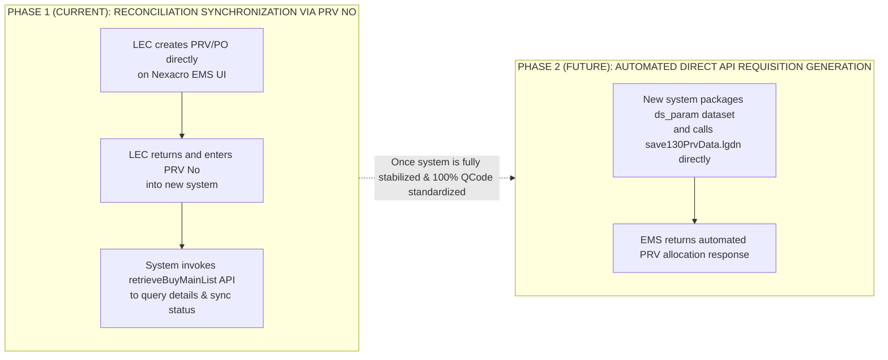

# 01. Parallel Integration Strategy with EMS (Nexacro Protocol)

## 1. Integration Principles & Core System Protection

The EMS system (LG Display Nexacro Platform) serves as the "System of Record" for financial and warehouse inventory transactions. The New Procurement Progress System operates as the agile "System of Engagement".

### Immutable Technical Principles:
1.  **Strictly No Direct Database Access to EMS**: All communications must route through the `ops-workflow` Gateway layer (which handles encoding/decoding of the Nexacro XML wire protocol).
2.  **Protection of EMS Servers**: Always enforce `max_concurrent: 3`, `min_interval: 100ms`, and only allow calls to whitelisted endpoints configured in `allowed_services`.
3.  **Session Auto-Relogin**: Maintain continuous authenticated session persistence for user account `658359 (Pham Duc Long)`.

---

## 2. Detailed Mapping Table of Critical Updated APIs

| EMS API Endpoint | Exchanged Datasets | Business Logic in New System |
| :--- | :--- | :--- |
| `/emsspareparts/sp302/sp330Nav/TargetStockSearchList.lgdn` | `ds_StockInfomation` | **Special CheckDisuse Handling**: Extracts the `holdReasonContent` field as the verbatim lock reason blocking spare part procurement. |
| `/emsspareparts/sp40/sp401Nav/retPartsTransferReqList.lgdn` | `ds_search`, `ds_item` | **Inter-Entity Transfer**: Dispatches requests to sister entities, transitions status to `PENDING_OTHER_ENTITY_CONFIRMATION`. |
| `/emsspareparts/sp40/sp405Nav/retOtherSitePoRevReqList.lgdn` | `ds_list` | Evaluates stock availability across affiliated entity sites based on binary Y/N flags. |
| `/emscom/popupNav/retrieveItemPoStatusList.lgdn` | `ds_Rtn` | Returns all binary Interlock flags: `stopPoFlag`, `transferFlag`, `waitRepairFlag`, `disuseInventoryFlag`. **Critically important**: the **`agingInterlockFlag`** (`'Y'`/`'N'`) field — when `'Y'`, triggers a mandatory task to borrow/use peer team stock prior to purchasing; and the **`unitPriceStatusCode`** field (`UP001` = contract price exists, `UP004: None Price` = price missing) determining the RFQ path. The `agingInterlockFlag` task automatically resolves only when the API re-syncs and the flag transitions to `'N'`. |
| `/emsspareparts/sp102/sp130Nav/save130PrvData.lgdn` | `ds_param` | **Push PRV Requisition Payload to EMS**: Applied in Phase 2 for automated direct requisition generation. |
| `/emsspareparts/sp102/sp135Nav/retrieveItemInfoDetail.lgdn` | `ds_Item`, `ds_Inv` | Retrieves CAD drawing file paths (`fdmUrl`) and historical consumption patterns for EBOM tree visualization. |
| `/emsspareparts/sp105/sp180Nav/EmergencyPoList.lgdn` | `ds_result` | Manages emergency purchase orders (`orderTypeDesc: immediate use`) for critical breakdown recovery. |
| `/emsspareparts/sp130/sp130Nav/retrieveBuyMainList.lgdn` | `ds_search`, `ds_list` | **Phase 1 - Reconciliation Synchronization**: Queries PRV No / PO No details entered by the LEC to synchronize status progression from EMS. |

---

## 3. Phased Pragmatic Rollout Roadmap

The system is designed with a 2-stage pragmatic implementation roadmap to eliminate failure risks associated with premature reliance on EMS write APIs:

### Outstanding Advantages of Phase 1 Strategy:
1. **Absolute Safety**: Eliminates risks of connection drops or fatal exceptions caused by missing schema fields in legacy EMS `ds_param` datasets.
2. **Maximum Operational Flexibility**: The LEC retains full control over PRV creation on EMS, while the new system standardizes internal workflows, aging justifications, Interlock verification, and status tracking.
3. **Extensible Architecture**: Once QCode conventions and API mappings are completely solidified, the system seamlessly enables the Phase 2 pipeline without requiring architectural rewrites.
