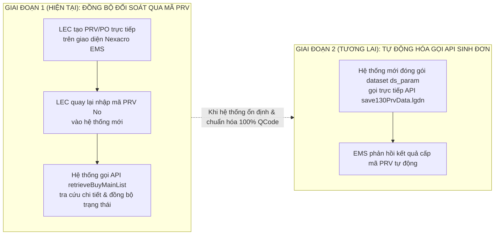

# 01. Chiến Lược Tích Hợp Song Song Với EMS (Nexacro Protocol)

## 1. Nguyên Tắc Tích Hợp & Bảo Vệ Hệ Thống Cốt Lõi

Hệ thống EMS (LG Display Nexacro Platform) được xem là "Nguồn chân lý" (System of Record) về tài chính và kho vận. Hệ thống Mua Bán Mới đóng vai trò là "Lớp vận hành linh hoạt" (System of Engagement).

### Các nguyên tắc kỹ thuật bất biến:
1.  **Không truy cập trực tiếp Database của EMS**: Mọi giao tiếp bắt buộc đi qua tầng Gateway của `ops-workflow` (thực hiện mã hóa/giải mã XML Nexacro wire protocol).
2.  **Bảo vệ máy chủ EMS**: Luôn áp dụng giới hạn `max_concurrent: 3`, `min_interval: 100ms`, và chỉ cho phép gọi các endpoint nằm trong danh sách trắng `allowed_services`.
3.  **Tự động tái đăng nhập phiên (Session Auto-Relogin)**: Giữ phiên làm việc liên tục của tài khoản `658359 (Pham Duc Long)`.

---

## 2. Bảng Xử Lý Chi Tiết Các API Trọng Yếu Đã Cập Nhật

| Đường Dẫn API EMS | Dataset Trao Đổi | Nghiệp Vụ Tại Hệ Thống Mới |
| :--- | :--- | :--- |
| `/emsspareparts/sp302/sp330Nav/TargetStockSearchList.lgdn` | `ds_StockInfomation` | **Xử lý đặc biệt CheckDisuse**: Trích xuất trường `holdReasonContent` làm nguyên văn lý do khóa mua phụ tùng. |
| `/emsspareparts/sp40/sp401Nav/retPartsTransferReqList.lgdn` | `ds_search`, `ds_item` | **Điều chuyển liên pháp nhân**: Gửi yêu cầu sang pháp nhân bạn, đặt trạng thái `PENDING_OTHER_ENTITY_CONFIRMATION`. |
| `/emsspareparts/sp40/sp405Nav/retOtherSitePoRevReqList.lgdn` | `ds_list` | Đánh giá tồn kho tại các site của pháp nhân liên kết theo định dạng cờ Y/N. |
| `/emscom/popupNav/retrieveItemPoStatusList.lgdn` | `ds_Rtn` | Trả về các cờ Interlock nhị phân (`stopPoFlag`, `transferFlag`, `waitRepairFlag`, `disuseInventoryFlag`). |
| `/emsspareparts/sp102/sp130Nav/save130PrvData.lgdn` | `ds_param` | **Đẩy hồ sơ PRV sang EMS**: Áp dụng trong Phase 2 khi mở rộng tự động sinh đơn trực tiếp. |
| `/emsspareparts/sp102/sp135Nav/retrieveItemInfoDetail.lgdn` | `ds_Item`, `ds_Inv` | Lấy đường dẫn bản vẽ CAD (`fdmUrl`) và mức tiêu hao lịch sử phục vụ hiển thị trên cây EBOM. |
| `/emsspareparts/sp105/sp180Nav/EmergencyPoList.lgdn` | `ds_result` | Quản lý các đơn mua khẩn cấp (`orderTypeDesc: tức sử dụng`) cho sự cố máy hỏng. |
| `/emsspareparts/sp130/sp130Nav/retrieveBuyMainList.lgdn` | `ds_search`, `ds_list` | **Phase 1 - Đồng bộ đối soát**: Tra cứu chi tiết PRV No/PO No do LEC nhập để đồng bộ trạng thái từ EMS. |

---

## 3. Lộ Trình Tích Hợp Mở Rộng Dần (Phased Pragmatic Rollout)

Hệ thống được thiết kế theo lộ trình 2 giai đoạn thực tiễn, tránh rủi ro văng lỗi khi phụ thuộc quá sớm vào API ghi của EMS:

### Lợi thế vượt trội của giải pháp Giai đoạn 1:
1. **Tuyệt đối an toàn**: Không sợ lỗi rớt mạng hoặc văng exception do thiếu trường dữ liệu trong dataset `ds_param` của EMS cũ.
2. **Linh hoạt tối đa**: LEC kiểm soát hoàn toàn việc tạo đơn trên EMS, hệ thống mới đóng vai trò chuẩn hóa quy trình nội bộ, giải trình tồn kho, kiểm tra Interlock và theo dõi trạng thái.
3. **Sẵn sàng mở rộng**: Khi các quy tắc mã QCode và API ổn định, hệ thống chỉ cần kích hoạt pipeline Giai đoạn 2 mà không phải đập đi xây lại kiến trúc.

