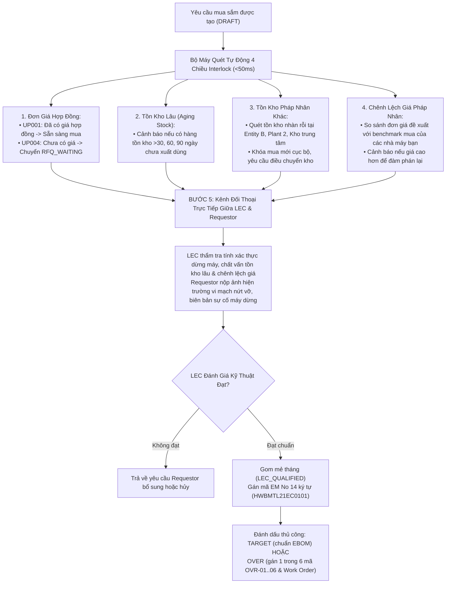
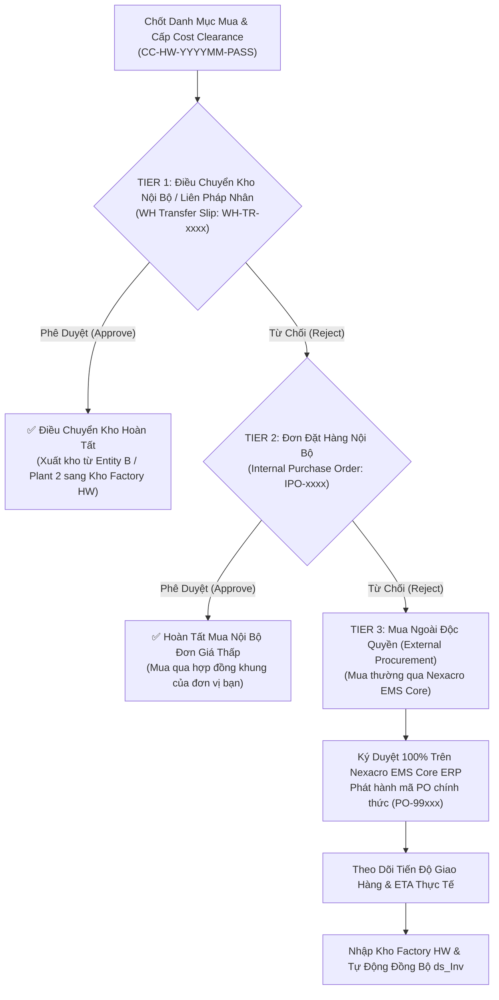

# ĐẶC TẢ TỔNG THỂ HỆ THỐNG QUẢN LÝ TIẾN ĐỘ & MUA SẮM SPARE PARTS
# (MASTER SYSTEM SPECIFICATION & ARCHITECTURE REFERENCE)

> **Dự án**: Spare Parts Procurement Tracking & Engineering Operations Platform  
> **Pháp nhân & Nhà máy**: LG Display Vietnam Haiphong — Factory HW (Display Module Plant 1 - Phân xưởng Smart Watch SW, Org ID: `28753`)  
> **Kiến trúc vận hành**: Song song & Đồng bộ với Nexacro EMS (Core ERP)  
> **Phiên bản tài liệu**: 2.0 Enterprise Single-Source Master Specification  
> **Ngày chuẩn hóa**: Tháng 11/2026  

---

## MỤC LỤC TỔNG THỂ

1. [TỔNG QUAN BỐI CẢNH & 10 NGUYÊN TẮC VÀNG VẬN HÀNH](#1-tổng-quan-bối-cảnh--10-nguyên-tắc-vàng-vận-hành)
2. [CƠ CẤU TỔ CHỨC & MA TRẬN PHÂN QUYỀN VAI TRÒ (RACI)](#2-cơ-cấu-tổ-chức--ma-trận-phân-quyền-vai-trò-raci)
3. [KIẾN TRÚC DỮ LIỆU & ĐỊNH DANH MÃ EM 14 KÝ TỰ (EQUIPMENT TREE)](#3-kiến-trúc-dữ-liệu--định-danh-mã-em-14-ký-tự-equipment-tree)
4. [EBOM TRỰC QUAN HÓA & CƠ CHẾ KHAI BÁO MUỘN (LATE DECLARATION)](#4-ebom-trực-quan-hóa--cơ-chế-khai-báo-muộn-late-declaration)
5. [QUY TRÌNH ONBOARDING QCODE & TẢI FOLDER BẢN VẼ/CATALOG (THEO WORKFLOW CHUẨN)](#5-quy-trình-onboarding-qcode--tải-folder-bản-vẽcatalog-theo-workflow-chuẩn)
6. [CƠ CHẾ INTERLOCK 4 CHIỀU, ĐỐI THOẠI TRỰC TIẾP LEC & REQUESTOR](#6-cơ-chế-interlock-4-chiều-đối-thoại-trực-tiếp-lec--requestor)
7. [QUẢN LÝ NGÂN SÁCH SG (STRICT NO-ROLLOVER), ĐÁNH GIÁ TARGET/OVER & 6 MÃ NGUYÊN NHÂN](#7-quản-lý-ngân-sách-sg-strict-no-rollover-đánh-giá-targetover--6-mã-nguyên-nhân)
8. [KIỂM THẢO ĐẦU THÁNG (NGÀY 01-05), CẦU NỐI GIẢI TRÌNH 3 BÊN, CHỨNG CHỈ COST CLEARANCE & CƠ CHẾ MUA THÁC NƯỚC 3 TẦNG](#8-kiểm-thảo-đầu-tháng-ngày-01-05-cầu-nối-giải-trình-3-bên-chứng-chỉ-cost-clearance--cơ-chế-mua-thác-nước-3-tầng)
9. [ĐẶC TẢ CHI TIẾT 10 MÀN HÌNH CHỨC NĂNG HỆ THỐNG (V2/2026 STANDARDIZED)](#9-đặc-tả-chi-tiết-10-màn-hình-chức-năng-hệ-thống-v22026-standardized)
10. [CHIẾN LƯỢC TÍCH HỢP 2 GIAI ĐOẠN VỚI NEXACRO EMS & GIỚI HẠN TẦN SUẤT API](#10-chiến-lược-tích-hợp-2-giai-đoạn-với-nexacro-ems--giới-hạn-tần-suất-api)

---

## 1. TỔNG QUAN BỐI CẢNH & 10 NGUYÊN TẮC VÀNG VẬN HÀNH

Hệ thống được thiết kế chuyên biệt cho dây chuyền sản xuất Module màn hình Smart Watch (SW) tại **Factory HW (Display Module Plant 1)**. Hệ thống đóng vai trò là **lớp điều hành tác nghiệp (Operational Engagement & Collaboration Layer)** nhằm theo dõi tiến độ mua sắm linh kiện thay thế, cảnh báo và giải trình tồn kho chậm luân chuyển, điều phối báo giá/mã linh kiện, và kiểm soát ngân sách chi phí SG định kỳ.

```
Tập đoàn / Pháp nhân (Enterprise Multi-Plant)
 └── Factory HW (Display Module Plant 1 - Smart Watch Division)
       ├── Bộ phận Quản lý Chi phí (Cost Management Team)
       │     └── 1 Chuyên viên duy nhất đảm nhiệm Reviewer & Assistant
       ├── Đội ngũ Kỹ sư Thiết bị Team (Requestor Team - e.g. PO Module Tech Team 2)
       │     ├── Nhóm LEC Team (Phạm Đức Long - 658359 và các đồng nghiệp LEC)
       │     └── Các Part (e.g. CP/SG Part 1, CP/SG Part 2)
       │           └── Các Kỹ sư Hiện trường (Field Engineers - Quan hệ Đồng nghiệp ngang hàng)
       └── Bộ phận Mua hàng Tập đoàn (Corporate Procurement / Purchase)
             └── Đàm phán thương mại độc lập với Nhà cung cấp
```

### 10 NGUYÊN TẮC VÀNG VẬN HÀNH (10 GOLDEN RULES):

1. **HỆ THỐNG KHÔNG PHÊ DUYỆT — PHÊ DUYỆT HOÀN TOÀN TRÊN EMS**:
   - Toàn bộ phê duyệt chính thức (PRV Approval, PO Signature, Ký duyệt Ngân sách) thực hiện 100% trên **LG Display Nexacro EMS**.
   - Ứng dụng mới chỉ quản trị: tiến độ mua sắm, các mốc giao hàng (Vendor Confirm Date, ETA), hạn mức ngân sách SG, và quản trị tác vụ giải trình tồn kho.
2. **TRIỆT TIÊU PHÂN CẤP CÔNG ĐOẠN — KỸ SƯ LÀ ĐỒNG NGHIỆP NGANG HÀNG**:
   - Không chia cấp bậc hay quy trình phê duyệt nội bộ theo công đoạn (không phân chia nhóm POL, TAB, DIP, LT, DB, BD và không có vai trò Trưởng công đoạn phê duyệt).
   - Mọi kỹ sư trong Part/Team là đồng nghiệp ngang hàng, trực tiếp đăng ký mua sắm cho cụm máy mình quản lý.
3. **CẢNH BÁO TỒN KHO LIÊN TEAM — TÁC VỤ BẮT BUỘC KHÔNG THỂ BỎ QUA**:
   - Khi kỹ sư chọn mã linh kiện mà hệ thống phát hiện tồn kho tại Team khác trong Factory HW (`agingInterlockFlag == 'Y'`):
   - Ngay lập tức hiển thị cảnh báo màu hổ phách và tạo tác vụ bắt buộc kỹ sư phải mượn/chuyển giao hàng tồn này trước khi mua mới.
   - Tác vụ này **không thể đóng thủ công**; hệ thống chỉ tự động gỡ bỏ khi kiểm tra lại EMS thấy cờ tồn kho chuyển sang `'N'`.
4. **KIỂM THẢO CHI PHÍ & TỒN KHO VÀO ĐẦU THÁNG (NGÀY 01-05)**:
   - Các buổi thẩm định chi phí và kiểm thảo linh kiện tồn kho lâu ngày diễn ra định kỳ vào đầu mỗi tháng (từ ngày 01 đến 05) với Bộ phận Quản lý Chi phí.
   - Báo cáo xuất ra duy nhất một file Excel theo Form cố định chuẩn hóa gồm 4 Sheet tiêu chuẩn.
5. **ĐIỀU KIỆN TIÊN QUYẾT ĐỂ THẨM ĐỊNH: BẮT BUỘC PHẢI CÓ MÃ QCODE CHÍNH THỨC**:
   - Tải lên thư mục bản vẽ/catalog chỉ là **bước chuẩn bị dữ liệu kỹ thuật** để LEC đăng ký mã QCode chính thức trên hệ thống ngoài (ERP/EMS).
   - Các hạng mục mang mã tạm (`TMP-HW-xxxx`) tuyệt đối không được đưa vào danh sách thẩm định đầu tháng.
6. **PHÂN LOẠI TARGET VS. OVER DO LEC TRỰC TIẾP ĐÁNH DẤU THỦ CÔNG**:
   - Hệ thống **tuyệt đối không tự động phân loại** Trong Kế hoạch (`TARGET`) hay Ngoài Kế hoạch (`OVER`).
   - Kỹ sư cung cấp mã Work Order (WO) và lý do, LEC căn cứ vào đó để trực tiếp đánh dấu thủ công phân loại và gán 1 trong 6 mã nguyên nhân `OVR-01..06`.
7. **CẤU HÌNH THỜI HẠN & DEADLINE DO LEC QUẢN TRỊ**:
   - Thời hạn kỹ sư phải hoàn thành giải trình tồn kho và thời hạn chốt hồ sơ kiểm thảo đầu tháng do LEC thiết lập thủ công trên hệ thống.
8. **CẦU NỐI THÔNG TIN GIẢI TRÌNH 3 BÊN**:
   - Khi Người thẩm định (Cost Management) có thắc mắc offline $\rightarrow$ LEC nhập câu hỏi lên hệ thống $\rightarrow$ Kỹ sư phản hồi giải trình $\rightarrow$ LEC tổng hợp chuyển tiếp cho Người thẩm định.
9. **QUẢN TRỊ MỐC GIAO HÀNG & PHÂN BỔ CHI PHÍ HÀNG THÁNG**:
   - Tiến độ giao hàng được theo dõi qua các mốc: Ngày NCC xác nhận giao hàng (Vendor Confirm Date), Ngày dự kiến hàng về (ETA), và Kế hoạch phân bổ ghi nhận chi phí theo tháng (`monthlyAllocations`). Việc nhận hàng thực tế được xác nhận đồng bộ từ EMS.
10. **NGÂN SÁCH SG CẤU HÌNH THỦ CÔNG & KHÔNG CỘNG DỒN SỐ DƯ (STRICT NO-ROLLOVER)**:
    - LEC nhập ngân sách hàng tháng thủ công lên hệ thống.
    - Hết tháng, ngân sách còn thừa sẽ hết hiệu lực (`carryoverSurplus = $0`), tuyệt đối không cộng dồn sang tháng sau.

---

## 2. CƠ CẤU TỔ CHỨC & MA TRẬN PHÂN QUYỀN VAI TRÒ (RACI)

### 2.1. Cấu trúc Tổ chức Không Phân Cấp Công Đoạn
```
Nhà máy: Factory HW (Mã: HW | Org ID: 28753)
 └── Phòng ban/Team: PO Module Technology Team 2 (Dept: 87321)
       ├── Nhóm Điều phối Thiết bị (LEC Team):
       │     └── Phạm Đức Long (MSNV: 658359) + Các đồng nghiệp LEC
       ├── Phân nhóm (Part): CP/SG Part 1 (Tầng 2F) & CP/SG Part 2 (Tầng 3F)
       │     └── Các Kỹ sư Hiện trường (Field Engineers): Đồng nghiệp ngang hàng
       └── Bộ phận Quản lý Chi phí (Cost Management): 1 Chuyên viên (Reviewer & Assistant)
```

### 2.2. Ma trận Phân quyền Màn hình (Screen Authorization Matrix)

| Vai trò người dùng | Universal Dashboard | Requestor Portal | Leader Dashboard | LEC Workbench | Cost Mgmt Portal | EBOM Explorer | Admin Console |
| :--- | :---: | :---: | :---: | :---: | :---: | :---: | :---: |
| **Kỹ sư Hiện trường (Requestor)** | 👁️ Theo cụm máy | 🟢 Toàn quyền tạo & nộp hồ sơ | 🚫 Không | 🚫 Không | 🚫 Không | 👁️ Tra cứu & Gán slot | 🚫 Không |
| **Trưởng nhóm / Part (Leader)** | 👁️ Toàn Team/Part | 👁️ Xem tiến độ kỹ sư | 🟢 Toàn quyền giám sát | 👁️ Xem tiến độ | 🚫 Không | 👁️ Tra cứu cấu trúc | 🚫 Không |
| **Điều phối Thiết bị (LEC)** | 👁️ Toàn Team | 👁️ Hỗ trợ kỹ sư | 👁️ Theo dõi | 🟢 Toàn quyền gom mẻ & Interlock | 👁️ Xem câu hỏi thẩm định | 🟢 Cập nhật Mapping | ⚙️ Cài đặt Budget/Deadline |
| **Quản lý Chi phí (Cost Mgmt - 1 người)** | 👁️ Toàn Nhà máy | 🚫 Không | 🚫 Không | 👁️ Tra cứu hồ sơ | 🟢 Toàn quyền thẩm định & Issue inquiry | 👁️ Tra cứu | 🚫 Không |
| **Quản trị Hệ thống (Admin)** | 🟢 Toàn quyền | 🟢 Toàn quyền hỗ trợ | 🟢 Toàn quyền | 🟢 Toàn quyền | 🟢 Toàn quyền | 🟢 Toàn quyền | 🟢 Toàn quyền cấu hình |

*(Ghi chú đặc biệt: Nhân viên Kho vận không sử dụng hệ thống này; dữ liệu xuất nhập kho được tự động đồng bộ từ EMS `ds_Inv`).*

---

## 3. KIẾN TRÚC DỮ LIỆU & ĐỊNH DANH MÃ EM 14 KÝ TỰ (EQUIPMENT TREE)

### 3.1. Công thức Mã Thiết bị EM 14 Ký tự
Mã EM (Equipment Management Code) chuẩn 14 ký tự tuân thủ nghiêm ngặt định dạng:
$$\text{EM\_No} = \text{Plant}(2) + \text{Product}(2) + \text{Process}(2) + \text{Line}(2) + \text{EquipCat}(2) + \text{EqSeq}(2) + \text{SubUnit}(2)$$

| Vị trí | Trường thông tin | Quy cách & Ví dụ | Diễn giải |
| :---: | :--- | :--- | :--- |
| **1-2** | **Plant** | `HW` (Factory HW), `TV` (Factory TV), `AD` (Auto Display) | Nhà máy sản xuất Module |
| **3-4** | **Product Division** | `BM` (Bonding Module), `SM` (Smart Module), `FP` (Flexible Panel) | Ngành hàng sản xuất |
| **5-6** | **Process Code** | `TL` (Total Line), `CL` (Clean Line), `ML` (Main Line) | Phân vùng công đoạn chuẩn hóa |
| **7-8** | **Line Number** | `21` (Line #201 - Tầng 2F), `31` (Line #301 - Tầng 3F) | `Left(Line, 1) = Tầng (Floor)` |
| **9-10**| **Equipment Category** | `EC` (Equipment Core), `DB` (Die Bonder), `TB` (TAB Bonder) | Chủng loại thiết bị |
| **11-12**| **Machine Sequence** | `01`, `02`, `03`... | Số thứ tự máy trên chuyền |
| **13-14**| **Assembly / Sub-Unit** | `01` (Cụm gắp Bonding Head), `02` (Bàn nhiệt Stage Heating) | Cụm cơ cấu chức năng |

*Ví dụ hoàn chỉnh*: `HWBMTL21EC0101` $\rightarrow$ Nhà máy Factory HW, Ngành hàng BM, Line 201 (Tầng 2F), Máy Die Bonder 01, Cụm đầu gắp Bonding Head 01.

### 3.2. Trải nghiệm Kỹ sư: Tên Thân thiện (Friendly Names)
Kỹ sư hiện trường không bắt buộc phải ghi nhớ mã 14 ký tự. Giao diện cung cấp bộ chọn phân cấp:
`Tên Thân Thiện Máy (Machine)` $\rightarrow$ `Tên Chuyền (Line)` $\rightarrow$ `Cụm Cơ Cấu (Mechanism)`  
Hệ thống tự động sinh ra mã EM No 14 ký tự chính xác để lưu vào cơ sở dữ liệu và gửi sang EMS.

---

## 4. EBOM TRỰC QUAN HÓA & CƠ CHẾ KHAI BÁO MUỘN (LATE DECLARATION)

### 4.1. Kiến trúc Cây EBOM
Cây EBOM thiết bị được tổ chức phân cấp 4 tầng:
```
Nhà máy: Factory HW
 └── Dây chuyền: Line #201 (Tầng 2F)
       └── Máy: Die Bonder 01 (Mã: DB-01)
             ├── Cụm 01: Cụm Đầu Gắp (Bonding Head)
             │     ├── Slot 01: Vòi hút Nozzle chân không (QCode: Q-008291, Số lượng tiêu chuẩn: 4)
             │     └── Slot 02: Cảm biến lực Load Cell (QCode: Q-003841, Số lượng tiêu chuẩn: 1)
             └── Cụm 02: Bàn Nhiệt Gia Nhiệt (Heating Stage)
                   └── Slot 01: Điện trở nhiệt Cartridge Heater (QCode: Q-009923, Số lượng tiêu chuẩn: 2)
```

### 4.2. Thao tác Kéo - Thả (Drag & Drop Slot Mapping)
- Giao diện EBOM Explorer cung cấp 2 khung làm việc song song: Khung trái là Cây cơ cấu thiết bị, Khung phải là Kho mã linh kiện đã đăng ký.
- Kỹ sư hoặc LEC chỉ cần kéo mã QCode từ bảng linh kiện thả trực tiếp vào Slot cơ cấu tương ứng để thiết lập liên kết thay thế (Matching).

### 4.3. Cơ chế Khai báo Muộn (Late Declaration Queue)
- Trong các tình huống phát sinh khẩn cấp (sự cố dừng chuyền), kỹ sư được phép tạo yêu cầu mua sắm ngay cả khi linh kiện chưa được khai báo vào Slot EBOM.
- Khi tạo yêu cầu, hệ thống đánh dấu cờ `ebomPendingMapping = true` và tự động sinh ra một Tác vụ Khai báo muộn trong Hộp thư Tác vụ của kỹ sư với thời hạn 7 ngày.
- Kỹ sư quay lại màn hình EBOM để kéo-thả gán Slot sau khi đã giải quyết xong sự cố hiện trường.

---

## 5. QUY TRÌNH ONBOARDING QCODE & TẢI FOLDER BẢN VẼ/CATALOG (THEO WORKFLOW CHUẨN)

Quy trình đăng ký hạng mục được chuẩn hóa theo 3 bước khởi đầu từ tài liệu chuẩn [`procurement-item-registration-flow.puml`](file:///home/longp/projects/company/ops-workflow/procurement-item-registration-flow.puml):

### 5.1. Bước 1: Chọn Vị Trí Cấu Trúc Thiết Bị 4 Tầng & Master Machine Template
- Cấu trúc cây 4 tầng bắt buộc: `Line` (Chuyền) $\rightarrow$ `Machine` (Tên máy) $\rightarrow$ `Unit` (Khối chức năng) $\rightarrow$ `Assembly` (Cơ cấu chi tiết).
- **Quy tắc nhận diện tầng tự động**: $\text{Floor} = \text{Left}(\text{Line}, 1)$. (Ví dụ: `Line 102` $\rightarrow$ Tầng 1 Cleanroom; `Line 305` $\rightarrow$ Tầng 3 Cleanroom).
- **Master Machine Template**: Hỗ trợ sao chép nhanh cấu trúc BOM mẫu giữa các máy giống nhau trên các chuyền song song, giảm 80% thời gian nhập liệu ban đầu.

### 5.2. Bước 2: Cổng Rẽ Nhánh Kiểm Tra Mã QCode ERP
```
[Yêu cầu mua sắm phát sinh]
    │
    ├── [Nhánh 2A: Đã có mã QCode ERP]
    │     ├── Quét/Nhập QCode qua thanh Omni-Search thông minh
    │     ├── Hệ thống tự động điền 100% dữ liệu gốc: Mô tả, Maker, Model, ĐVT,
    │     │   Đơn giá hợp đồng UP001, Tồn kho hiện hữu, Link bản vẽ CAD 2D/3D
    │     └── Trạng thái khởi tạo: DRAFT_ACTIVE
    │
    └── [Nhánh 2B: Chưa có mã QCode - Phụ tùng mới / Cải tiến CIP]
          ├── Đăng ký Tên Hạng Mục (Category: Optics, Pneumatics, Sensors, Heating...)
          ├── Đăng ký Tên Item mới & Quy cách kỹ thuật, Maker sơ bộ
          ├── Kéo thả trọn bộ Folder hồ sơ kỹ thuật (CAD .dwg/.step, Catalog .pdf)
          ├── Hệ thống cấp mã định danh tạm thời: TMP-HW-xxxx
          ├── CHỐT CHẶN CỨNG: Tự động khóa cờ chi phí costBlocked = true
          └── Trạng thái khởi tạo: DRAFT_TMP
```

> [!WARNING]
> **Quy định Chặn Cứng về Mã Tạm (Hard Block Gate)**: Mọi hạng mục còn mang tiền tố `TMP-HW-` sẽ bị hệ thống **khóa chặt không cho phát hành PO mua sắm** và bị Hội đồng Thẩm định Chi phí (ngày 01-05) **từ chối thẩm định ngay lập tức**. Bắt buộc LEC và Kỹ sư phải hoàn tất đăng ký QCode ERP chính thức trước khi đưa vào danh mục mua.

### 5.3. Bước 3: Khai Báo Số Lượng Xin Mua & Bối Cảnh Vận Hành
- Nhập `Request Quantity` (Số lượng xin mua hợp lệ theo ĐVT).
- Chọn `Usage Category` (Lý do sử dụng): `[Setup, Continuous Improvement (CIP), Equipment Breakdown, Preventive Maintenance (PM), Safety Stock Reserve]`.
- Phân tích `Technical Logic & Root Cause`: Ghi rõ cơ chế mài mòn, nứt vỡ nhiệt, cháy hỏng cuộn cảm, biến dạng cơ học.
- Khai báo `Machine Operational Status & Impact`:
  * Máy dừng hẳn (`Line Stop`): Bắt buộc định lượng sản lượng thiếu hụt trong ca (vd: $-150\text{ sp/ca}$).
  * Hoạt động bất thường: Giảm tốc độ, chạy chập chờn.
- Bật `Urgent Priority Flag` (Cờ khẩn cấp): Nếu máy dừng line hoặc có nguy cơ an toàn $\rightarrow$ Kích hoạt SLA xử lý khẩn cấp 24-48h.

---

## 6. CƠ CHẾ INTERLOCK 4 CHIỀU, ĐỐI THOẠI TRỰC TIẾP LEC & REQUESTOR

Mỗi yêu cầu mua sắm sau khi tạo lập phải trải qua **Bộ máy quét Interlock tự động 4 chiều (<50ms execution)**:



---

## 7. QUẢN LÝ NGÂN SÁCH SG (STRICT NO-ROLLOVER), ĐÁNH GIÁ TARGET/OVER & 6 MÃ NGUYÊN NHÂN

### 7.1. Chính sách Ngân sách SG Nghiêm ngặt (Strict No-Rollover)
Ngân sách vật tư SG (Spare Goods Budget) được LEC nhập thủ công đầu tháng theo hạn mức được phê duyệt của Team.
- **Hạn mức phân bổ tháng ($B_{\text{alloc}}$)**: Ví dụ \$150,000 USD.
- **Thực chi PO cam kết ($S_{\text{PO}}$)**: Tổng giá trị các PRV/PO đã phát hành trong tháng.
- **Chi phí xuất kho thực tế từ EMS ($E_{\text{EMS}}$)**: Đồng bộ từ dữ liệu xuất kho thực tế của thủ kho trên EMS (`ds_Inv`).
- **Nguyên tắc Không Cộng Dồn (No-Rollover Policy)**:
  $$\text{Số dư chuyển sang tháng sau} = \$0 \quad (\text{Bắt buộc hết hạn cuối tháng})$$

### 7.2. Đánh giá Thủ công Target vs. Over do LEC
- **Trong Kế hoạch (TARGET)**: Các hạng mục nằm trong danh mục bảo dưỡng định kỳ hoặc thay thế tiêu chuẩn đã đăng ký trước.
- **Ngoài Kế hoạch (OVER)**: Các hạng mục phát sinh ngoài định mức. LEC bắt buộc phải chọn 1 trong 6 mã nguyên nhân chuẩn:

| Mã Over | Tên Nguyên Nhân | Diễn giải Chi tiết | Tài liệu Đối chiếu Bắt buộc |
| :---: | :--- | :--- | :--- |
| `OVR-01` | **Đột xuất hỏng hóc dừng chuyền** | Sự cố thiết bị bất ngờ gây gián đoạn sản xuất (Line Stop) | Mã Work Order (WO) sự cố |
| `OVR-02` | **Tăng sản lượng đột biến** | Nhà máy tăng công suất vượt kế hoạch ban đầu | Kế hoạch sản xuất cập nhật |
| `OVR-03` | **Chậm trễ chuyển giao liên pháp nhân** | Hàng chuyển giao từ pháp nhân khác bị trễ, phải mua khẩn cấp | Mã phiếu Transfer trễ hạn |
| `OVR-04` | **Setup model mới (e.g. D111 $\rightarrow$ D222)** | Cải tạo, căn chỉnh máy để chạy sản phẩm mới | Phiên bản Model & Kế hoạch NPI |
| `OVR-05` | **Biến động giá / Tỷ giá NCC** | NCC tăng giá đơn lẻ hoặc biến động tỷ giá ngoại tệ | Báo giá so sánh của Mua hàng |
| `OVR-06` | **Hư hỏng trong căn chỉnh/lắp đặt** | Linh kiện bị vỡ, hỏng trong quá trình kỹ sư lắp ráp thử nghiệm | Biên bản bất thường kỹ thuật |

---

## 8. KIỂM THẢO ĐẦU THÁNG (NGÀY 01-05), CẦU NỐI GIẢI TRÌNH 3 BÊN, CHỨNG CHỈ COST CLEARANCE & CƠ CHẾ MUA THÁC NƯỚC 3 TẦNG

### 8.1. Quy trình Cầu nối Giải trình 3 Bên (3-Party Bridge)
Reviewer (Cost Management Team - 1 chuyên viên duy nhất kiêm nhiệm Reviewer & Assistant) không làm việc trực tiếp với hàng trăm kỹ sư hiện trường, mà thông qua **Cầu nối Trung gian Độc quyền LEC**:
```
[1. Người Thẩm định Chi phí (Reviewer)]
    │  Xem xét hồ sơ đầu tháng (ngày 01-05), phát hiện linh kiện giá cao hoặc Over bất thường
    │  Tạo câu hỏi thắc mắc trên hệ thống (Status: PENDING_LEC)
    ▼
[2. Điều phối Thiết bị LEC (Trung gian Điều phối)]
    │  Tiếp nhận câu hỏi, bổ sung ghi chú hướng dẫn kỹ thuật
    │  Chuyển tiếp tác vụ giải trình cho Kỹ sư liên quan (Status: PENDING_ENGINEER)
    ▼
[3. Kỹ sư Hiện trường (Requestor)]
    │  Nhận thông báo trong Hộp thư Tác vụ
    │  Nhập nội dung giải trình lý do kỹ thuật, đính kèm biên bản sự cố / hình ảnh hỏng hóc hiện trường
    │  Gửi phản hồi cho LEC (Status: ENGINEER_REPLIED)
    ▼
[4. LEC Tổng hợp & Đệ trình Bằng chứng]
    │  Kiểm tra tính hợp lý kỹ thuật, tổng hợp số liệu
    │  Đệ trình hồ sơ giải trình chuẩn mực cho Người Thẩm định (Status: RESOLVED)
```

### 8.2. Phiên Thẩm định Đầu Tháng (Ngày 01-05) & Chốt Chặn Cứng Mã Tạm (TMP Hard Block)
- **Thời gian diễn ra**: Cố định từ ngày 01 đến ngày 05 hàng tháng.
- **Chốt chặn cứng đối với mã tạm (`TMP-HW-xxxx`)**:
  * Hội đồng Thẩm định kiên quyết **loại bỏ 100% các yêu cầu mua sắm còn mang mã tạm `TMP-`**.
  * Bắt buộc Kỹ sư và LEC phải hoàn tất chuyển đổi sang mã QCode ERP chính thức trước ngày 01.
- **Cấp Chứng chỉ Thẩm duyệt Chi phí (`Cost Clearance Certificate`)**:
  * Sau khi rà soát toàn bộ danh mục, đối soát ngân sách SG và thông qua các giải trình, Reviewer ký cấp chứng chỉ điện tử: `CC-HW-YYYYMM-PASS`.
  * Danh mục đạt chứng chỉ sẽ được **Khóa cứng (Final Purchase List Lock)** để chuyển sang công đoạn Mua hàng.
  * **Chính sách Không Cộng Dồn (Strict No-Rollover)**: Bất kỳ số dư ngân sách nào còn thừa của tháng cũ sẽ tự động hết hạn (`surplus = $0`), không bảo lưu sang tháng tiếp theo.

### 8.3. Cơ Chế Thác Nước 3 Tầng Xử Lý Hạng Mục Interlock & Mua Hàng (3-Tier Waterfall Purchase Execution)
Tại Bước 9, đối với các hạng mục đã được duyệt mua và vượt qua kiểm thảo, hệ thống triển khai cơ chế thác nước 3 tầng nghiêm ngặt nhằm tối ưu hóa chi phí tập đoàn trước khi tiến hành mua mới ra ngoài thị trường:



1. **Tier 1 — Inventory Transfer (Điều chuyển Kho)**:
   - Hệ thống ưu tiên phát hành phiếu điều chuyển kho nội bộ (`WH-TR-xxxx`) để tận dụng tồn kho nhàn rỗi tại Entity B, Plant 2 hoặc Kho Trung tâm.
   - Nếu thủ kho/pháp nhân xuất kho đồng thuận phê duyệt (`Approve`) $\rightarrow$ Quy trình kết thúc thành công với chi phí mua mới bằng 0.
   - Nếu bị từ chối (`Reject`) $\rightarrow$ Tự động chuyển xuống Tier 2.
2. **Tier 2 — Internal Purchase Order (Internal PO)**:
   - Nếu đơn vị bạn có hợp đồng mua sắm khung với nhà cung cấp có mức giá ưu đãi hơn hẳn hoặc quyền hạn mua độc quyền $\rightarrow$ Phát hành đơn mua hàng nội bộ (`IPO-xxxx`).
   - Nếu được phê duyệt (`Approve`) $\rightarrow$ Thực hiện mua nội bộ, tiết kiệm chênh lệch giá.
   - Nếu bị từ chối (`Reject`) $\rightarrow$ Tự động chuyển xuống Tier 3.
3. **Tier 3 — External Procurement via Nexacro EMS Core (Mua Ngoài Độc Quyền)**:
   - Áp dụng khi cả Tier 1 và Tier 2 đều bị từ chối hoặc không khả thi.
   - Chọn nhà cung cấp có đơn giá hợp đồng cạnh tranh nhất.
   - **Ký duyệt hồ sơ 100% trên Nexacro EMS Core ERP** (tuân thủ Golden Rule 1).
   - Hệ thống ghi nhận mã PO chính thức (`PO-99xxx`), theo dõi giao nhận Inbound, cập nhật mốc ETA hàng về xưởng và đồng bộ chỉ số xuất kho qua bảng dữ liệu `ds_Inv`.

### 8.4. Cấu trúc Chuẩn hóa File Báo cáo Excel 4 Sheet (Ngày 25 Hàng Tháng)
Hệ thống kết xuất duy nhất 1 tệp Excel chuẩn mực phục vụ họp ban giám đốc:
- **Sheet 1: `KPI_Summary`**: Bảng điều khiển tài chính tổng thể (Hạn mức SG, Tỷ lệ PO chi, Chi phí xuất kho EMS, Tỷ lệ giải trình tồn kho hoàn thành).
- **Sheet 2: `Target_Requisitions`**: Danh sách toàn bộ các hạng mục mua sắm Trong Kế hoạch (`TARGET`) với mã QCode, đơn giá, mã máy thân thiện và mã EM 14 ký tự.
- **Sheet 3: `Over_Requisitions`**: Danh sách chi tiết các hạng mục Ngoài Kế hoạch (`OVER`), tách bạch rõ: Over do Mua sắm (PO Commit) vs. Over do Xuất kho (EMS Issue), gắn liền với mã nguyên nhân `OVR-01..06` và mã Work Order.
- **Sheet 4: `Aging_Stock_Justifications`**: Bảng tổng hợp toàn bộ giải trình của các kỹ sư về lý do tại sao linh kiện tồn kho lâu ngày chưa đưa vào sử dụng kèm cam kết ngày sử dụng.

---

## 9. ĐẶC TẢ CHI TIẾT 10 MÀN HÌNH CHỨC NĂNG HỆ THỐNG (V2/2026 STANDARDIZED)

Hệ thống giao diện được chuẩn hóa thành 10 tài liệu đặc tả màn hình độc lập tại thư mục [`05-ui-ux-screen-specifications/`](file:///home/longp/projects/company/ops-workflow/procurement-system/05-ui-ux-screen-specifications/):

### 9.1. Màn hình 00: Tổng Quan Kiến Trúc Hệ Thống Màn Hình (`UI-ARCH-00`)
- **Tài liệu**: [`00-tong-quan-kien-truc-he-thong-man-hinh.md`](file:///home/longp/projects/company/ops-workflow/procurement-system/05-ui-ux-screen-specifications/00-tong-quan-kien-truc-he-thong-man-hinh.md)
- **Nội dung**: Ma trận phân quyền 5 vai trò (Requestor, Leader, LEC, Reviewer, Admin), cấu trúc Layout Shell tiêu chuẩn, chuẩn thiết kế Design Tokens, quy tắc trạng thái và phím tắt điều hướng nhanh.

### 9.2. Màn hình 01: Đăng Ký Hạng Mục Mua Hàng (`UI-ROLE-01-REQ`)
- **Tài liệu**: [`01-man-hinh-dang-ky-hang-muc-mua-hang.md`](file:///home/longp/projects/company/ops-workflow/procurement-system/05-ui-ux-screen-specifications/01-man-hinh-dang-ky-hang-muc-mua-hang.md)
- **Nội dung**: Form đăng ký cho Kỹ sư hiện trường với cấu trúc máy 4 tầng (`Line > Machine > Unit > Assembly`), quy tắc nhận diện tầng `Left(Line, 1)`, Omni-Search QCode, cảnh báo tức thời tồn kho liên team và cờ khẩn cấp dừng máy.

### 9.3. Màn hình 02: Onboarding QCode & Tải Thư Mục Bản Vẽ (`UI-ROLE-01-QCODE`)
- **Tài liệu**: [`02-man-hinh-onboarding-qcode-va-tai-folder.md`](file:///home/longp/projects/company/ops-workflow/procurement-system/05-ui-ux-screen-specifications/02-man-hinh-onboarding-qcode-va-tai-folder.md)
- **Nội dung**: Khu vực kéo-thả trọn bộ thư mục hồ sơ linh kiện mới (CAD 2D/3D, Catalog PDF, Specsheet), cấp mã tạm `TMP-HW-xxxx` với chốt chặn cứng chi phí `costBlocked = true`, bàn giao gói hồ sơ cho LEC đăng ký ERP.

### 9.4. Màn hình 03: Hộp Thư Tác Vụ & Giải Trình Tồn Kho (`UI-ROLE-01-TASK`)
- **Tài liệu**: [`03-man-hinh-hop-thu-tac-vu-va-giai-trinh-ton-kho.md`](file:///home/longp/projects/company/ops-workflow/procurement-system/05-ui-ux-screen-specifications/03-man-hinh-hop-thu-tac-vu-va-giai-trinh-ton-kho.md)
- **Nội dung**: Quản lý các tác vụ bắt buộc không thể tự đóng (mượn hàng liên team), tác vụ giải trình tồn kho lâu ngày trước deadline của LEC, và hàng đợi khai báo muộn linh kiện vào EBOM trong 7 ngày.

### 9.5. Màn hình 04: EBOM Kéo-Thả Cơ Cấu Thiết Bị (`UI-ROLE-04-EBOM`)
- **Tài liệu**: [`04-man-hinh-ebom-keo-tha-co-cau.md`](file:///home/longp/projects/company/ops-workflow/procurement-system/05-ui-ux-screen-specifications/04-man-hinh-ebom-keo-tha-co-cau.md)
- **Nội dung**: Cây thiết bị trực quan 4 tầng song song với bảng linh kiện đã đăng ký. Hỗ trợ thao tác kéo-thả gán slot phụ tùng, thiết lập số lượng định mức tiêu chuẩn và sao chép cấu trúc qua Master Machine Template.

### 9.6. Màn hình 05: Điều Phối LEC Master Workbench (`UI-ROLE-03-LEC`)
- **Tài liệu**: [`05-man-hinh-dieu-phoi-lec-master-workbench.md`](file:///home/longp/projects/company/ops-workflow/procurement-system/05-ui-ux-screen-specifications/05-man-hinh-dieu-phoi-lec-master-workbench.md)
- **Nội dung**: Bàn làm việc trung tâm cho Điều phối thiết bị: Gom mẻ xử lý hàng loạt theo trạng thái, trực tiếp đánh giá thủ công `TARGET` vs. `OVER` (gán mã `OVR-01..06` & Work Order), quản lý mốc Vendor Confirm / ETA, điều phối cầu nối 3 bên và cài đặt hạn chót/ngân sách.

### 9.7. Màn hình 06: Giám Sát Leader và Work Order (`UI-ROLE-02-LEAD`)
- **Tài liệu**: [`06-man-hinh-giam-sat-leader-va-work-order.md`](file:///home/longp/projects/company/ops-workflow/procurement-system/05-ui-ux-screen-specifications/06-man-hinh-giam-sat-leader-va-work-order.md)
- **Nội dung**: Bảng giám sát tiến độ mua sắm theo Team và Part, theo dõi tỷ lệ hoàn thành giải trình tồn kho của các kỹ sư đồng nghiệp. Tuyệt đối không chứa nút phê duyệt hệ thống (phê duyệt trên EMS).

### 9.8. Màn hình 07: Thẩm Định Chi Phí Đầu Tháng (`UI-ROLE-06-AUDIT`)
- **Tài liệu**: [`07-man-hinh-tham-dinh-chi-phi-dau-thang.md`](file:///home/longp/projects/company/ops-workflow/procurement-system/05-ui-ux-screen-specifications/07-man-hinh-tham-dinh-chi-phi-dau-thang.md)
- **Nội dung**: Không gian làm việc cho 1 Chuyên viên Thẩm định (Reviewer & Assistant) từ ngày 01 đến 05 hàng tháng: Lọc danh sách đủ điều kiện (chặn cứng `TMP-`), phát hành phiếu chất vấn gửi LEC, xuất file Excel 4 sheet chuẩn mực và cấp chứng chỉ `CC-HW-YYYYMM-PASS`.

### 9.9. Màn hình 08: Dashboard Tổng Quan Toàn Xưởng (`UI-COMMON-08-DASH`)
- **Tài liệu**: [`08-man-hinh-dashboard-tong-quan-toan-xuan.md`](file:///home/longp/projects/company/ops-workflow/procurement-system/05-ui-ux-screen-specifications/08-man-hinh-dashboard-tong-quan-toan-xuan.md)
- **Nội dung**: Bảng điều khiển phân tích tổng quan xưởng HW: Phễu tiến độ mua sắm 7 chặng, biểu đồ đối soát 3 trục ngân sách SG (Budget - PO Commit - Issue Expense), phân bổ 6 mã Over và danh sách cảnh báo tồn kho liên team.

### 9.10. Màn hình 09: Cài Đặt Hệ Thống & Gateway EMS (`UI-ADMIN-09-SYS`)
- **Tài liệu**: [`09-man-hinh-cai-dat-he-thong-va-gateway-ems.md`](file:///home/longp/projects/company/ops-workflow/procurement-system/05-ui-ux-screen-specifications/09-man-hinh-cai-dat-he-thong-va-gateway-ems.md)
- **Nội dung**: Cấu hình quy tắc nhà máy & tầng `Left(Line, 1) = Floor`, cây tổ chức kỹ sư đồng nghiệp, công thức định mức 5 loại nhu cầu, chính sách khóa ngân sách No-Rollover, quản trị bộ đệm Token Bucket (5 req/s) và danh mục mã chuẩn.

---

## 10. CHIẾN LƯỢC TÍCH HỢP 2 GIAI ĐOẠN VỚI NEXACRO EMS & GIỚI HẠN TẦN SUẤT API

### 10.1. Chiến lược 2 Giai đoạn (2-Phase Integration Strategy)
1. **Giai đoạn 1 (Hiện tại - Vận hành Song song)**:
   - Hệ thống chuẩn bị dữ liệu kỹ thuật, gom mẻ, giải trình tồn kho, thẩm định chi phí và đối soát mốc giao hàng.
   - Kỹ sư/LEC thao tác tạo PRV/PO trên Nexacro EMS bên ngoài sau khi hồ sơ đạt chứng chỉ Cost Clearance.
   - LEC nhập mã PRV No / PO No lên hệ thống để gắn kết và theo dõi.
   - Hệ thống quét API từ EMS để đồng bộ trạng thái `ds_Inv` (tồn kho, xuất kho) và trạng thái đơn giá `unitPriceFlag`.
2. **Giai đoạn 2 (Tương lai - Tự động hóa Toàn diện)**:
   - Tích hợp cổng REST/SOAP trực tiếp với Nexacro X-Platform Gateway.
   - Tự động sinh PRV trên EMS khi LEC bấm "Chuyển sang EMS", tự động nhận mã PRV No trả về từ EMS.

### 10.2. Kiểm soát Tần suất Gọi API (Rate Limiting)
- Máy chủ Nexacro EMS của tập đoàn có độ nhạy tải cao. Cổng kết nối tích hợp thuật toán **Token Bucket** với tham số:
  - Tần suất tối đa: `5 requests/giây`.
  - Hàng đợi chờ tối đa: `50 requests`.
  - Cơ chế Re-try Exponential Backoff (1s, 2s, 4s, 8s) khi gặp mã lỗi `EMS-503 (Gateway Busy)`.

---
*Tài liệu này là chuẩn mực duy nhất (Single Source of Truth) chi phối toàn bộ mã nguồn frontend `services/procurement-web` và backend `services/ops-workflow`.*

