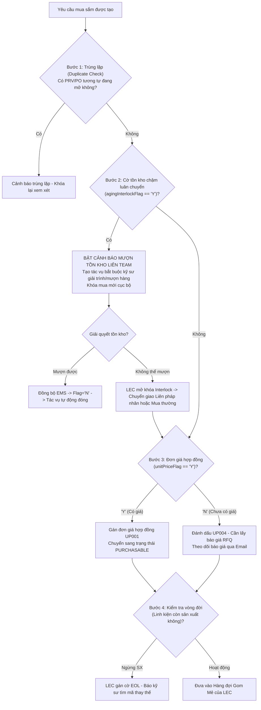

# ĐẶC TẢ TỔNG THỂ HỆ THỐNG QUẢN LÝ TIẾN ĐỘ & MUA SẮM SPARE PARTS
# (MASTER SYSTEM SPECIFICATION & ARCHITECTURE REFERENCE)

> **Dự án**: Spare Parts Procurement Tracking & Engineering Operations Platform  
> **Pháp nhân & Nhà máy**: LG Display Vietnam Haiphong — Factory HW (Display Module Plant 1 - Phân xưởng Smart Watch SW, Org ID: `28753`)  
> **Kiến trúc vận hành**: Song song & Đồng bộ với Nexacro EMS (Core ERP)  
> **Phiên bản tài liệu**: 2.0 Enterprise Single-Source Master Specification  
> **Ngày chuẩn hóa**: Tháng 11/2026  

---

## MỤC LỤC TỔNG THỂ

1. [TỔNG QUAN BỐI CẢNH & 10 NGUYÊN TẮC VÀNG VẬN HÀNH](#1-tổng-quan-bối-cảnh--10-nguyên-tắc-vàng-vận-hành)
2. [CƠ CẤU TỔ CHỨC & MA TRẬN PHÂN QUYỀN VAI TRÒ (RACI)](#2-cơ-cấu-tổ-chức--ma-trận-phân-quyền-vai-trò-raci)
3. [KIẾN TRÚC DỮ LIỆU & ĐỊNH DANH MÃ EM 14 KÝ TỰ (EQUIPMENT TREE)](#3-kiến-trúc-dữ-liệu--định-danh-mã-em-14-ký-tự-equipment-tree)
4. [EBOM TRỰC QUAN HÓA & CƠ CHẾ KHAI BÁO MUỘN (LATE DECLARATION)](#4-ebom-trực-quan-hóa--cơ-chế-khai-báo-muộn-late-declaration)
5. [QUY TRÌNH ONBOARDING QCODE & TẢI FOLDER BẢN VẼ/CATALOG](#5-quy-trình-onboarding-qcode--tải-folder-bản-vẽcatalog)
6. [CƠ CHẾ INTERLOCK 4 BƯỚC, TỒN KHO LIÊN PHÁP NHÂN & CẢNH BÁO MƯỢN HÀNG](#6-cơ-chế-interlock-4-bước-tồn-kho-liên-pháp-nhân--cảnh-báo-mượn-hàng)
7. [QUẢN LÝ NGÂN SÁCH SG (STRICT NO-ROLLOVER), ĐÁNH GIÁ TARGET/OVER & 6 MÃ NGUYÊN NHÂN](#7-quản-lý-ngân-sách-sg-strict-no-rollover-đánh-giá-targetover--6-mã-nguyên-nhân)
8. [KIỂM THẢO ĐẦU THÁNG (NGÀY 01-05), CẦU NỐI GIẢI TRÌNH 3 BÊN & XUẤT BÁO CÁO EXCEL 4 SHEET](#8-kiểm-thảo-đầu-tháng-ngày-01-05-cầu-nối-giải-trình-3-bên--xuất-báo-cáo-excel-4-sheet)
9. [ĐẶC TẢ CHI TIẾT 6 GIAO DIỆN CHỨC NĂNG (UNIVERSAL DASHBOARD + 5 ROLE WORKSPACES)](#9-đặc-tả-chi-tiết-6-giao-diện-chức-năng-universal-dashboard--5-role-workspaces)
10. [CHIẾN LƯỢC TÍCH HỢP 2 GIAI ĐOẠN VỚI NEXACRO EMS & GIỚI HẠN TẦN SUẤT API](#10-chiến-lược-tích-hợp-2-giai-đoạn-với-nexacro-ems--giới-hạn-tần-suất-api)

---

## 1. TỔNG QUAN BỐI CẢNH & 10 NGUYÊN TẮC VÀNG VẬN HÀNH

Hệ thống được thiết kế chuyên biệt cho dây chuyền sản xuất Module màn hình Smart Watch (SW) tại **Factory HW (Display Module Plant 1)**. Hệ thống đóng vai trò là **lớp điều hành tác nghiệp (Operational Engagement & Collaboration Layer)** nhằm theo dõi tiến độ mua sắm linh kiện thay thế, cảnh báo và giải trình tồn kho chậm luân chuyển, điều phối báo giá/mã linh kiện, và kiểm soát ngân sách chi phí SG định kỳ.

```
Tập đoàn / Pháp nhân (Enterprise Multi-Plant)
 └── Factory HW (Display Module Plant 1 - Smart Watch Division)
       ├── Bộ phận Quản lý Chi phí (Cost Management Team)
       │     └── 1 Chuyên viên duy nhất đảm nhiệm Reviewer & Assistant
       ├── Đội ngũ Kỹ sư Thiết bị Team (Requestor Team - e.g. PO Module Tech Team 2)
       │     ├── Nhóm LEC Team (Phạm Đức Long - 658359 và các đồng nghiệp LEC)
       │     └── Các Part (e.g. CP/SG Part 1, CP/SG Part 2)
       │           └── Các Kỹ sư Hiện trường (Field Engineers - Quan hệ Đồng nghiệp ngang hàng)
       └── Bộ phận Mua hàng Tập đoàn (Corporate Procurement / Purchase)
             └── Đàm phán thương mại độc lập với Nhà cung cấp
```

### 10 NGUYÊN TẮC VÀNG VẬN HÀNH (10 GOLDEN RULES):

1. **HỆ THỐNG KHÔNG PHÊ DUYỆT — PHÊ DUYỆT HOÀN TOÀN TRÊN EMS**:
   - Toàn bộ phê duyệt chính thức (PRV Approval, PO Signature, Ký duyệt Ngân sách) thực hiện 100% trên **LG Display Nexacro EMS**.
   - Ứng dụng mới chỉ quản trị: tiến độ mua sắm, các mốc giao hàng (Vendor Confirm Date, ETA), hạn mức ngân sách SG, và quản trị tác vụ giải trình tồn kho.
2. **TRIỆT TIÊU PHÂN CẤP CÔNG ĐOẠN — KỸ SƯ LÀ ĐỒNG NGHIỆP NGANG HÀNG**:
   - Không chia cấp bậc hay quy trình phê duyệt nội bộ theo công đoạn (không phân chia nhóm POL, TAB, DIP, LT, DB, BD và không có vai trò Trưởng công đoạn phê duyệt).
   - Mọi kỹ sư trong Part/Team là đồng nghiệp ngang hàng, trực tiếp đăng ký mua sắm cho cụm máy mình quản lý.
3. **CẢNH BÁO TỒN KHO LIÊN TEAM — TÁC VỤ BẮT BUỘC KHÔNG THỂ BỎ QUA**:
   - Khi kỹ sư chọn mã linh kiện mà hệ thống phát hiện tồn kho tại Team khác trong Factory HW (`agingInterlockFlag == 'Y'`):
   - Ngay lập tức hiển thị cảnh báo màu hổ phách và tạo tác vụ bắt buộc kỹ sư phải mượn/chuyển giao hàng tồn này trước khi mua mới.
   - Tác vụ này **không thể đóng thủ công**; hệ thống chỉ tự động gỡ bỏ khi kiểm tra lại EMS thấy cờ tồn kho chuyển sang `'N'`.
4. **KIỂM THẢO CHI PHÍ & TỒN KHO VÀO ĐẦU THÁNG (NGÀY 01-05)**:
   - Các buổi thẩm định chi phí và kiểm thảo linh kiện tồn kho lâu ngày diễn ra định kỳ vào đầu mỗi tháng (từ ngày 01 đến 05) với Bộ phận Quản lý Chi phí.
   - Báo cáo xuất ra duy nhất một file Excel theo Form cố định chuẩn hóa gồm 4 Sheet tiêu chuẩn.
5. **ĐIỀU KIỆN TIÊN QUYẾT ĐỂ THẨM ĐỊNH: BẮT BUỘC PHẢI CÓ MÃ QCODE CHÍNH THỨC**:
   - Tải lên thư mục bản vẽ/catalog chỉ là **bước chuẩn bị dữ liệu kỹ thuật** để LEC đăng ký mã QCode chính thức trên hệ thống ngoài (ERP/EMS).
   - Các hạng mục mang mã tạm (`TMP-HW-xxxx`) tuyệt đối không được đưa vào danh sách thẩm định đầu tháng.
6. **PHÂN LOẠI TARGET VS. OVER DO LEC TRỰC TIẾP ĐÁNH DẤU THỦ CÔNG**:
   - Hệ thống **tuyệt đối không tự động phân loại** Trong Kế hoạch (`TARGET`) hay Ngoài Kế hoạch (`OVER`).
   - Kỹ sư cung cấp mã Work Order (WO) và lý do, LEC căn cứ vào đó để trực tiếp đánh dấu thủ công phân loại và gán 1 trong 6 mã nguyên nhân `OVR-01..06`.
7. **CẤU HÌNH THỜI HẠN & DEADLINE DO LEC QUẢN TRỊ**:
   - Thời hạn kỹ sư phải hoàn thành giải trình tồn kho và thời hạn chốt hồ sơ kiểm thảo đầu tháng do LEC thiết lập thủ công trên hệ thống.
8. **CẦU NỐI THÔNG TIN GIẢI TRÌNH 3 BÊN**:
   - Khi Người thẩm định (Cost Management) có thắc mắc offline $\rightarrow$ LEC nhập câu hỏi lên hệ thống $\rightarrow$ Kỹ sư phản hồi giải trình $\rightarrow$ LEC tổng hợp chuyển tiếp cho Người thẩm định.
9. **QUẢN TRỊ MỐC GIAO HÀNG & PHÂN BỔ CHI PHÍ HÀNG THÁNG**:
   - Tiến độ giao hàng được theo dõi qua các mốc: Ngày NCC xác nhận giao hàng (Vendor Confirm Date), Ngày dự kiến hàng về (ETA), và Kế hoạch phân bổ ghi nhận chi phí theo tháng (`monthlyAllocations`). Việc nhận hàng thực tế được xác nhận đồng bộ từ EMS.
10. **NGÂN SÁCH SG CẤU HÌNH THỦ CÔNG & KHÔNG CỘNG DỒN SỐ DƯ (STRICT NO-ROLLOVER)**:
    - LEC nhập ngân sách hàng tháng thủ công lên hệ thống.
    - Hết tháng, ngân sách còn thừa sẽ hết hiệu lực (`carryoverSurplus = $0`), tuyệt đối không cộng dồn sang tháng sau.

---

## 2. CƠ CẤU TỔ CHỨC & MA TRẬN PHÂN QUYỀN VAI TRÒ (RACI)

### 2.1. Cấu trúc Tổ chức Không Phân Cấp Công Đoạn
```
Nhà máy: Factory HW (Mã: HW | Org ID: 28753)
 └── Phòng ban/Team: PO Module Technology Team 2 (Dept: 87321)
       ├── Nhóm Điều phối Thiết bị (LEC Team):
       │     └── Phạm Đức Long (MSNV: 658359) + Các đồng nghiệp LEC
       ├── Phân nhóm (Part): CP/SG Part 1 (Tầng 2F) & CP/SG Part 2 (Tầng 3F)
       │     └── Các Kỹ sư Hiện trường (Field Engineers): Đồng nghiệp ngang hàng
       └── Bộ phận Quản lý Chi phí (Cost Management): 1 Chuyên viên (Reviewer & Assistant)
```

### 2.2. Ma trận Phân quyền Màn hình (Screen Authorization Matrix)

| Vai trò người dùng | Universal Dashboard | Requestor Portal | Leader Dashboard | LEC Workbench | Cost Mgmt Portal | EBOM Explorer | Admin Console |
| :--- | :---: | :---: | :---: | :---: | :---: | :---: | :---: |
| **Kỹ sư Hiện trường (Requestor)** | 👁️ Theo cụm máy | 🟢 Toàn quyền tạo & nộp hồ sơ | 🚫 Không | 🚫 Không | 🚫 Không | 👁️ Tra cứu & Gán slot | 🚫 Không |
| **Trưởng nhóm / Part (Leader)** | 👁️ Toàn Team/Part | 👁️ Xem tiến độ kỹ sư | 🟢 Toàn quyền giám sát | 👁️ Xem tiến độ | 🚫 Không | 👁️ Tra cứu cấu trúc | 🚫 Không |
| **Điều phối Thiết bị (LEC)** | 👁️ Toàn Team | 👁️ Hỗ trợ kỹ sư | 👁️ Theo dõi | 🟢 Toàn quyền gom mẻ & Interlock | 👁️ Xem câu hỏi thẩm định | 🟢 Cập nhật Mapping | ⚙️ Cài đặt Budget/Deadline |
| **Quản lý Chi phí (Cost Mgmt - 1 người)** | 👁️ Toàn Nhà máy | 🚫 Không | 🚫 Không | 👁️ Tra cứu hồ sơ | 🟢 Toàn quyền thẩm định & Issue inquiry | 👁️ Tra cứu | 🚫 Không |
| **Quản trị Hệ thống (Admin)** | 🟢 Toàn quyền | 🟢 Toàn quyền hỗ trợ | 🟢 Toàn quyền | 🟢 Toàn quyền | 🟢 Toàn quyền | 🟢 Toàn quyền | 🟢 Toàn quyền cấu hình |

*(Ghi chú đặc biệt: Nhân viên Kho vận không sử dụng hệ thống này; dữ liệu xuất nhập kho được tự động đồng bộ từ EMS `ds_Inv`).*

---

## 3. KIẾN TRÚC DỮ LIỆU & ĐỊNH DANH MÃ EM 14 KÝ TỰ (EQUIPMENT TREE)

### 3.1. Công thức Mã Thiết bị EM 14 Ký tự
Mã EM (Equipment Management Code) chuẩn 14 ký tự tuân thủ nghiêm ngặt định dạng:
$$\text{EM\_No} = \text{Plant}(2) + \text{Product}(2) + \text{Process}(2) + \text{Line}(2) + \text{EquipCat}(2) + \text{EqSeq}(2) + \text{SubUnit}(2)$$

| Vị trí | Trường thông tin | Quy cách & Ví dụ | Diễn giải |
| :---: | :--- | :--- | :--- |
| **1-2** | **Plant** | `HW` (Factory HW), `TV` (Factory TV), `AD` (Auto Display) | Nhà máy sản xuất Module |
| **3-4** | **Product Division** | `BM` (Bonding Module), `SM` (Smart Module), `FP` (Flexible Panel) | Ngành hàng sản xuất |
| **5-6** | **Process Code** | `TL` (Total Line), `CL` (Clean Line), `ML` (Main Line) | Phân vùng công đoạn chuẩn hóa |
| **7-8** | **Line Number** | `21` (Line #201 - Tầng 2F), `31` (Line #301 - Tầng 3F) | `Left(Line, 1) = Tầng (Floor)` |
| **9-10**| **Equipment Category** | `EC` (Equipment Core), `DB` (Die Bonder), `TB` (TAB Bonder) | Chủng loại thiết bị |
| **11-12**| **Machine Sequence** | `01`, `02`, `03`... | Số thứ tự máy trên chuyền |
| **13-14**| **Assembly / Sub-Unit** | `01` (Cụm gắp Bonding Head), `02` (Bàn nhiệt Stage Heating) | Cụm cơ cấu chức năng |

*Ví dụ hoàn chỉnh*: `HWBMTL21EC0101` $\rightarrow$ Nhà máy Factory HW, Ngành hàng BM, Line 201 (Tầng 2F), Máy Die Bonder 01, Cụm đầu gắp Bonding Head 01.

### 3.2. Trải nghiệm Kỹ sư: Tên Thân thiện (Friendly Names)
Kỹ sư hiện trường không bắt buộc phải ghi nhớ mã 14 ký tự. Giao diện cung cấp bộ chọn phân cấp:
`Tên Thân Thiện Máy (Machine)` $\rightarrow$ `Tên Chuyền (Line)` $\rightarrow$ `Cụm Cơ Cấu (Mechanism)`  
Hệ thống tự động sinh ra mã EM No 14 ký tự chính xác để lưu vào cơ sở dữ liệu và gửi sang EMS.

---

## 4. EBOM TRỰC QUAN HÓA & CƠ CHẾ KHAI BÁO MUỘN (LATE DECLARATION)

### 4.1. Kiến trúc Cây EBOM
Cây EBOM thiết bị được tổ chức phân cấp 4 tầng:
```
Nhà máy: Factory HW
 └── Dây chuyền: Line #201 (Tầng 2F)
       └── Máy: Die Bonder 01 (Mã: DB-01)
             ├── Cụm 01: Cụm Đầu Gắp (Bonding Head)
             │     ├── Slot 01: Vòi hút Nozzle chân không (QCode: Q-008291, Số lượng tiêu chuẩn: 4)
             │     └── Slot 02: Cảm biến lực Load Cell (QCode: Q-003841, Số lượng tiêu chuẩn: 1)
             └── Cụm 02: Bàn Nhiệt Gia Nhiệt (Heating Stage)
                   └── Slot 01: Điện trở nhiệt Cartridge Heater (QCode: Q-009923, Số lượng tiêu chuẩn: 2)
```

### 4.2. Thao tác Kéo - Thả (Drag & Drop Slot Mapping)
- Giao diện EBOM Explorer cung cấp 2 khung làm việc song song: Khung trái là Cây cơ cấu thiết bị, Khung phải là Kho mã linh kiện đã đăng ký.
- Kỹ sư hoặc LEC chỉ cần kéo mã QCode từ bảng linh kiện thả trực tiếp vào Slot cơ cấu tương ứng để thiết lập liên kết thay thế (Matching).

### 4.3. Cơ chế Khai báo Muộn (Late Declaration Queue)
- Trong các tình huống phát sinh khẩn cấp (sự cố dừng chuyền), kỹ sư được phép tạo yêu cầu mua sắm ngay cả khi linh kiện chưa được khai báo vào Slot EBOM.
- Khi tạo yêu cầu, hệ thống đánh dấu cờ `ebomPendingMapping = true` và tự động sinh ra một Tác vụ Khai báo muộn trong Hộp thư Tác vụ của kỹ sư với thời hạn 7 ngày.
- Kỹ sư quay lại màn hình EBOM để kéo-thả gán Slot sau khi đã giải quyết xong sự cố hiện trường.

---

## 5. QUY TRÌNH ONBOARDING QCODE & TẢI FOLDER BẢN VẼ/CATALOG

```
[Kỹ sư Hiện trường]
    │  Tải lên toàn bộ Folder (Bản vẽ CAD .dwg, Catalog .pdf, Spec ảnh .png)
    ▼
[Hệ thống Ops-Workflow]
    │  Trích xuất cấu trúc tệp, hiển thị bảng xem trước thuộc tính kỹ thuật
    │  Sinh mã tạm: TMP-HW-xxxx (CỜ: isTempCode = true)
    ▼
[LEC Master Workbench]
    │  Kiểm tra hồ sơ kỹ thuật, tải tài liệu xuống
    │  Đăng ký mã QCode chính thức trên hệ thống ngoài (ERP / EMS Core)
    │  Cập nhật mã QCode chính thức (e.g. Q-009182) vào hệ thống
    ▼
[Đủ điều kiện Thẩm định]
    │  Mã tạm TMP-HW-xxxx được chuyển thành QCode chính thức
    │  Hạng mục đủ điều kiện để đưa vào danh mục Thẩm định Chi phí Đầu tháng
```

> [!WARNING]
> **Quy định Nghiêm ngặt về Mã Tạm**: Mọi hạng mục còn mang tiền tố `TMP-HW-` sẽ bị bộ lọc của Bộ phận Quản lý Chi phí tự động từ chối đưa vào phiên thẩm định đầu tháng.

---

## 6. CƠ CHẾ INTERLOCK 4 BƯỚC, TỒN KHO LIÊN PHÁP NHÂN & CẢNH BÁO MƯỢN HÀNG

Mỗi yêu cầu mua sắm được tạo ra phải trải qua phễu quét Interlock 4 bước tự động:



---

## 7. QUẢN LÝ NGÂN SÁCH SG (STRICT NO-ROLLOVER), ĐÁNH GIÁ TARGET/OVER & 6 MÃ NGUYÊN NHÂN

### 7.1. Chính sách Ngân sách SG Nghiêm ngặt (Strict No-Rollover)
Ngân sách vật tư SG (Spare Goods Budget) được LEC nhập thủ công đầu tháng theo hạn mức được phê duyệt của Team.
- **Hạn mức phân bổ tháng ($B_{\text{alloc}}$)**: Ví dụ \$150,000 USD.
- **Thực chi PO cam kết ($S_{\text{PO}}$)**: Tổng giá trị các PRV/PO đã phát hành trong tháng.
- **Chi phí xuất kho thực tế từ EMS ($E_{\text{EMS}}$)**: Đồng bộ từ dữ liệu xuất kho thực tế của thủ kho trên EMS (`ds_Inv`).
- **Nguyên tắc Không Cộng Dồn (No-Rollover Policy)**:
  $$\text{Số dư chuyển sang tháng sau} = \$0 \quad (\text{Bắt buộc hết hạn cuối tháng})$$

### 7.2. Đánh giá Thủ công Target vs. Over do LEC
- **Trong Kế hoạch (TARGET)**: Các hạng mục nằm trong danh mục bảo dưỡng định kỳ hoặc thay thế tiêu chuẩn đã đăng ký trước.
- **Ngoài Kế hoạch (OVER)**: Các hạng mục phát sinh ngoài định mức. LEC bắt buộc phải chọn 1 trong 6 mã nguyên nhân chuẩn:

| Mã Over | Tên Nguyên Nhân | Diễn giải Chi tiết | Tài liệu Đối chiếu Bắt buộc |
| :---: | :--- | :--- | :--- |
| `OVR-01` | **Đột xuất hỏng hóc dừng chuyền** | Sự cố thiết bị bất ngờ gây gián đoạn sản xuất (Line Stop) | Mã Work Order (WO) sự cố |
| `OVR-02` | **Tăng sản lượng đột biến** | Nhà máy tăng công suất vượt kế hoạch ban đầu | Kế hoạch sản xuất cập nhật |
| `OVR-03` | **Chậm trễ chuyển giao liên pháp nhân** | Hàng chuyển giao từ pháp nhân khác bị trễ, phải mua khẩn cấp | Mã phiếu Transfer trễ hạn |
| `OVR-04` | **Setup model mới (e.g. D111 $\rightarrow$ D222)** | Cải tạo, căn chỉnh máy để chạy sản phẩm mới | Phiên bản Model & Kế hoạch NPI |
| `OVR-05` | **Biến động giá / Tỷ giá NCC** | NCC tăng giá đơn lẻ hoặc biến động tỷ giá ngoại tệ | Báo giá so sánh của Mua hàng |
| `OVR-06` | **Hư hỏng trong căn chỉnh/lắp đặt** | Linh kiện bị vỡ, hỏng trong quá trình kỹ sư lắp ráp thử nghiệm | Biên bản bất thường kỹ thuật |

---

## 8. KIỂM THẢO ĐẦU THÁNG (NGÀY 01-05), CẦU NỐI GIẢI TRÌNH 3 BÊN & XUẤT BÁO CÁO EXCEL 4 SHEET

### 8.1. Quy trình Cầu nối Giải trình 3 Bên (3-Party Bridge)
```
[1. Người Thẩm định Chi phí]
    │  Xem xét hồ sơ đầu tháng (ngày 01-05), phát hiện linh kiện giá cao hoặc Over bất thường
    │  Tạo câu hỏi thắc mắc trên hệ thống (Status: PENDING_LEC)
    ▼
[2. Điều phối Thiết bị LEC]
    │  Tiếp nhận câu hỏi, bổ sung ghi chú hướng dẫn kỹ thuật
    │  Chuyển tiếp tác vụ giải trình cho Kỹ sư liên quan (Status: PENDING_ENGINEER)
    ▼
[3. Kỹ sư Hiện trường]
    │  Nhận thông báo trong Hộp thư Tác vụ
    │  Nhập nội dung giải trình lý do kỹ thuật, đính kèm biên bản/hình ảnh
    │  Gửi phản hồi cho LEC (Status: ENGINEER_REPLIED)
    ▼
[4. LEC Tổng hợp & Đệ trình]
    │  Kiểm tra nội dung giải trình của kỹ sư, xác nhận tính hợp lý
    │  Chuyển giao bằng chứng cho Người Thẩm định (Status: RESOLVED)
```

### 8.2. Cấu trúc Chuẩn hóa File Báo cáo Excel 4 Sheet (Ngày 25 Hàng Tháng)
Hệ thống kết xuất duy nhất 1 tệp Excel chuẩn mực phục vụ họp ban giám đốc:
- **Sheet 1: `KPI_Summary`**: Bảng điều khiển tài chính tổng thể (Hạn mức SG, Tỷ lệ PO chi, Chi phí xuất kho EMS, Tỷ lệ giải trình tồn kho hoàn thành).
- **Sheet 2: `Target_Requisitions`**: Danh sách toàn bộ các hạng mục mua sắm Trong Kế hoạch (`TARGET`) với mã QCode, đơn giá, mã máy thân thiện và mã EM 14 ký tự.
- **Sheet 3: `Over_Requisitions`**: Danh sách chi tiết các hạng mục Ngoài Kế hoạch (`OVER`), tách bạch rõ: Over do Mua sắm (PO Commit) vs. Over do Xuất kho (EMS Issue), gắn liền với mã nguyên nhân `OVR-01..06` và mã Work Order.
- **Sheet 4: `Aging_Stock_Justifications`**: Bảng tổng hợp toàn bộ giải trình của các kỹ sư về lý do tại sao linh kiện tồn kho lâu ngày chưa đưa vào sử dụng kèm cam kết ngày sử dụng.

---

## 9. ĐẶC TẢ CHI TIẾT 6 GIAO DIỆN CHỨC NĂNG

### 9.1. Giao diện 00: Dashboard Phân tích Tổng quan (`UI-COMMON-00`)
- **Phễu Tiến độ 7 Giai đoạn**: Tải Folder QCode $\rightarrow$ Phân tích Interlock $\rightarrow$ Chờ Báo giá RFQ $\rightarrow$ Phê duyệt EMS $\rightarrow$ Theo dõi Inbound/ETA $\rightarrow$ Hàng về Kho HW $\rightarrow$ Xuất kho vào Dây chuyền.
- **Đối soát Ngân sách SG 3 Trục**: Đối chiếu trực quan giữa Hạn mức Ngân sách tháng (\$150k), Thực chi PO cam kết (\$148.2k), và Chi phí xuất kho thực tế từ EMS (\$118.45k).
- **Phân bổ 6 Mã Over**: Biểu đồ phân tích nguyên nhân phát sinh Over kèm danh sách chi tiết các hạng mục gây Over.

### 9.2. Giao diện 01: Cổng Kỹ sư Hiện trường (`UI-ROLE-01`)
- **Tab 1: Đăng ký Mua sắm Thân thiện**: Bộ chọn Tên Máy, Chuyền, Cụm cơ cấu; tự động sinh mã EM 14 ký tự; kiểm tra tức thời tồn kho và đơn giá. Banner màu hổ phách cảnh báo tồn kho liên team.
- **Tab 2: Tải Folder Chuẩn bị Dữ liệu QCode**: Kéo thả thư mục bản vẽ/catalog, hiển thị cây tệp, bảng trích xuất thông số, tạo mã tạm `TMP-HW-xxxx` gửi cho LEC.
- **Tab 3: Hộp thư Tác vụ Bắt buộc**: Quản lý các nhiệm vụ giải trình tồn kho lâu ngày, cảnh báo mượn hàng liên team, và tác vụ khai báo muộn EBOM.
- **Tab 4: Cầu nối Trao đổi 2 Chiều với LEC**: Khung hội thoại giải trình trực tiếp với LEC theo từng mã yêu cầu.

### 9.3. Giao diện 02: Dashboard Giám sát Trưởng nhóm / Part (`UI-ROLE-02`)
- **Giám sát Phân cấp Team $\rightarrow$ Part $\rightarrow$ Kỹ sư**: Theo dõi tiến độ đăng ký của từng kỹ sư trong Part mà không phân biệt công đoạn sản xuất.
- **Theo dõi Tác vụ Giải trình Tồn kho**: Kiểm soát tỷ lệ hoàn thành giải trình tồn kho của các kỹ sư trước hạn chót của LEC.
- **Tuyệt đối Không có Nút Phê duyệt**: Bảng giám sát thuần túy phục vụ đối soát kỹ thuật nội bộ; thông báo nhắc nhở phê duyệt chính thức diễn ra trên EMS.

### 9.4. Giao diện 03: Bàn làm việc LEC Master Workbench (`UI-ROLE-03`)
- **Hỗ trợ Đa LEC**: Chuyển đổi linh hoạt hồ sơ LEC đang trực ban (Phạm Đức Long - 658359 hoặc đồng nghiệp).
- **Gom Mẻ & Xử lý Đồng loạt**: Gom nhóm các hạng mục có cùng trạng thái (`PURCHASABLE`, `INTERLOCK_CHECK`, `CROSS_TEAM_STOCK`, `EOL`) để mở khóa hoặc gửi sang EMS hàng loạt.
- **Đánh giá Thủ công Target / Over**: Bảng điều khiển phân loại trực tiếp từng mã kèm gắn mã `OVR-01..06` và mã Work Order.
- **Quản lý Mốc Inbound & Phân bổ Chi phí**: Nhập ngày Vendor Confirm, ngày ETA hàng về, và ma trận phân bổ ngân sách 3 tháng tới.
- **Cầu nối Thẩm định 3 Bên**: Tiếp nhận câu hỏi từ Cost Management, chuyển cho kỹ sư, và phản hồi lại kết quả.
- **Cấu hình Deadline & Ngân sách**: Thiết lập hạn chót giải trình, hạn chót chốt sổ kiểm thảo, và hạn mức ngân sách SG tháng (Strict No-Rollover).

### 9.5. Giao diện 04: Cổng Thẩm định Quản lý Chi phí (`UI-ROLE-06`)
- **Dành riêng cho 1 Chuyên viên (Reviewer & Assistant)**: Hợp nhất vai trò thẩm tra chi phí và kiểm soát hồ sơ kiểm thảo.
- **Phiên Thẩm định Đầu Tháng (Ngày 01-05)**: Lọc danh sách các hạng mục đủ điều kiện thẩm định (bắt buộc có QCode chính thức, không duyệt mã tạm `TMP-`).
- **Phát hành Phiếu Yêu cầu Giải trình**: Tạo câu hỏi thắc mắc trực tiếp gửi cho LEC đối với các hạng mục Over hoặc giá cao.
- **Kết xuất File Báo cáo Excel 4 Sheet**: Xem trước trực quan và tải xuống tệp Excel chuẩn hóa 4 Sheet phục vụ họp lãnh đạo.
- **Cấp Chứng chỉ Thẩm duyệt Chi phí (Cost Clearance)**: Ký xác nhận thông qua danh mục sau khi giải trình thành công.

### 9.6. Giao diện 05: Khám phá Cây EBOM Thiết bị Kéo - Thả (`UI-ROLE-07`)
- **Cây Thiết bị Trực quan**: Hiển thị phân cấp Nhà máy $\rightarrow$ Chuyền $\rightarrow$ Máy $\rightarrow$ Cụm Cơ cấu $\rightarrow$ Slot linh kiện.
- **Kéo - Thả Gán Linh Kiện**: Thao tác kéo mã QCode thả vào Slot cơ cấu để thiết lập định mức tiêu chuẩn và chu kỳ thay thế.
- **Hàng đợi Khai báo Muộn**: Danh sách các linh kiện đã mua phát sinh khẩn cấp cần kỹ sư hoàn thiện gán Slot trong vòng 7 ngày.

### 9.7. Giao diện 06: Cài đặt Hệ thống Quản trị (`UI-ROLE-05`)
- **Tab 1: Cấu trúc Nhà máy & Tầng**: Định nghĩa quy tắc `Left(Line, 1) = Tầng (Floor)` cho Factory HW, TV, Auto Display.
- **Tab 2: Cây Tổ chức Multi-Team**: Cấu hình các Team và Part với các kỹ sư đồng nghiệp ngang hàng (triệt tiêu phân cấp công đoạn).
- **Tab 3: Công thức Tính Nhu cầu 5 Loại**: Công thức định mức Setup, Cải tiến (Improve), Sự cố (Breakdown), Bảo dưỡng (PM), và Dự phòng an toàn (Safety Stock).
- **Tab 4: Chính sách Ngân sách & Deadline**: Khóa chính sách Không cộng dồn (No-Rollover) và thời gian đóng băng dữ liệu.
- **Tab 5: Cổng Tích hợp Nexacro EMS**: Quản trị giới hạn tần suất Token Bucket (5 req/s), giám sát độ trễ API và trạng thái kết nối.
- **Tab 6: Danh mục Mã Chuẩn**: Quản lý 6 mã Over `OVR-01..06`, các loại nhu cầu và đơn vị đo lường.

---

## 10. CHIẾN LƯỢC TÍCH HỢP 2 GIAI ĐOẠN VỚI NEXACRO EMS & GIỚI HẠN TẦN SUẤT API

### 10.1. Chiến lược 2 Giai đoạn (2-Phase Integration Strategy)
1. **Giai đoạn 1 (Hiện tại - Vận hành Song song)**:
   - Hệ thống chuẩn bị dữ liệu kỹ thuật, gom mẻ, giải trình tồn kho và đối soát mốc giao hàng.
   - Kỹ sư/LEC thao tác tạo PRV/PO trên Nexacro EMS bên ngoài.
   - LEC nhập mã PRV No / PO No lên hệ thống để theo dõi.
   - Hệ thống quét API từ EMS để đồng bộ trạng thái `ds_Inv` (tồn kho, xuất kho) và trạng thái đơn giá `unitPriceFlag`.
2. **Giai đoạn 2 (Tương lai - Tự động hóa Toàn diện)**:
   - Tích hợp cổng REST/SOAP trực tiếp với Nexacro X-Platform Gateway.
   - Tự động sinh PRV trên EMS khi LEC bấm "Chuyển sang EMS", tự động nhận mã PRV No trả về từ EMS.

### 10.2. Kiểm soát Tần suất Gọi API (Rate Limiting)
- Máy chủ Nexacro EMS của tập đoàn có độ nhạy tải cao. Cổng kết nối tích hợp thuật toán **Token Bucket** với tham số:
  - Tần suất tối đa: `5 requests/giây`.
  - Hàng đợi chờ tối đa: `50 requests`.
  - Cơ chế Re-try Exponential Backoff (1s, 2s, 4s, 8s) khi gặp mã lỗi `EMS-503 (Gateway Busy)`.

---
*Tài liệu này là chuẩn mực duy nhất (Single Source of Truth) chi phối toàn bộ mã nguồn frontend `services/procurement-web` và backend `services/ops-workflow`.*

