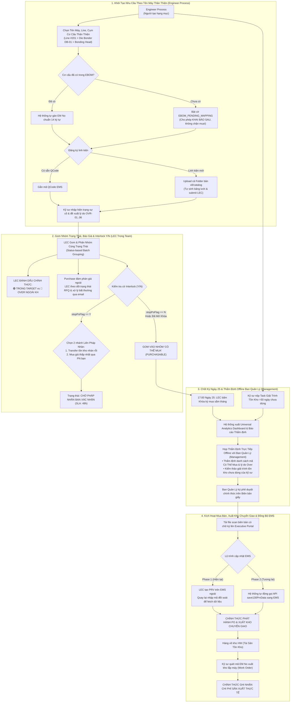

# Hệ Thống Quản Lý Mua Bán Phụ Tùng (Spare Parts Procurement System)
> **Mô hình hoạt động song song với hệ thống EMS (LG Display Nexacro Platform)**  
> *Ngành sản phẩm: Smart Watch (SW) = Nhà máy: Factory HW (Display Module Plant 1)*

---

## 1. Bối Cảnh Nghiệp Vụ & Các Nguyên Tắc Vận Hành Cốt Lõi (Cập Nhật Toàn Diện)

Hệ thống được thiết kế dựa trên thực tế vận hành dây chuyền sản xuất linh kiện Smart Watch tại **Factory HW** (Display Module Plant 1 - Org ID: 28753), đồng thời xây dựng theo kiến trúc mô-đun hóa linh hoạt để **dễ dàng nhân rộng và áp dụng ngay cho các Team khác và Nhà máy khác (Nhà máy TV, Auto Display...)**.

```
Tập Đoàn / Công Ty (Nhiều Pháp Nhân & Nhiều Nhà Máy)
 └── Factory HW (Display Module Plant 1 - Ngành Smart Watch) / Factory TV / Auto Display
       │
       ├── Team Management (Ban Lãnh Đạo / Quản Lý Nhà Máy)
       │     └── Thẩm định kiểm thảo hàng tháng (ngày 25): Duyệt trước khi chuyển giao/mua
       │
       ├── Team (Ví dụ: PO Module Technology Team 2 - Mã BP: 87321)
       │     │
       │     ├── Nhóm LEC Trong Team (Multi-LEC: Pham Duc Long - 658359 cùng các đồng sự)
       │     │     ├── Gom đơn cùng trạng thái, xử lý đồng loạt, đăng ký EM No
       │     │     ├── Đánh dấu Trong Target vs Over, phân loại hàng ngừng sản xuất EOL
       │     │     ├── Theo dõi RFQ Purchase & xử lý bất thường qua email
       │     │     └── Nhập budget thủ công hàng tháng (KHÔNG CỘNG DỒN SỐ DƯ)
       │     │
       │     └── Part (Phân ban - ví dụ: CP/SG Part 1)
       │           │
       │           └── Process (Các công đoạn: POL, TAB, DIP, LT, DB, BD):
       │                 ├── Process Leaders: Giám sát, thẩm tra Work Order
       │                 └── Engineer Process: Kỹ sư trực tiếp vận hành máy (NGƯỜI TẠO HẠNG MỤC)
       │                       ↳ Làm việc trực tiếp với TÊN Machine, Line, Assembly thân thiện
```

### 10 Nguyên tắc vận hành cốt lõi:

1. **Requestor làm việc với Tên thân thiện — LEC quản lý mã EM No**:
   - Kỹ sư công đoạn (`Engineer Process`) chỉ làm việc với các tên gọi trực quan tại hiện trường: **Tên Machine, Line, Assembly**. Kỹ sư không cần phải nhớ hoặc gõ chuỗi 14 ký tự EM No phức tạp.
   - **LEC là người đăng ký mã EM No 14 ký tự** và thiết lập ánh xạ mô tả tương ứng lên hệ thống.
2. **Gom đơn và xử lý đồng loạt theo trạng thái**:
   - Nhóm LEC gom và kiểm tra các hạng mục đăng ký từ các kỹ sư trong Team theo cùng trạng thái để xử lý hàng loạt.
   - Nếu mã linh kiện ở trạng thái có thể mua (không vướng chặn) $\rightarrow$ gom lại để thẩm định kỹ thuật và chuẩn bị chốt kỳ mua.
3. **Theo dõi báo giá Purchase & Xử lý bất thường qua Email**:
   - Về báo giá: LEC **chỉ cần theo dõi trạng thái RFQ** (Đang yêu cầu báo giá / Đã có giá).
   - Khi có bất thường (giá tăng cao, nhà cung cấp hết hàng, thời gian giao hàng quá dài) nhận thông tin qua email $\rightarrow$ LEC nhập thông tin lên hệ thống để phản hồi cho Requestor hoặc xử lý.
4. **2 Hình thức Giao dịch liên pháp nhân**:
   - *(1) Chuyển giao tồn kho (Inventory Transfer)* từ kho của pháp nhân bạn.
   - *(2) Mua với giá thấp nhất từ pháp nhân khác*: Tận dụng hợp đồng/đơn giá ưu đãi của pháp nhân liên kết nếu giá mua qua bên đó thấp hơn.
5. **EBOM Matching chi tiết cơ cấu — Đơn giản hóa bằng Kéo Thả (Drag & Drop)**:
   - Mua bán linh kiện bắt buộc matching với **chi tiết cơ cấu cụm máy** để xác định chính xác thay thế cho bộ phận nào trong trường hợp thay thế hỏng.
   - **Linh hoạt khai báo sau**: Trường hợp chi tiết cơ cấu chưa có trên cây EBOM, hệ thống vẫn cho phép tạo đơn và **bắt buộc khai báo bổ sung sau**.
   - Cung cấp giao diện **kéo thả linh kiện vào cụm cơ cấu (Drag-and-Drop EBOM Mapper)** để giảm thiểu tối đa độ phức tạp cho người dùng.
6. **Đăng ký QCode qua Upload cả Folder bản vẽ & catalog**:
   - Kỹ sư có thể tải lên **nguyên cả thư mục (folder)** chứa bản vẽ CAD, tài liệu catalog, thông số kỹ thuật $\rightarrow$ Hệ thống tự động phân tích và sinh ra bảng thông tin thuộc tính cần điền.
   - Kỹ sư điền thông tin ban đầu $\rightarrow$ Submit cho LEC hoàn thiện.
   - **Lộ trình thực tế**: Tạm thời đăng ký bên ngoài (trên ERP/EMS) rồi cập nhật thông tin QCode lên hệ thống; sau này cung cấp thêm thông tin để tự động đăng ký trực tiếp lên ERP.
7. **LEC là người chính thức đánh dấu Trong Target hay Over**:
   - Kỹ sư cung cấp lý do, vấn đề, hiện trạng và phân loại nhu cầu cơ sở.
   - **LEC mới là người chính thức đánh dấu nhãn `🟢 TRONG TARGET` hay `🔴 OVER NGOÀI KẾ HOẠCH`** dựa trên đối chiếu ngân sách và tính hợp lý của lý do kỹ sư cung cấp.
8. **Phân loại lại hàng Ngừng sản xuất (EOL) dù EMS vẫn báo Active**:
   - Một số thông tin từ hệ thống EMS cũ không đầy đủ hoặc bị chậm cập nhật (ví dụ: trên EMS cờ vẫn là Active nhưng nhà sản xuất đã khai tử).
   - LEC chủ động kiểm tra, phân loại lại vào nhóm **Ngừng sản xuất (Discontinued / EOL)** và phản hồi cho Requestor để tìm phương án mã thay thế.
9. **Budget: Nhập thủ công & TUYỆT ĐỐI KHÔNG CỘNG DỒN SỐ DƯ**:
   - Thông tin hạn mức ngân sách SG do **LEC nhập thủ công lên hệ thống hàng tháng**.
   - **Tuyệt đối KHÔNG CỘNG DỒN SỐ DƯ** từ tháng trước sang tháng sau; ngân sách tháng nào kiểm soát và chốt dứt điểm tháng đó.
10. **Mua bán & Chuyển giao chỉ thực hiện SAU THẨM ĐỊNH — Dễ dàng áp dụng cho Nhà máy khác**:
    - Mọi hoạt động Mua mới (PO) và Chuyển giao (Transfer) **bắt buộc phải diễn ra SAU KHI Hội Đồng Thẩm Định & Kiểm Thảo phê duyệt**.
    - Kiến trúc tham số hóa đa đơn vị: Dễ dàng cấu hình để áp dụng ngay cho các Team khác trong Factory HW hoặc các nhà máy khác trong tập đoàn (Factory TV, Auto Display...).

---

## 2. Bản Đồ Thư Mục Phân Tách Theo Nhiệm Vụ (Task-Based Architecture)

Toàn bộ hệ thống được phân rã thành **7 thư mục nhiệm vụ độc lập**:

```
procurement-system/
│
├── 01-master-data-and-ebom/                    # NHIỆM VỤ 1: Master Data, Cây Thiết Bị EBOM & Đăng Ký Hàng Loạt
│   ├── 01-organization-and-plant-hierarchy.md  # Factory HW = Smart Watch, Multi-LEC, 2 phương án Liên pháp nhân, Multi-Plant
│   ├── 02-ebom-structure-and-equipment-tree.md # Tên thân thiện vs EM No, Drag-and-Drop EBOM Slot Mapper, Cơ chế Khai báo sau
│   └── 03-batch-qcode-registration-and-media.md# Upload cả Folder bản vẽ/catalog -> Bảng lưới -> Submit LEC hoàn thiện (2 giai đoạn)
│
├── 02-requestor-and-leader-portal/             # NHIỆM VỤ 2: Cổng Kỹ Sư & Bàn Điều Khiển Leader Nội Bộ Team
│   ├── 01-requestor-requisition-workbench.md   # Đăng ký đơn lẻ/lưới, phân loại Trong Target vs Over
│   ├── 02-leader-team-monitoring-dashboard.md  # Leader giám sát toàn diện mua sắm nội bộ theo Team => Part => Process
│   └── 03-auto-requisition-engine.md           # Động cơ tự động sinh đơn theo sản lượng & MTBF
│
├── 03-lec-workbench-and-interlock/             # NHIỆM VỤ 3: Bàn Làm Việc LEC, Báo Giá & Interlock
│   ├── 01-interlock-resolution-process.md      # Quy trình Interlock Y/N, Chờ pháp nhân xác nhận, EOL phân loại lại, Phase 1 & 2
│   ├── 02-purchase-quotation-coordination.md   # Theo dõi trạng thái RFQ, xử lý bất thường qua email từ Purchase & phản hồi Kỹ sư
│   └── 03-batch-interlock-resolver.md          # Gom theo trạng thái, lọc mã 'Có thể mua' đưa vào thẩm định, đánh dấu Target/Over
│
├── 04-budget-cost-and-over-management/         # NHIỆM VỤ 4: Ngân Sách SG, Chi Phí Mua/Xuất & Xử Lý Over
│   ├── 01-sg-budget-and-cost-accounting.md     # Ngân sách tháng LEC nhập thủ công, TUYỆT ĐỐI KHÔNG ROLLOVER, Chi phí Mua vs Xuất
│   ├── 02-unplanned-over-budget-tracking.md    # Phân loại Over ngoài kế hoạch do LEC đánh dấu, chuẩn hóa 6 mã OVR
│   └── 03-monthly-offline-management-audit.md  # Kiểm thảo giải trình tồn kho chưa dùng & Thẩm định offline ngày 25 với Management
│
├── 05-ui-ux-screen-specifications/             # NHIỆM VỤ 5: Đặc Tả Giao Diện Tách Nhỏ Riêng Biệt Cho Từng Vai Trò
│   ├── 00-role-based-screen-matrix.md          # Ma trận phân định & bản đồ điều hướng theo 6 vai trò
│   ├── 00-common-dashboard/                    # MÀN HÌNH CHUNG / DASHBOARD BÁO CÁO TOÀN NHÀ MÁY
│   │   └── screen-universal-analytics-dashboard.md # Dashboard: Phễu tiến độ, tồn kho, ngân sách SG, phân tích & danh sách Over
│   ├── 01-role-requestor/                      # VAI TRÒ 1: Kỹ Sư Công Đoạn (Engineer Process)
│   │   └── screen-requestor-portal.md          # Cổng Kỹ Sư: Tên máy thân thiện, upload folder QCode, late EBOM, Task tồn kho
│   ├── 02-role-leader/                         # VAI TRÒ 2: Quản Lý Các Cấp (Process / Part / Team Leader)
│   │   └── screen-leader-team-dashboard.md     # Bàn Leader: Giám sát Team, thẩm tra Work Order, rà soát Task giải trình
│   ├── 03-role-lec/                            # VAI TRÒ 3: LEC Quản Lý Spare Part (Pham Duc Long - 658359)
│   │   └── screen-lec-master-workbench.md      # Bàn LEC: Gom trạng thái, lọc Purchasable, CheckDisuse, RFQ mail, budget tháng
│   ├── 04-role-warehouse/                      # VAI TRÒ 4: Thủ Kho Nhà Máy HW (Warehouse Storekeeper)
│   │   └── screen-warehouse-portal.md          # Cổng Thủ Kho: Quét Barcode EM No xuất lắp máy & hạch toán chi phí thực
│   ├── 05-role-admin/                          # VAI TRÒ 5: Quản Trị Hệ Thống (System Administrator)
│   │   └── screen-admin-settings-portal.md     # Cổng Admin: Cấu hình 6 tab (Logic mua, nhà xưởng đa đơn vị, RBAC, Gateway EMS)
│   ├── 06-role-management/                     # VAI TRÒ 6: Ban Giám Đốc Thẩm Định Offline (Reviewer & Assistant)
│   │   └── screen-management-audit-portal.md   # Cổng Lãnh Đạo: Thẩm định kiểm thảo ngày 25 (duyệt trước khi chuyển giao/PO)
│   ├── 07-screen-ebom-visual-tree-explorer.md  # Bàn thiết kế kéo - thả EBOM trực quan (Drag-and-Drop EBOM Slot Mapper)
│   └── phan-tich-phan-bien-man-hinh-chuc-nang.md # TÀI LIỆU PHÂN TÍCH & PHẢN BIỆN CHUYÊN SÂU CÁC MÀN HÌNH CHỨC NĂNG
│
├── 06-process-workflows-and-diagrams/          # NHIỆM VỤ 6: Toàn Bộ Sơ Đồ Workflow & Process Chi Tiết
│   ├── 01-end-to-end-procurement-workflow.md   # Sơ đồ Swimlane quy trình đầu - cuối các tác nhân
│   ├── 02-inter-entity-transfer-workflow.md    # Sơ đồ Giao dịch liên pháp nhân: 2 nhánh (Transfer & Mua giá thấp nhất)
│   ├── 03-rfq-and-purchase-tracking-flow.md    # Sơ đồ Theo dõi trạng thái RFQ & xử lý bất thường nhận qua email
│   ├── 04-target-vs-over-evaluation-flow.md    # Cây quyết định phân loại Trong Target vs Over do LEC đánh dấu chính thức
│   └── 05-monthly-offline-audit-workflow.md    # Quy trình kiểm thảo tồn kho chưa dùng, chốt ngày 25 & thẩm định Management
│
└── 07-integration-and-api-specs/               # NHIỆM VỤ 7: Tích Hợp EMS & Hợp Đồng REST API v1
    ├── 01-ems-nexacro-integration-strategy.md  # Bản đồ 18 API EMS, đọc holdReasonContent, đẩy PRV Phase 1 & 2
    └── 02-ops-workflow-api-contracts.md        # Hợp đồng REST API v1, JSON Schemas & Docker setup
```

---

## 3. Phân Định Giao Diện Độc Lập Cho Từng Vai Trò Người Dùng

Hệ thống cung cấp **1 Màn Hình Chung / Dashboard Báo Cáo** cùng **6 Không Gian Giao Diện Chuyên Biệt Cho 6 Vai Trò**:

| Không Gian Giao Diện | Vai Trò / Đối Tượng | Liên Kết Tài Liệu Chi Tiết | Các Chức Năng Cốt Lõi |
| :--- | :--- | :--- | :--- |
| **0. Màn Hình Chung**<br>(Universal Dashboard) | Dùng chung toàn nhà máy HW | [`00-common-dashboard`](file:///home/longp/projects/company/ops-workflow/procurement-system/05-ui-ux-screen-specifications/00-common-dashboard/screen-universal-analytics-dashboard.md) | Phễu tiến độ mua sắm 7 bước, KPIs tồn kho, ngân sách SG 3-chiều, phân tích 6 mã Over và danh sách chi tiết các hạng mục gây Over (cả do Mua hàng và do Xuất kho) |
| **1. Requestor Portal**<br>(Kỹ Sư Công Đoạn) | Kỹ sư vận hành máy | [`01-role-requestor`](file:///home/longp/projects/company/ops-workflow/procurement-system/05-ui-ux-screen-specifications/01-role-requestor/screen-requestor-portal.md) | Giải mã EM No 14 ký tự, snapshot tồn kho, 5 nhu cầu cơ sở & logic rule, lưới Excel, EBOM, đối thoại LEC và **Task Giải Trình Tồn Kho Chưa Dùng** |
| **2. Leader Dashboard**<br>(Quản Lý Các Cấp) | Process/Part/Team Leader | [`02-role-leader`](file:///home/longp/projects/company/ops-workflow/procurement-system/05-ui-ux-screen-specifications/02-role-leader/screen-leader-team-dashboard.md) | Giám sát Team => Part => Process, thẩm tra Work Order máy hỏng kèm ảnh hiện trường, rà soát Task giải trình tồn kho của kỹ sư |
| **3. LEC Workbench**<br>(LEC Trong Team) | Nhóm LEC (Multi-LEC) | [`03-role-lec`](file:///home/longp/projects/company/ops-workflow/procurement-system/05-ui-ux-screen-specifications/03-role-lec/screen-lec-master-workbench.md) | Multi-LEC gom đơn toàn team, Interlock 4 bước Y/N, CheckDisuse popup, theo dõi giá Purchase, chốt kỳ 25 và Modal đối soát mã PRV EMS |
| **4. Warehouse Portal**<br>(Thủ Kho HW) | Thủ kho nhà máy HW | [`04-role-warehouse`](file:///home/longp/projects/company/ops-workflow/procurement-system/05-ui-ux-screen-specifications/04-role-warehouse/screen-warehouse-portal.md) | Quét barcode EM No 14 ký tự & serial linh kiện, xuất kho lắp máy, hạch toán chi phí sử dụng vào máy, đối soát tồn kho vật lý HW vs EMS |
| **5. Admin Console**<br>(Quản Trị Hệ Thống) | Quản trị viên hệ thống | [`05-role-admin`](file:///home/longp/projects/company/ops-workflow/procurement-system/05-ui-ux-screen-specifications/05-role-admin/screen-admin-settings-portal.md) | Cấu hình 6 Tab: Logic 5 nhu cầu, Master Data xưởng, Phân cấp Line `Left(Line,1)=Floor`, RBAC, Ngân sách SG 33-33-34, Gateway EMS |
| **6. Management Portal**<br>(Ban Giám Đốc) | Reviewer & Assistant | [`06-role-management`](file:///home/longp/projects/company/ops-workflow/procurement-system/05-ui-ux-screen-specifications/06-role-management/screen-management-audit-portal.md) | Kiểm thảo ngày 25, phê duyệt kế hoạch trước khi kích hoạt Chuyển giao/PO, rà soát danh sách Over và kho lưu trữ biên bản giấy scan |

*(Chi tiết kiến trúc phân quyền xem tại [00-role-based-screen-matrix.md](file:///home/longp/projects/company/ops-workflow/procurement-system/05-ui-ux-screen-specifications/00-role-based-screen-matrix.md); Đọc phản biện chuyên sâu tại [phan-tich-phan-bien-man-hinh-chuc-nang.md](file:///home/longp/projects/company/ops-workflow/procurement-system/05-ui-ux-screen-specifications/phan-tich-phan-bien-man-hinh-chuc-nang.md))*.

*(Chi tiết kiến trúc phân quyền xem tại [00-role-based-screen-matrix.md](file:///home/longp/projects/company/ops-workflow/procurement-system/05-ui-ux-screen-specifications/00-role-based-screen-matrix.md))*.

---

## 4. Quy Trình Vận Hành Đầu - Cuối


