# Hệ Thống Quản Lý Mua Bán Phụ Tùng (Spare Parts Procurement System)
> **Mô hình hoạt động song song với hệ thống EMS (LG Display Nexacro Platform)**  
> *Ngành sản phẩm: Smart Watch (SW) = Nhà máy: Factory HW (Display Module Plant 1)*

---

## 1. Bối Cảnh Nghiệp Vụ & Các Nguyên Tắc Vận Hành Cốt Lõi

Hệ thống được thiết kế dựa trên thực tế vận hành dây chuyền sản xuất linh kiện Smart Watch tại **Factory HW** (trong đó **Factory HW chính là toàn bộ ngành Smart Watch - SW**). 

Hệ thống chuẩn hóa sự phối hợp nội bộ trong cấu trúc phòng ban:
$$\mathbf{Team\ (Ph\grave{o}ng\ Ban)} \Longrightarrow \mathbf{Part\ (Ph\hat{a}n\ Ban)} \Longrightarrow \mathbf{Process\ (C\hat{o}ng\ \text{đ}o\text{ạ}n)} \Longrightarrow \mathbf{Engineer\ Process\ (K\tilde{y}\ S\u{)}\}$$

### 6 Nguyên tắc vận hành cốt lõi:
1. **Vị trí của LEC trong Team**:
   - **LEC là 1 người hoặc 1 nhóm người nằm trong chính Team** (ví dụ: `PO Module Technology Team 2`, đại diện phụ trách: **Pham Duc Long - User ID: 658359**).
   - LEC phụ trách quản lý spare part: tiếp nhận hạng mục từ các `Engineer Process` trong các `Part` và `Process`, chuẩn hóa mã tạm `TMP-HW-xxxx`, làm việc với bộ phận `Purchase`, điều phối Interlock, chốt kỳ mua sắm tháng và phát hành PO.
2. **Team Management thẩm định OFFLINE**:
   - Team Management tạm thời **CHƯA đưa vào hệ thống phần mềm**.
   - Hàng tháng (ngày 25), sau khi thẩm định nội bộ xong, LEC sẽ chốt danh sách mua sắm, xuất **Hồ sơ Báo cáo Tổng hợp Mua Sắm Tháng** và tiến hành **thẩm định offline trực tiếp với Team Management**. Sau khi có chữ ký phê duyệt trên văn bản giấy, LEC cập nhật trạng thái kèm bản scan lên phần mềm để kích hoạt đẩy đơn sang EMS.
3. **Phân cấp thiết bị 4 tầng kỹ thuật (EBOM)**:
   - Quản lý chính xác theo: $\mathbf{Process\ (C\hat{o}ng\ \text{đ}o\text{ạ}n)} \rightarrow \mathbf{Machine\ (M\acute{a}y)} \rightarrow \mathbf{Unit\ (C\text{ụ}m\ m\acute{a}y)} \rightarrow \mathbf{Line\ (D\hat{a}y\ chuy\text{ề}n)}$.
   - 6 công đoạn: **POL | TAB | DIP | LT | DB | BD**.
   - Dây chuyền: **Line #201 ~ #210, #601, #604** (Quy ước: `Left(Line, 1) = Floor`).
4. **Leader giám sát nội bộ Team (Team => Part => Process)**:
   - Các Leader (Team Leader, Part Leader, Process Leader) được phân quyền theo cấp bậc để xem, theo dõi tiến độ và xác nhận toàn bộ hoạt động mua sắm nội bộ thuộc phạm vi quản lý của mình.
5. **Cơ chế Interlock theo cờ Y/N (Liên pháp nhân)**:
   - Chỉ tìm kiếm và đánh giá Interlock theo **Y/N**, KHÔNG theo số lượng tồn kho ảo.
   - Các giao dịch điều chuyển `retPartsTransferReqList` và `retOtherSitePoRevReqList` là giữa **các pháp nhân khác nhau (Different Legal Entities)**: **Pháp nhân không có quyền từ chối chuyển giao**, hệ thống chỉ chuyển trạng thái: **Chờ pháp nhân khác xác nhận (Pending External Entity Confirmation)**.
   - **`CheckDisuse` là trường hợp đặc biệt**: Tự động trích xuất nguyên văn lý do cấm sử dụng/khóa phụ tùng từ trường **`holdReasonContent`** của `TargetStockSearchList`.
6. **Quản lý Chi phí 3 Chiều & Phân loại "Trong Target" vs "Over Ngoài Kế Hoạch"**:
   - Tách biệt: **Chi phí Mua (PO Commit)** vs **Chi phí Xuất (Thực tế vào máy)**.
   - **Over phải là ngoài kế hoạch (Unplanned)**: Giao diện thể hiện rõ danh sách mua nào Trong Target, mua nào Over ngoài kế hoạch.
   - Mọi dòng Over bắt buộc gắn 1 trong 6 mã nguyên nhân (**OVR-01 đến OVR-06**) kèm mã lệnh máy `Work Order` để giải trình với Management.

---

## 2. Bản Đồ Thư Mục Phân Tách Theo Nhiệm Vụ (Task-Based Architecture)

Toàn bộ hệ thống được phân rã thành **7 thư mục nhiệm vụ độc lập**:

```
procurement-system/
│
├── 01-master-data-and-ebom/                    # NHIỆM VỤ 1: Master Data, Cây Thiết Bị EBOM & Đăng Ký Hàng Loạt
│   ├── 01-organization-and-plant-hierarchy.md  # Factory HW = Smart Watch, Team => Part => Process, LEC trong Team
│   ├── 02-ebom-structure-and-equipment-tree.md # Cây thiết bị: Process > Machine > Unit > Line
│   └── 03-batch-qcode-registration-and-media.md# Đăng ký hàng loạt QCode, nhập lưới bảng & upload ảnh hàng loạt
│
├── 02-requestor-and-leader-portal/             # NHIỆM VỤ 2: Cổng Kỹ Sư & Bàn Điều Khiển Leader Nội Bộ Team
│   ├── 01-requestor-requisition-workbench.md   # Đăng ký đơn lẻ/lưới, phân loại Trong Target vs Over
│   ├── 02-leader-team-monitoring-dashboard.md  # Leader giám sát toàn diện mua sắm nội bộ theo Team => Part => Process
│   └── 03-auto-requisition-engine.md           # Động cơ tự động sinh đơn theo sản lượng & MTBF
│
├── 03-lec-workbench-and-interlock/             # NHIỆM VỤ 3: Bàn Làm Việc LEC, Báo Giá & Interlock
│   ├── 01-interlock-resolution-process.md      # Quy trình Interlock Y/N, Chờ pháp nhân xác nhận, CheckDisuse
│   ├── 02-purchase-quotation-coordination.md   # Phối hợp thủ công tiến độ báo giá với Purchase Dept
│   └── 03-batch-interlock-resolver.md          # Bàn làm việc giải tỏa Interlock hàng loạt của LEC
│
├── 04-budget-cost-and-over-management/         # NHIỆM VỤ 4: Ngân Sách SG, Chi Phí Mua/Xuất & Xử Lý Over
│   ├── 01-sg-budget-and-cost-accounting.md     # Ngân sách 33-33-34, Chi phí Mua, Chi phí Xuất kho
│   ├── 02-unplanned-over-budget-tracking.md    # Phân loại Over ngoài kế hoạch, chuẩn hóa 6 mã OVR
│   └── 03-monthly-offline-management-audit.md  # Chốt kỳ ngày 25 & thẩm định offline với Team Management
│
├── 05-ui-ux-screen-specifications/             # NHIỆM VỤ 5: Ý Tưởng Chi Tiết Cho Từng Màn Hình (8 Màn Hình Chuẩn)
│   ├── 01-screen-requestor-portal.md           # Màn hình Kỹ sư: Giải mã EM No (HWBMTL21EC0101), Snapshot tồn kho, Badge Target/Over
│   ├── 02-screen-leader-team-dashboard.md      # Màn hình Leader: Giám sát nội bộ team, duyệt sơ bộ, thẩm tra Work Order
│   ├── 03-screen-lec-workbench.md              # Màn hình LEC: Quản lý đơn, xử lý Interlock Y/N, CheckDisuse reason popup
│   ├── 04-screen-batch-qcode-and-media.md      # Màn hình Đăng ký hàng loạt QCode & Dropzone upload ảnh tự động khớp nối
│   ├── 05-screen-purchase-tracking.md          # Màn hình Theo dõi tiến độ báo giá Purchase (nhập thủ công tiến độ & giá)
│   ├── 06-screen-monthly-audit-and-budget.md   # Màn hình Chốt kỳ tháng ngày 25, cân đối 33-33-34 & Tải biên bản scan
│   ├── 07-screen-ebom-visual-tree-explorer.md  # Màn hình Trình duyệt trực quan Cây thiết bị EBOM 6 cấp tích hợp EM No
│   └── 08-screen-warehouse-issuance-and-expense.md # Màn hình Xuất kho lắp máy theo EM No & Ghi nhận chi phí thực tế
│
├── 06-process-workflows-and-diagrams/          # NHIỆM VỤ 6: Toàn Bộ Sơ Đồ Workflow & Process Chi Tiết
│   ├── 01-end-to-end-procurement-workflow.md   # Sơ đồ Swimlane quy trình đầu - cuối các tác nhân
│   ├── 02-inter-entity-transfer-workflow.md    # Sơ đồ Điều chuyển liên pháp nhân & SLA Chờ xác nhận
│   ├── 03-rfq-and-purchase-tracking-flow.md    # Sơ đồ Khảo sát báo giá & đồng bộ thủ công Purchase
│   ├── 04-target-vs-over-evaluation-flow.md    # Cây quyết định phân loại Trong Target vs Over ngoài kế hoạch
│   └── 05-monthly-offline-audit-workflow.md    # Dòng thời gian chốt số liệu và thẩm định offline
│
└── 07-integration-and-api-specs/               # NHIỆM VỤ 7: Tích Hợp EMS & Hợp Đồng REST API v1
    ├── 01-ems-nexacro-integration-strategy.md  # Bản đồ 18 API EMS, đọc holdReasonContent, đẩy PRV
    └── 02-ops-workflow-api-contracts.md        # Hợp đồng REST API v1, JSON Schemas & Docker setup
```

---

## 3. Quy Trình Vận Hành Đầu - Cuối

```mermaid
flowchart TD
    subgraph S1["1. Khởi Tạo Nhu Cầu (Team => Part => Process)"]
        REQ["Engineer Process\n(Người tạo hạng mục)"] --> EBOM["Chọn phụ tùng từ Cây EBOM\n(Process > Machine > Unit > Line)"]
        EBOM --> CODE{"Đã có QCode?"}
        CODE -->|"Chưa có"| TEMP["Cấp mã tạm TMP-HW-xxxx"]
        CODE -->|"Đã có"| STD["Gắn mã QCode EMS"]
        TEMP & STD --> EVAL{"Đánh giá kế hoạch"}
        EVAL -->|"Định kỳ / Đúng mức tồn"| IN_TGT["🟢 TRONG TARGET"]
        EVAL -->|"Sự cố / Ngoài kế hoạch"| OVER["🔴 OVER NGOÀI KẾ HOẠCH\n(Gắn mã OVR-01..06 & Work Order)"]
        IN_TGT & OVER --> LDR_CHECK["Leader Thẩm Tra Nội Bộ (Process / Part / Team)\nBấm: Xác Nhận Team"]
    end

    subgraph S2["2. Báo Giá Purchase & Interlock Y/N (LEC Trong Team)"]
        LDR_CHECK --> LEC["LEC Trong Team (Pham Duc Long - 658359) Tiếp Nhận"]
        LEC --> PUR_REQ["Gửi Request RFQ sang Purchase Dept\nCập nhật ngày gửi lên hệ thống"]
        PUR_REQ --> PUR_WORK["Purchase đàm phán với NCC ngoài\nPhản hồi tiến độ qua Phone/Email"]
        PUR_WORK --> LEC_LOG["LEC cập nhật thủ công tiến độ & đơn giá sơ bộ"]
        LEC_LOG --> INT_CHECK{"Kiểm tra cờ Interlock (Y/N)"}
        INT_CHECK -->|"transferFlag == Y"| TRANS["Gửi yêu cầu sang pháp nhân bạn\nTrạng thái: CHỜ PHÁP NHÂN KHÁC XÁC NHẬN"]
        INT_CHECK -->|"disuseFlag == Y"| DISUSE["CheckDisuse đặc biệt: Trích xuất holdReasonContent\nHiển thị lý do cấm mua -> Bấm Reject"]
        INT_CHECK -->|"waitRepairFlag == Y"| REPAIR["Đánh giá sửa chữa SPR có khả thi (Y/N)"]
        TRANS & REPAIR --> CLEAR_INT["Đủ điều kiện: Mở chặn Mua Thường (stopPoFlag = N)"]
    end

    subgraph S3["3. Chốt Tháng & Thẩm Định Offline (Management)"]
        CLEAR_INT --> MONTH_LOCK["Ngày 25: LEC bấm Khóa kỳ mua sắm tháng"]
        MONTH_LOCK --> EXPORT_PKG["Hệ thống xuất File Báo Cáo Thẩm Định Offline\n(Tách riêng Trong Target vs Over)"]
        EXPORT_PKG --> OFFLINE_MTG["Họp Thẩm Định Trực Tiếp Offline với Team Management\n(Giải trình chi tiết các dòng Over)"]
        OFFLINE_MTG --> PAPER_SIGN["Team Management ký phê duyệt trên hồ sơ giấy"]
        PAPER_SIGN --> UPLOAD_SCAN["LEC cập nhật 'Đã Duyệt Offline' & Tải file scan biên bản"]
    end

    subgraph S4["4. Xuất PO EMS & Ghi Nhận Chi Phí Thực Tế"]
        UPLOAD_SCAN --> OUT_EMS["Gọi API save130PrvData sang EMS phát hành PO"]
        OUT_EMS --> WH["Hàng về kho HW (Tài Sản Tồn Kho)"]
        WH --> ISSUE["Kỹ sư xuất kho lắp máy trên Line (WO-xxxx)"]
        ISSUE --> POST_EXP["CHÍNH THỨC GHI NHẬN CHI PHÍ SẢN XUẤT"]
    end
```


