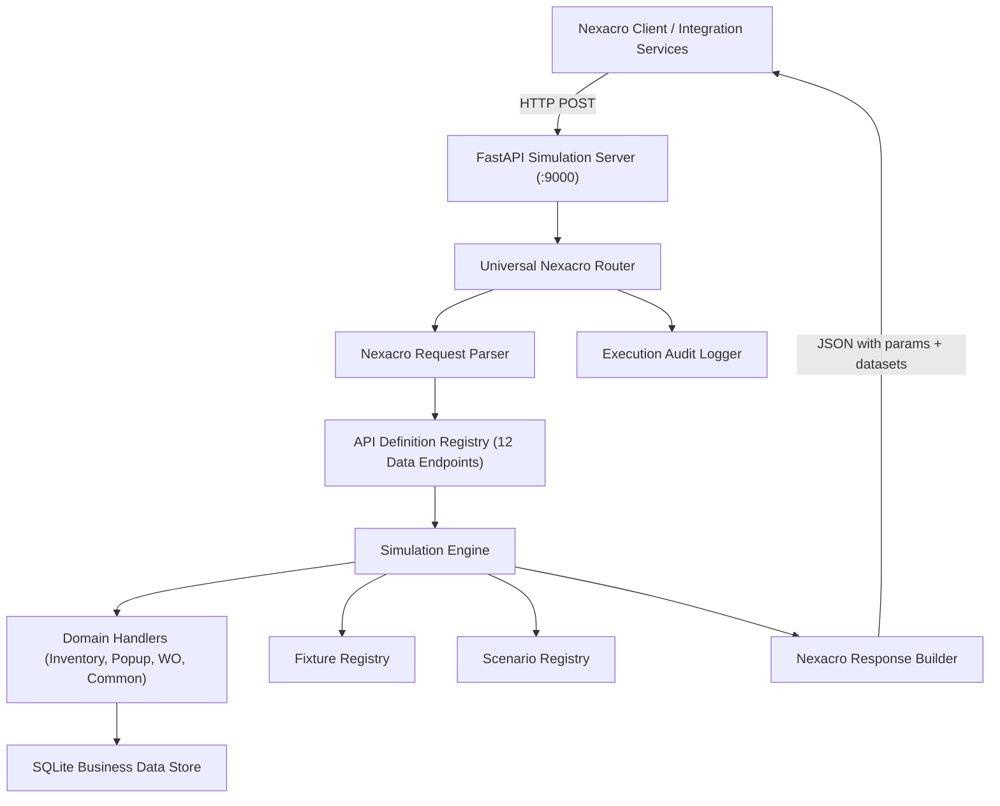

# Nexacro EMS API Simulation Platform

A configuration-driven API Simulation System designed to emulate Nexacro-based EMS backend APIs without requiring access to the production backend.

Built strictly according to the architecture and requirements specified in [`AGENTS.md`](../../AGENTS.md).

---

## 1. Overview & Architecture

The simulator acts as a drop-in replacement for the Nexacro EMS backend (listening on port `9000` by default):



### Key Capabilities
- **First-Class Nexacro XML Wire Protocol**: Accepts and produces standard Nexacro Platform XML documents (`<Root xmlns="http://www.nexacroplatform.com/platform/dataset">`) with `<Parameters>` and `<Dataset id="...">` `<ColumnInfo>` `<Rows>`.
- **Strict Protocol Compatibility**: Preserves Nexacro `params` and `datasets` (with ordered `cols`, row count, and 2D `rows` arrays).
- **Multiple Datasets Support**: Fully supports APIs returning multiple datasets (e.g. `retrieveItemInfoDetail.lgdn` returning `ds_Item`, `ds_Inv`, and `ds_Summary`; `WO230WoSaveInit.lgdn` returning 6 datasets).
- **Domain Business Simulation**: Includes database-backed simulation for Spare Parts, Inventory, Work Orders, Popups, Common Codes, and Application Logs.
- **Configurable Scenarios**: Dynamic behavior override via match rules (e.g. `_scenario: "empty"`, not-found handling, or business error codes).
- **Execution Audit Logging**: Records every incoming request, duration in milliseconds, matched scenario/fixture, and full payloads for debugging and replay.
- **Admin Management APIs**: Provides REST endpoints to inspect endpoints, schemas, scenarios, and execution logs.

---

## 2. Supported Business Endpoints (14 APIs)

All non-data endpoints (such as audit logging `insertStartLog`, `updateEndLog` and UI grid formatting `retrieveGridFormat`) have been excluded. The platform is dedicated exclusively to **Business Data Retrieval and Mutation APIs**:

| Domain | Method | Endpoint Path | Execution Type | Returned Datasets / Output |
|---|:---:|---|---|---|
| **Spare Parts** | POST | `/emsspareparts/sp101/sp110Nav/RetStockStatusList.lgdn` | Handler (`inventory.search_stock_status`) | `ds_result` |
| **Spare Parts** | POST | `/emsspareparts/sp101/sp120Nav/RetEstimateRequestList.lgdn` | Handler / Fixture | `ds_list` |
| **Spare Parts** | POST | `/emsspareparts/sp102/sp130Nav/save130PrvData.lgdn` | Handler (`inventory.save_130_prv_data`) | Success parameters (`ErrorCode: 0`) |
| **Spare Parts** | POST | `/emsspareparts/sp102/sp130Nav/retrievePoRequest.lgdn` | Handler (`inventory.retrieve_po_request`) | `ds_param` |
| **Spare Parts** | POST | `/emsspareparts/sp102/sp135Nav/retrieveItemInfoDetail.lgdn` | Handler (`inventory.retrieve_item_detail`) | `ds_Item`, `ds_Inv`, `ds_Summary` |
| **Stock Management** | POST | `/emsspareparts/sp302/sp330Nav/TargetStockSearchList.lgdn` | Handler / Fixture | `ds_StockInfomation` |
| **Stock Management** | POST | `/emsspareparts/sp302/sp335Nav/TargetStockSearchList.lgdn` | Handler / Fixture | `ds_StockInfomation` |
| **Purchasing** | POST | `/emscom/popupNav/retrieveItemPoStatusList.lgdn` | Handler / Fixture | `ds_Rtn` |
| **Purchasing** | POST | `/emscom/popupNav/retrieveItem.lgdn` | Handler (`popup.retrieve_item`) | `ds_List`, `ds_Search` |
| **Work Orders** | POST | `/emscom/woMasterNav/WoMasterRetInit.lgdn` | Handler / Fixture | `ds_wo`, `ds_step`, `ds_spAttachFile` |
| **Work Orders** | POST | `/emsworkorder/wo20/wo230Nav/WO230WoSaveInit.lgdn` | Handler / Fixture | `ds_init`, `ds_oplist`, `ds_mtlist`, flags |
| **Work Orders** | POST | `/emscom/woSearchNav/retrieveWipEntity.lgdn` | Handler (`workorder.retrieve_wip_entity`) | `ds_output` |
| **Work Orders** | POST | `/emsworkorder/wo50/wo580Nav/statusHistory.lgdn` | Handler / Fixture | `ds_list`, `ds_input` |
| **Common Data** | POST | `/emscom/codeNav/retComCodeList.lgdn` | Handler (`common.com_code_list`) | `ds_output0` .. `ds_output7` |

---

## 3. Directory Layout

```text
services/ems-simulation/
├── catalog/
│   ├── apis/            # 15 YAML definitions for captured endpoints
│   ├── datasets/        # 30 Reusable dataset schemas
│   ├── fixtures/        # 15 Request/response fixtures extracted from production traces
│   ├── scenarios/       # Simulation scenarios (e.g. empty results, errors)
│   └── seed_data.json   # Seed business entities (Items, Organizations, WIP, Common codes)
├── config/              # Runtime configuration
├── scripts/
│   └── extract_catalog.py # Pipeline to parse traces and generate definitions
├── src/
│   └── ems_sim/
│       ├── builder/     # NexacroResponseBuilder
│       ├── database/    # SQLite engine, models & repository
│       ├── engine/      # SimulationEngine & domain handlers
│       ├── logger/      # Audit & trace execution logger
│       ├── models/      # Protocol, definition, and entity models
│       ├── parser/      # NexacroParser
│       ├── registry/    # API, Dataset, Fixture, Scenario registries
│       ├── server/      # FastAPI server, universal router, admin APIs
│       └── cli.py       # Typer CLI application
├── tests/
│   ├── unit/            # Protocol, parser, and registry tests
│   └── integration/     # Integration tests covering all 15 endpoints
├── Dockerfile
├── pyproject.toml
├── requests.http       # Ready-to-use HTTP requests for VS Code REST Client / IntelliJ
└── README.md
```

---

## 4. Quickstart

### 4.1 Running with Python CLI
```bash
cd services/ems-simulation

# Create venv and install
uv venv
source .venv/bin/activate
uv pip install -e ".[dev]"

# Seed database with initial items & entities
ems-sim seed

# Inspect registered endpoints
ems-sim endpoints

# Inspect registered dataset schemas
ems-sim datasets

# Start the simulation server (default: http://0.0.0.0:9000)
ems-sim start
```

### 4.2 Running Tests
```bash
pytest -v
```

### 4.3 Running with Docker
```bash
docker build -t ems-simulation .
docker run -p 9000:9000 ems-simulation
```

---

## 5. Management & Inspection APIs

The simulator provides management endpoints alongside the simulated EMS APIs:

| Endpoint | Method | Description |
|---|:---:|---|
| `/health` | GET | Health check status |
| `/admin/endpoints` | GET | List all registered simulated endpoints |
| `/admin/endpoints/{api_id}` | GET | Get detailed schema and execution configuration for an API |
| `/admin/datasets` | GET | List all registered dataset schemas |
| `/admin/scenarios` | GET | List all simulation scenarios |
| `/admin/scenarios/toggle` | POST | Enable or disable a simulation scenario |
| `/admin/logs` | GET | Retrieve execution audit logs and timing statistics |
